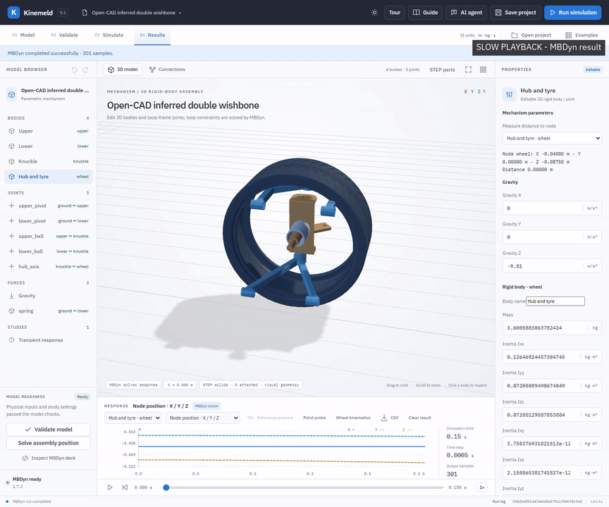
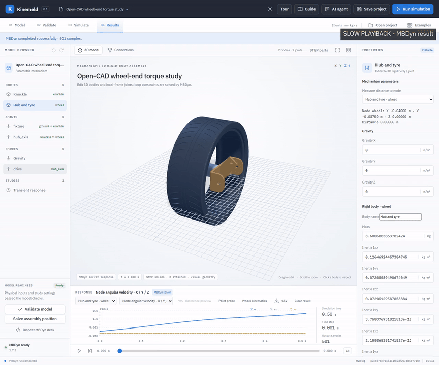

# Kinemeld

**Open multibody dynamics, from STEP geometry to simulated motion.**

Kinemeld is an early-stage, local workbench for building and exploring mechanical
systems with [MBDyn](https://www.mbdyn.org/). Import STEP parts, define bodies,
joints and forces, inspect the generated solver input, and visualize the motion
and response. A Rust Windows desktop host and a browser-based interface share the
same Python service and solver workflow.

> **Project status:** Preview. The examples demonstrate modeling workflows and
> numerical checks; they are not validated designs, certified hardware, or a
> substitute for measured material data and engineering review.

## Industry-inspired demos

These silent, slowed recordings show actual MBDyn results in the application.
The animated previews loop; select **Watch MP4** for the full-resolution clip.
Open a linked `.mbdyn-studio` project from **Open project**, then validate and
run it with a configured MBDyn installation. Each guide documents the source
geometry, assumptions and checks. See [how the demos were recorded](docs/demo-videos.md).

### Aircraft nose-gear kinematics

Explore an open-source STEP assembly with 11 occurrences, six modeled bodies,
and a prescribed 10 mm strut sweep. The linkage and material assumptions are
inferred; source overlaps and joint substitutions make this a **kinematic
illustration only**, not an aircraft load prediction.
[Watch MP4](docs/demos/aircraft-nose-gear.mp4) ·
[Open project](examples/open-aircraft-nose-kinematics/nose-gear-kinematics.mbdyn-studio) ·
[Engineering guide](docs/aircraft-nose-kinematics.md) ·
[STEP source and license](examples/open-aircraft-nose-gear/README.md)

### Double-wishbone suspension

Study a reconstructed spatial closed loop using five original STEP parts:
control arms, knuckle, hub and tire. Observe wheel motion and measure camber,
toe and travel. Hardpoints, connections and material properties are inferred;
there is no steering tie rod or validated tire model.
[Watch MP4](docs/demos/double-wishbone.mp4) ·
[Open project](examples/open-suspension/suspension.mbdyn-studio) ·
[Engineering guide](docs/open-suspension.md) ·
[STEP source and license](examples/step-suspension/README.md)

### Wheel-end torque and drop

Use source STEP geometry for a knuckle, hub and tire to study an idealized
wheel-bearing torque case or a sphere-plane drop. The tire is rigid and the
bearing and material properties are approximations.
[Watch MP4](docs/demos/wheel-end.mp4) ·
[Torque project](examples/open-wheel-end/wheel-end.mbdyn-studio) ·
[Drop project](examples/open-wheel-end/wheel-end-drop.mbdyn-studio) ·
[Engineering guide](docs/open-wheel-end.md)

### Nonlinear oleo strut

Investigate gas pressure, asymmetric compression/rebound damping and stroke stops
on a STEP wheel-end fixture. Its parameters and imposed motion are illustrative,
not a calibrated landing-gear strut.
[Watch MP4](docs/demos/oleo-strut.mp4) ·
[Open project](examples/oleo-strut/wheel-oleo.mbdyn-studio) ·
[Engineering guide](docs/oleo-strut.md)

## What works today

- Edit planar and 3D rigid-body assemblies, including supported joint types, closed
  loops, body inertia, gravity, springs, dampers, forces and selected contact laws.
- Import original STEP solids, attach occurrences to bodies, calculate mass
  properties from an explicitly chosen density, and preserve CAD sources in projects.
- Check model inputs, inspect or export an MBDyn deck, run a configured solver,
  view its motion and plots, and save or reopen projects and results.
- Use position and velocity kinematics, point probes and wheel measurements; derived
  plots use displayed samples and can miss peaks between them.
- Connect an optional local AI assistant for supported, reviewable model edits.

See [multibody capabilities](docs/multibody-feature-map.md),
[STEP geometry](docs/step-geometry.md), [solver setup](docs/solver.md) and
[AI setup](docs/ai-agent.md) for details and limitations.

## Get started

The source checkout requires Python 3.10+, an installed MBDyn solver and, for
STEP import, the `cadquery-ocp` Python package. MBDyn runs as a separate process.
On Windows, the desktop build additionally requires Rust with the MSVC toolchain
and Microsoft WebView2 Runtime. The repository does not bundle a ready-to-run
solver or desktop executable.

1. Clone this repository and follow [solver setup](docs/solver.md).
2. Install the STEP dependency in the Python environment used by the application:
   `python -m pip install cadquery-ocp`.
3. Start the local browser interface with `python start.py` and open the shown
   local URL. The guided tour can be turned off.
4. To build the Windows host, follow [desktop build instructions](native/README.md).
5. Open one of the projects above, validate it, then run and inspect the result.

For development, install the locked JavaScript dependencies with `npm ci`, run
`npm run check`, and see [contributing](CONTRIBUTING.md) for tests. Real solver
and STEP checks need the corresponding local dependencies.

## Roadmap

The next priorities are safer project and CAD workflows, fuller rigid-body and
actuation coverage, full-resolution postprocessing, validated industry examples,
and portable Windows distribution. Longer-term work includes more contact models,
flexible bodies and coupled systems. Each capability needs a worked example,
documentation and solver evidence. See the [development roadmap](docs/roadmap.md).

## License and attribution

Kinemeld's original application code is [MIT licensed](LICENSE). Third-party
components and examples have their own licenses: MBDyn and its included example
decks are GPL-2.0-only; the cited STEP assets retain their upstream MIT notices;
and the CAD runtime has separate license and redistribution requirements. See
[third-party notices](THIRD_PARTY_NOTICES.md) before redistributing dependencies.
