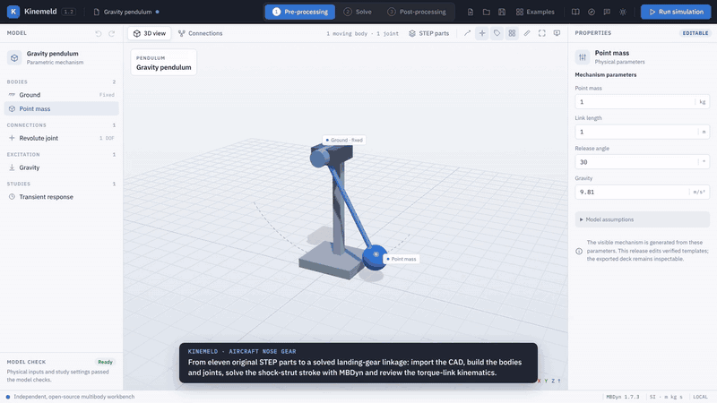
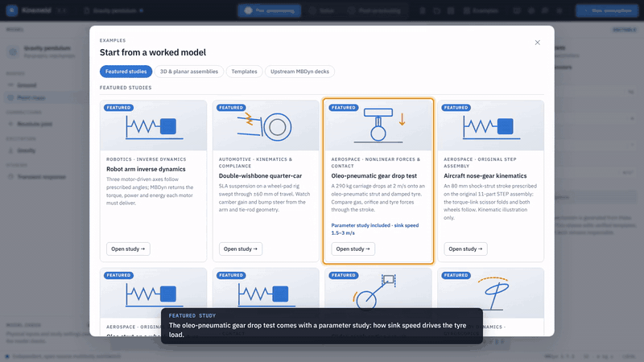
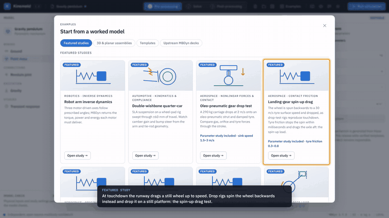
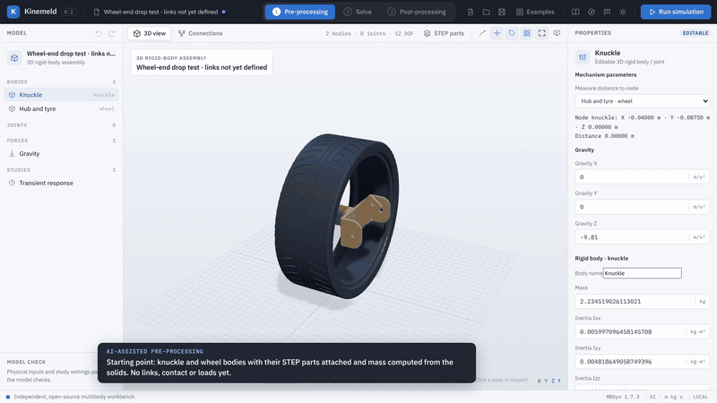
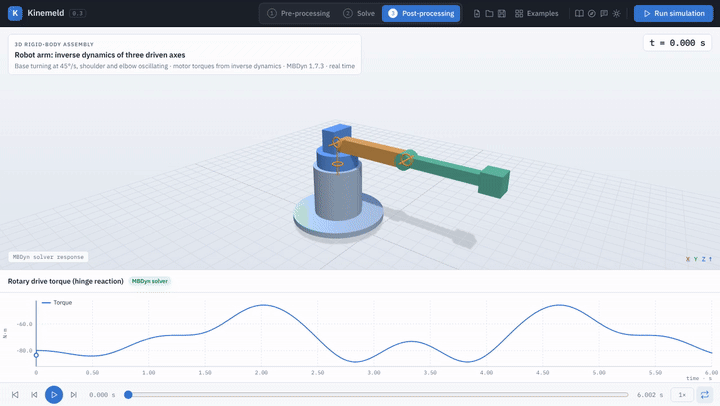
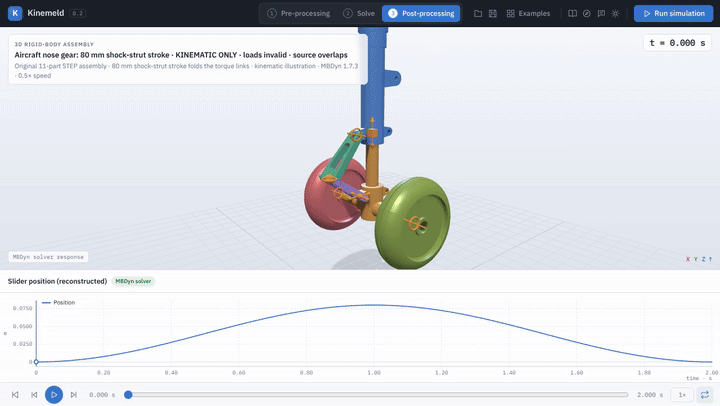
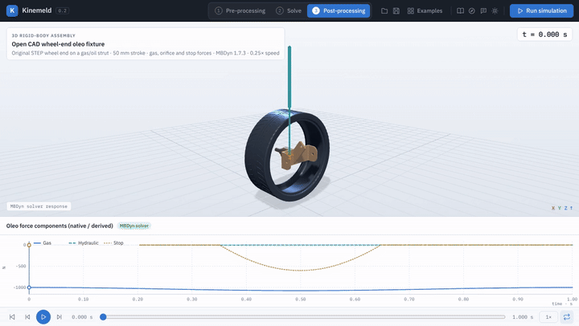
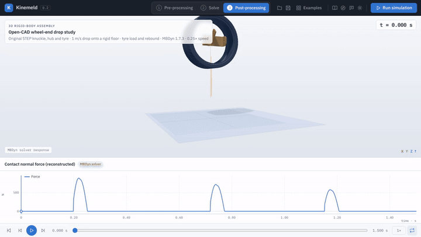

# Kinemeld

**Open multibody dynamics, from STEP geometry to simulated motion.**

[](https://github.com/AkshayRamanandaRao/Kinemeld/actions/workflows/ci.yml)
[](https://github.com/AkshayRamanandaRao/Kinemeld/releases)
[](LICENSE)

Kinemeld is a desktop workbench for building, solving and post-processing mechanical
systems with the open-source [MBDyn](https://www.mbdyn.org/) solver. Import STEP parts,
define bodies, joints and force elements, check and inspect the solver input, run MBDyn,
then animate, plot, measure and export the response. It runs as a native desktop app on
Linux, macOS and Windows, or in your browser from a source checkout.

> **Project status:** Preview. The studies demonstrate modelling workflows and numerical
> checks; they are not validated designs or certified hardware, and are no substitute for
> measured data and engineering review.

## Industry-inspired demos

Every clip is an actual MBDyn 1.7.3 solution recorded in Kinemeld; the playback rate is
stated in each caption. The animations below are condensed GIFs; each links to its
full-quality MP4. Open the same studies from **Examples → Featured studies**. The
[study guide](docs/featured-studies.md) lists each model's parameters and the independent
checks it passes (`backend/verify_featured_studies.py`).

### End to end: aircraft nose gear from eleven STEP parts *(new in 1.2)*

[](docs/demos/workflow-nose-gear.mp4)

One continuous session in the real interface, on the open-source design of a light-aircraft
nose gear. The eleven original parts — strut, piston, axle, hub, two torque links, three pin
bolts and two wheels — are imported one by one. Six bodies are built with a strut mount, a
shock-strut slide, the torque-link scissor and two wheel bearings; the CAD is attached, every
joint is placed by pointing at its pin bolt or bore in the CAD, and mass and inertia come
from the solids. An 80 mm shock-strut stroke is prescribed and solved with MBDyn; the
post-processing shows the stroke, the 10.5° torque-link fold and the idealised slide reaction.
This is a kinematic illustration; see the [study's engineering scope](docs/aircraft-nose-kinematics.md)
for modelling assumptions and interpretation limits.
[Watch the MP4](docs/demos/workflow-nose-gear.mp4) · [the part files](examples/open-aircraft-nose-gear)
· the **guided tour** (compass icon) builds a wheel-end drop test step by step.

### Parameter study: landing-gear sink speed

[](docs/demos/study-gear-drop.mp4)

The oleo-pneumatic gear drop test opens with its study preloaded: the initial velocity of all
bodies swept from 1.5 to 3 m/s around the 2 m/s baseline. MBDyn solves the four cases; the
plot overlays their tyre loads and the table lists each case's peak, RMS and final value. The
peak tyre load rises from 18.0 to 27.5 kN, and in every case the mechanical, stored and
dissipated energy balance within 0.1 % of the impact energy.
[Watch the MP4](docs/demos/study-gear-drop.mp4) · [parameter studies](docs/workspaces.md#parameter-studies)

### Contact friction: landing-gear spin-up drag

[](docs/demos/study-spin-up.mp4)

At touchdown the runway drags a still wheel up to speed and loads the gear aft. As on
drop-test rigs, the wheel is spun backwards to a 30 m/s tyre surface speed and dropped on a
still platform; regularised Coulomb friction on the tyre contact stops the spin about 50 ms
after touchdown. The preloaded study compares friction coefficients 0.3, 0.55 and 0.8: peak
drag rises from 6.3 to 16.9 kN and the spin-up shortens from 220 to 36 ms. In every case the
drag equals μ × vertical load while the tyre slides, the axle carries it, the wheel's angular
momentum matches the friction impulse and friction absorbs exactly the spin energy.
[Watch the MP4](docs/demos/study-spin-up.mp4) · [contact friction](docs/contact-friction.md)

### AI-assisted set-up

[](docs/demos/ai-assistant-setup.mp4)

The optional assistant runs a local model through [Ollama](https://ollama.com) — `qwen3.5:4b`
in this recording — and turns a request in engineering terms into model edits: here a
revolute wheel bearing, a tyre contact with stated stiffness and damping, drop conditions and
the study settings. The review lists every changed field with its old and new value; nothing
changes until you apply it, and Undo restores the previous model. Recorded on a 4-core CPU
without a GPU; the four-minute wait for the model is condensed.
[Watch the MP4](docs/demos/ai-assistant-setup.mp4) · [assistant guide](docs/ai-agent.md)

### Featured studies

<table>
<tr>
<td width="50%"></td>
<td width="50%"><b>Robot arm inverse dynamics</b> <i>(new in 0.3)</i> — rotary drives prescribe the turret, shoulder and elbow angles; MBDyn returns the torque, power and energy each motor must deliver. The drive work equals the arm's change in kinetic and potential energy. <a href="docs/demos/robot-arm.mp4">MP4</a> · <a href="docs/rotary-drives.md">rotary drives</a></td>
</tr>
</table>

<table>
<tr>
<td width="50%"><br>
<b>Double-wishbone quarter-car</b> — SLA arms, tie rod and coil-over swept through ±60 mm. Camber gain 2.1°, bump steer under 0.7°. <a href="docs/demos/quarter-car.mp4">MP4</a></td>
<td width="50%"><br>
<b>Oleo-pneumatic gear drop test</b> — 290 kg at 2 m/s onto a gas/oil strut and damped tyre. Orifice spike, gas spring, static settle; includes a sink-speed study. <a href="docs/demos/gear-drop.mp4">MP4</a></td>
</tr>
<tr>
<td><br>
<b>Aircraft nose-gear kinematics</b> — the original 11-part STEP assembly through an 80 mm strut stroke; the torque links fold on two-circle geometry to 10⁻¹⁴ m. <a href="docs/demos/aircraft-nose-gear.mp4">MP4</a></td>
<td><br>
<b>Oleo strut on a wheel-end fixture</b> — original STEP wheel end on a gas/oil strut; native gas pressure follows the polytropic law. <a href="docs/demos/oleo-strut.mp4">MP4</a></td>
</tr>
<tr>
<td><br>
<b>Wheel-end drop test</b> — original STEP knuckle, hub and tyre dropped at 1 m/s; first contact matches free fall and the lost energy equals contact dissipation. Its tyre-stiffness study matches an independent drop calculation within 0.5 %. <a href="docs/demos/wheel-end-drop.mp4">MP4</a></td>
<td><br>
<b>Slider-crank engine run-up</b> — loop closed by spherical, universal and prismatic joints; motor torque against a pumping load. <a href="docs/demos/slider-crank.mp4">MP4</a></td>
</tr>
</table>

### Rigid-body dynamics showcases

Three classic problems that exercise the solver's 3D rotational dynamics, each checked against
theory or a conservation law.

<table>
<tr>
<td width="33%"><br>
<b>Gyroscopic top</b> — precession within 3 % of theory, with nutation cusps. <a href="docs/demos/gyroscopic-top.mp4">MP4</a></td>
<td width="33%"><br>
<b>Tumbling T-handle</b> — intermediate-axis flips with angular momentum conserved. <a href="docs/demos/tumbling-handle.mp4">MP4</a></td>
<td width="33%"><br>
<b>Chaotic double pendulums</b> — released 0.001° apart, completely different after 3 s. <a href="docs/demos/chaotic-pendulums.mp4">MP4</a></td>
</tr>
</table>

## A complete simulation workflow


Kinemeld separates the work into three workspaces (keys **1**, **2**, **3**):

1. **Pre-processing** — model tree and property editor for bodies, joints (revolute,
   prismatic, cylindrical, universal, spherical, weld), springs, dampers, oleo struts,
   loads, drives, contact and named frames; STEP import, attachment and measured mass
   properties; joints and frames placed by picking or dragging onto CAD bores, shafts and
   faces, and in-view distance and angle measurement; Grübler mobility estimate.
2. **Solve** — study settings, pre-run checks, linked validation issues, the generated
   MBDyn deck, solver status, a live console with the solver log, and parameter studies
   that solve the model for several values of one input.
3. **Post-processing** — animation with frame stepping and speed control, interactive
   plots with hover readout, scrubbing and channel statistics, body-axes angular velocity,
   joint reactions, motion trails, follow camera, point and wheel-kinematics measurements,
   full-resolution plots and statistics from every solver step, pinned traces, comparison
   with an earlier run, every case of a parameter study with a table of peaks, RMS and final
   values, SVG/PNG plot export, full-resolution CSV, and a presentation mode.

See [workspaces and post-processing](docs/workspaces.md) for details and shortcuts.

## Install

### Desktop release (recommended)

Download the archive for your platform from the
[latest release](https://github.com/AkshayRamanandaRao/Kinemeld/releases/latest):

| Platform | Package | Solver | Also requires |
| --- | --- | --- | --- |
| Linux x86-64 | `Kinemeld-<version>-linux-x86_64.tar.gz` | MBDyn 1.7.3 bundled | Python 3.10+, WebKitGTK 4.1 (`libwebkit2gtk-4.1-0`) |
| macOS (Apple silicon) | `Kinemeld-<version>-macos-arm64.zip` | MBDyn 1.7.3 bundled | Python 3.10+ |
| Windows x64 | `Kinemeld-<version>-windows-x86_64.zip` | MBDyn 1.7.3 bundled (Cygwin build) | Python 3.10+, WebView2 Runtime |

Extract the archive and run `kinemeld` (Linux), `Kinemeld.app` (macOS, Control-click →
Open the first time — the app is not notarized) or `Kinemeld.exe` (Windows). STEP import
needs the OpenCascade runtime in the same Python:

```bash
python3 -m pip install -r requirements.txt
```

Each archive has a `.sha256` checksum and a `package-manifest.json` listing every file's
digest. Audited packaging also requires complete notices and an exact solver-source
companion archive, including runtime-library sources and distribution patches. Packages
are unpacked and checked on fresh Linux, macOS and Windows runners before publication.
The [dependency audit](docs/dependency-audit.md) records gaps in the historical v1.2.1
packages and remaining redistribution questions; the application MIT license does not
replace its dependencies' licenses.

The desktop app autosaves unsaved work for crash recovery and offers it back after an
unexpected exit; see [autosave and crash recovery](native/README.md#autosave-and-crash-recovery).

### From source

Requirements: Python 3.10+, an MBDyn 1.7.3 executable ([build or configure it](docs/solver.md)),
and optionally `cadquery-ocp` 7.9 or 8 for STEP (`pip install -r requirements.txt`).

```bash
git clone https://github.com/AkshayRamanandaRao/Kinemeld.git
```

```bash
cd Kinemeld && python3 start.py
```

`start.py` serves the interface at `http://127.0.0.1:8766` and opens your browser. On Linux
or WSL, `bash backend/build_solver.sh` downloads, verifies and builds MBDyn 1.7.3 locally;
the app also finds `mbdyn` on `PATH` or a `solver/bin/mbdyn` next to the application. To
build the native desktop host see [desktop builds](native/README.md).

## Verification

- `python -m unittest discover -p 'test_*.py'` in `backend/` — 220+ unit, deck and real-MBDyn tests.
- `python -B backend/verify_featured_studies.py` — every featured study against independent
  physics (gyroscopic theory, momentum conservation, closed-form kinematics, power and static
  balance).
- `npm run check` and the Playwright workflows in `tests/` — interface syntax and end-to-end
  user flows against a running server.
- GitHub Actions builds MBDyn, runs the backend suite and the study verification, and builds
  and tests the desktop host on Linux, macOS and Windows for every change.
- `scripts/check_package.py` — every release package unpacked on a fresh machine: file
  hashes, the packaged service, real MBDyn runs and the desktop self-check.

See [verification](docs/verification.md) and [multibody capabilities](docs/multibody-feature-map.md)
for scope and limitations.

## Roadmap

The current increment preserves edits during asynchronous CAD/project operations and
verifies native project dialogs on Windows. macOS/Linux dialog checks remain open.
Next: dependency provenance, stronger engineering examples, then CAD picking and
assistant extensions. Each item is reviewed before starting the next. See the
[prioritized roadmap](docs/roadmap.md) for acceptance checks and longer-term work,
and the [changelog](CHANGELOG.md) for released changes.

## License and attribution

Kinemeld's application code is [MIT licensed](LICENSE). MBDyn and its example decks are
GPL-2.0-only; cited STEP assets retain their upstream licenses; the CAD runtime has separate
terms. See [third-party notices](THIRD_PARTY_NOTICES.md) before redistributing dependencies.
