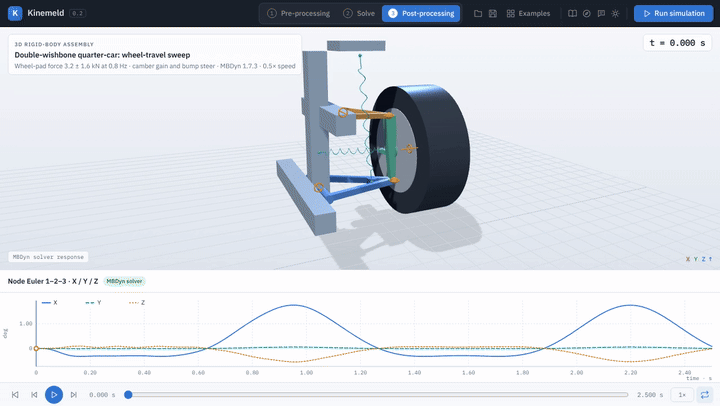
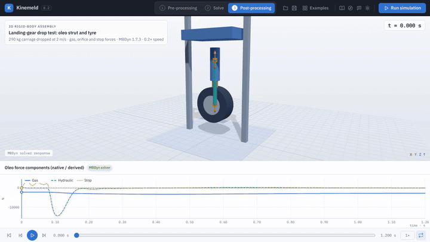
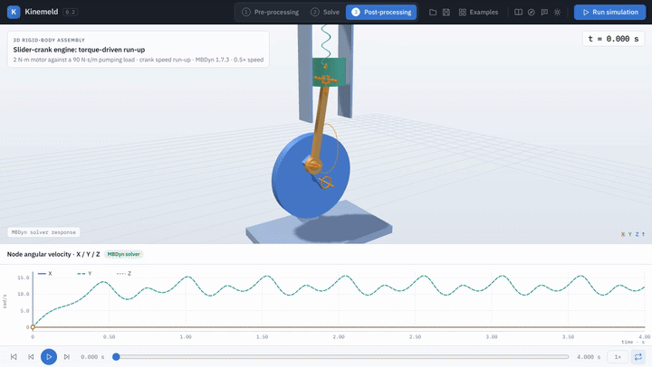
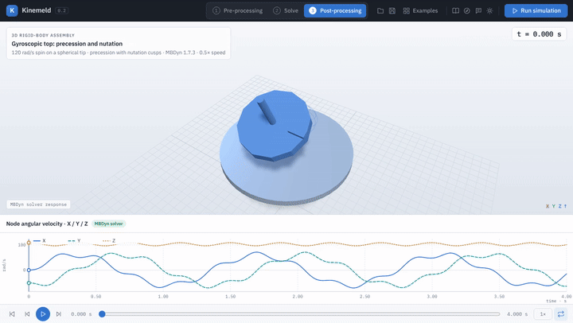
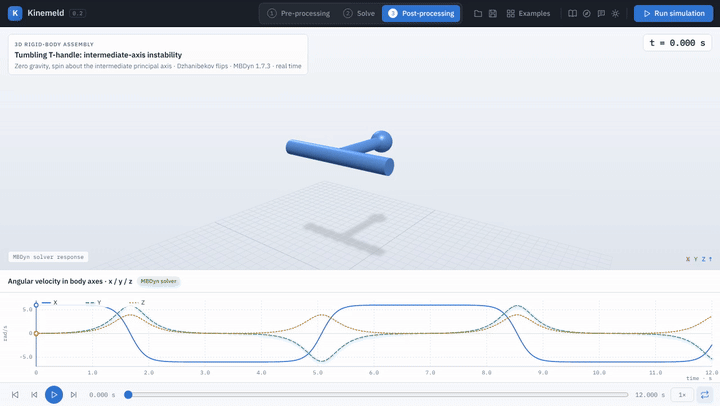
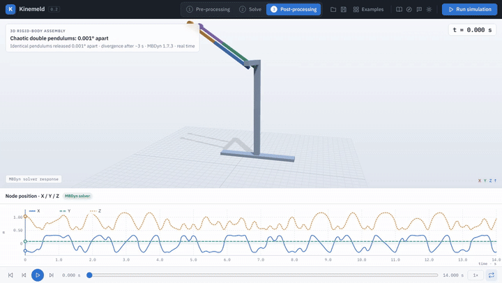
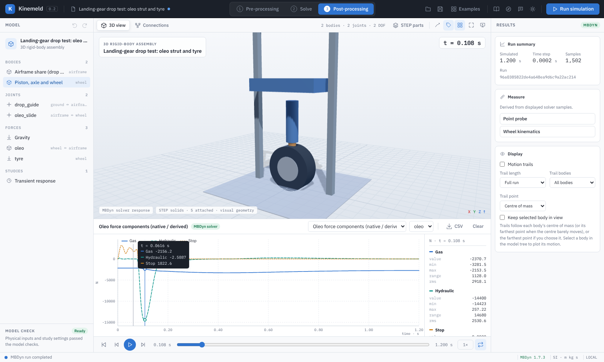

# Kinemeld

**Open multibody dynamics, from STEP geometry to simulated motion.**

[](https://github.com/AkshayRamanandaRao/Kinemeld/actions/workflows/ci.yml)
[](https://github.com/AkshayRamanandaRao/Kinemeld/releases)
[](LICENSE)

Kinemeld is a desktop workbench for building, solving and post-processing mechanical
systems with the open-source [MBDyn](https://www.mbdyn.org/) solver. Import STEP parts,
define bodies, joints and force elements, check and inspect the solver input, run MBDyn,
then animate, plot, measure and export the response. It runs as a native desktop app on
Linux, macOS and Windows, or in your browser from a source checkout.

> **Project status:** Preview. The studies demonstrate modelling workflows and numerical
> checks; they are not validated designs or certified hardware, and are no substitute for
> measured data and engineering review.

## Featured studies

Every clip is an actual MBDyn 1.7.3 solution played back in Kinemeld's presentation mode;
the playback rate is stated in each caption. Open the same studies from **Examples →
Featured studies**. See the [study guide](docs/featured-studies.md) for models, parameters
and the independent checks each one passes.

<table>
<tr>
<td width="50%"><br>
<b>Double-wishbone quarter-car</b> — SLA arms, tie rod and coil-over swept through ±60 mm. Camber gain 2.1°, bump steer under 0.7°. <a href="docs/demos/quarter-car.mp4">MP4</a></td>
<td width="50%"><br>
<b>Oleo-pneumatic gear drop test</b> — 290 kg at 2 m/s onto a gas/oil strut and damped tyre. Orifice spike, gas spring, static settle. <a href="docs/demos/gear-drop.mp4">MP4</a></td>
</tr>
<tr>
<td><br>
<b>Slider-crank engine run-up</b> — loop closed by spherical, universal and prismatic joints; torque against a pumping load. <a href="docs/demos/slider-crank.mp4">MP4</a></td>
<td><br>
<b>Gyroscopic top</b> — 120 rad/s on a spherical tip: precession within 3 % of steady-precession theory, with nutation cusps. <a href="docs/demos/gyroscopic-top.mp4">MP4</a></td>
</tr>
<tr>
<td><br>
<b>Tumbling T-handle</b> — a free body spun about its intermediate axis flips every few seconds while angular momentum is conserved. <a href="docs/demos/tumbling-handle.mp4">MP4</a></td>
<td><br>
<b>Chaotic double pendulums</b> — identical except for 0.001° at release; together for two seconds, then completely different. <a href="docs/demos/chaotic-pendulums.mp4">MP4</a></td>
</tr>
</table>

## A complete simulation workflow



Kinemeld separates the work into three workspaces (keys **1**, **2**, **3**):

1. **Pre-processing** — model tree and property editor for bodies, joints (revolute,
   prismatic, cylindrical, universal, spherical, weld), springs, dampers, oleo struts,
   loads, drives, contact and named frames; STEP import, attachment and measured mass
   properties; Grübler mobility estimate.
2. **Solve** — study settings, pre-run checks, linked validation issues, the generated
   MBDyn deck, solver status and a live console with the solver log.
3. **Post-processing** — animation with frame stepping and speed control, interactive
   plots with hover readout, scrubbing and channel statistics, body-axes angular velocity,
   joint reactions, motion trails, follow camera, point and wheel-kinematics measurements,
   full-resolution CSV, and a presentation mode for reviews and recordings.

See [workspaces and post-processing](docs/workspaces.md) for details and shortcuts.

## Install

### Desktop release (recommended)

Download the archive for your platform from the
[latest release](https://github.com/AkshayRamanandaRao/Kinemeld/releases/latest):

| Platform | Package | Solver | Also requires |
| --- | --- | --- | --- |
| Linux x86-64 | `Kinemeld-<version>-linux-x86_64.tar.gz` | MBDyn 1.7.3 bundled | Python 3.10+, WebKitGTK 4.1 (`libwebkit2gtk-4.1-0`) |
| macOS (Apple silicon) | `Kinemeld-<version>-macos-arm64.zip` | MBDyn 1.7.3 bundled when the CI build succeeds | Python 3.10+ |
| Windows x64 | `Kinemeld-<version>-windows-x86_64.zip` | Configure MBDyn through WSL ([solver setup](docs/solver.md)) | Python 3.10+, WebView2 Runtime |

Extract the archive and run `kinemeld` (Linux), `Kinemeld.app` (macOS, Control-click →
Open the first time — the app is not notarized) or `Kinemeld.exe` (Windows). STEP import
needs the OpenCascade runtime in the same Python:

```bash
python3 -m pip install -r requirements.txt
```

Each archive has a `.sha256` checksum and a `package-manifest.json` listing every file's
digest. Bundled MBDyn binaries are GPL-2.0-only; their corresponding source is attached
to every release.

### From source

Requirements: Python 3.10+, an MBDyn 1.7.3 executable ([build or configure it](docs/solver.md)),
and optionally `cadquery-ocp` 7.9 for STEP (`pip install -r requirements.txt`; version 8 is not
yet supported).

```bash
git clone https://github.com/AkshayRamanandaRao/Kinemeld.git
```

```bash
cd Kinemeld && python3 start.py
```

`start.py` serves the interface at `http://127.0.0.1:8766` and opens your browser. On Linux
or WSL, `bash backend/build_solver.sh` downloads, verifies and builds MBDyn 1.7.3 locally;
the app also finds `mbdyn` on `PATH` or a `solver/bin/mbdyn` next to the application. To
build the native desktop host see [desktop builds](native/README.md).

## Verification

- `python -m unittest discover -p 'test_*.py'` in `backend/` — 220+ unit, deck and real-MBDyn tests.
- `python -B backend/verify_featured_studies.py` — every featured study against independent
  physics (gyroscopic theory, momentum conservation, closed-form kinematics, power and static
  balance).
- `npm run check` and the Playwright workflows in `tests/` — interface syntax and end-to-end
  user flows against a running server.
- GitHub Actions builds MBDyn, runs the backend suite and the study verification, and builds
  and tests the desktop host on Linux, macOS and Windows for every change.

See [verification](docs/verification.md) and [multibody capabilities](docs/multibody-feature-map.md)
for scope and limitations.

## Roadmap

Next: prescribed rotary drives with motor torque results, richer post-processing
(full-resolution plots, multi-quantity overlays, result comparison), interactive joint and
frame placement, and more validated engineering examples. Longer term:
broader contact, flexible bodies, controls and co-simulation. See the [roadmap](docs/roadmap.md)
and the [changelog](CHANGELOG.md).

## License and attribution

Kinemeld's application code is [MIT licensed](LICENSE). MBDyn and its example decks are
GPL-2.0-only; cited STEP assets retain their upstream licenses; the CAD runtime has separate
terms. See [third-party notices](THIRD_PARTY_NOTICES.md) before redistributing dependencies.
