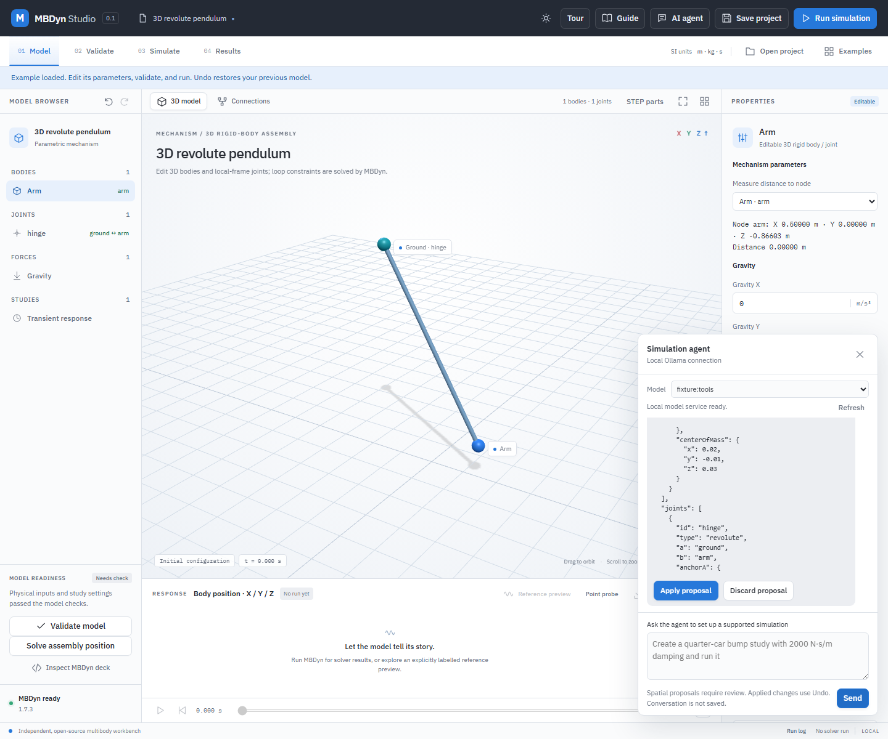
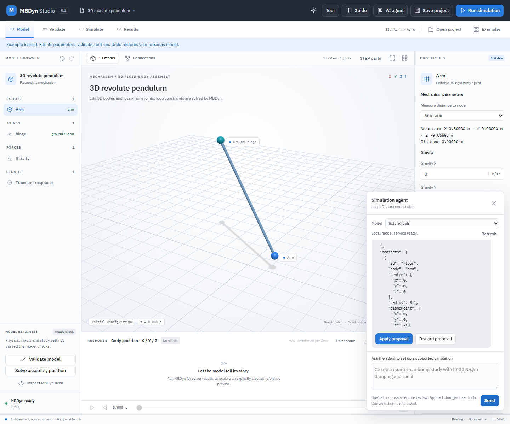
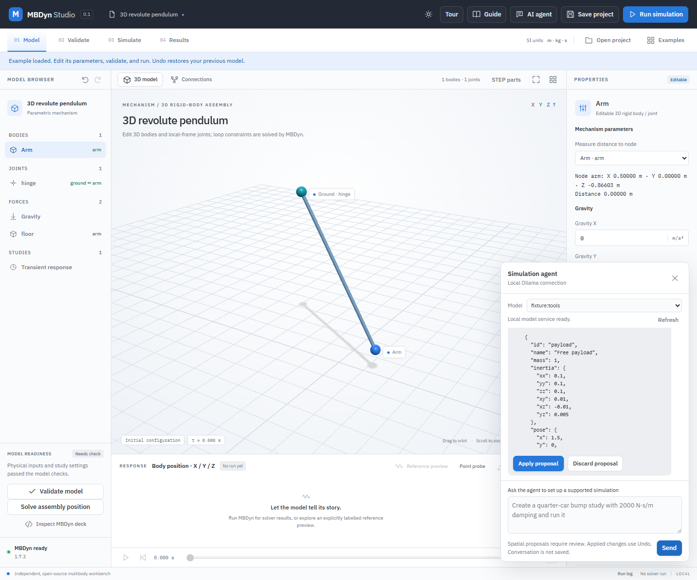
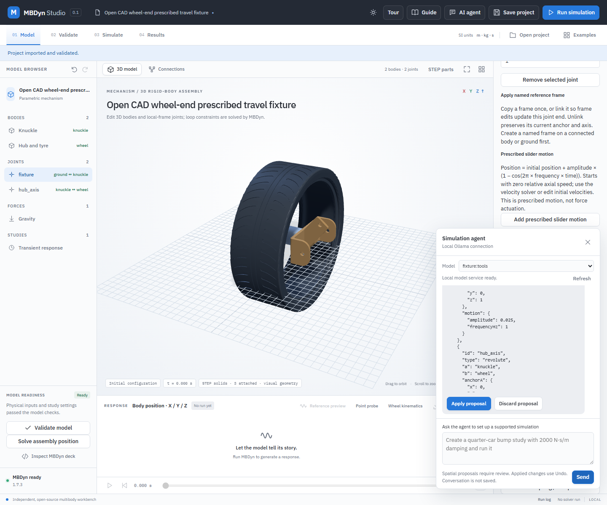
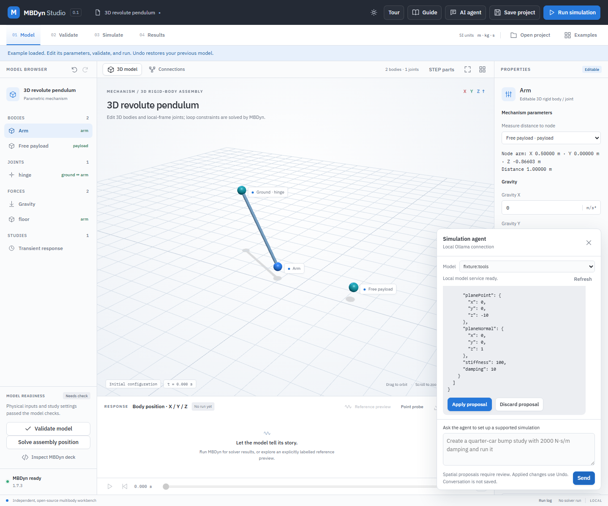
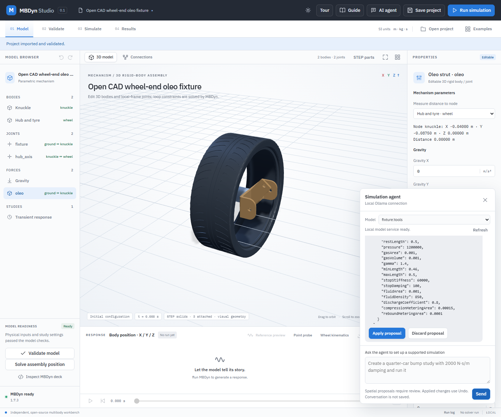

# Local AI simulation assistant

The desktop connects to an actual local Ollama model. It can select a supported example, change numerical template parameters and time settings, validate the draft, and request a real MBDyn run when the latest user message explicitly asks for one. The model does not execute Python, shell commands, arbitrary decks or URLs. Spatial drafts are presented with complete current and proposed model values for explicit Apply or Discard. The frontend revalidates before applying through its existing undo history; an authorized solver run is deferred until the user applies the reviewed spatial draft.

The implemented tool boundary covers the six editable templates and the verified upstream example catalog. Pinned upstream studies keep their source revision, input hashes and original time settings; the assistant cannot modify those studies. User-authored spatial assembly graphs support atomic add/update operations on bodies, joints, translational springs, external loads, rotational elements, joint efforts, named frames and sphere-plane contacts, plus gravity-vector edits. A body may be copied from an existing ID with its physical properties, pose and velocity. The assistant can inspect and validate planar graphs but cannot edit their topology. This is a scoped simulation assistant, not an unrestricted CAD/CAE agent.

## Connection

Ollama must already be running. The default endpoint is `http://127.0.0.1:11434`. Select an installed local model explicitly in the desktop. Status discovery does not download models or invoke inference. It prefers an already-installed `qwen3.5:4b`, then `qwen3.5:2b`, then `qwen3:4b` as the suggested selection. Other installed tool-capable local models may be selected, but their quality has not been established by the recorded smoke.

To use a different local port, create `%LOCALAPPDATA%\MBDynStudio\agent.json` for the Windows desktop. `MBDYN_STUDIO_DATA_DIR` may override that folder; if the user file is absent, the desktop reads legacy `backend/agent.json` without changing it. Browser development defaults to `backend/agent.json`:

```json
{"endpoint":"http://127.0.0.1:11435"}
```

The file is limited to 4 KiB and accepts only the `endpoint` field. Only HTTP literal loopback IP addresses are permitted, including IPv6 loopback. Hostnames, URL credentials, paths, queries and redirects are rejected. Connections use Python's direct HTTP client, without inherited proxy settings. No ambient environment, API key files or unrelated application configuration is read.

Models labelled `cloud`, models carrying remote-host/model metadata, and tiny remote stubs are excluded. The selected model is checked again through `/api/show` for remote metadata and tool capability before inference. This app does not change the Ollama daemon's configuration or independently attest its network behavior. For a daemon-wide offline policy, Ollama documents `OLLAMA_NO_CLOUD=1` or `disable_ollama_cloud:true`; changing that setting and restarting a shared daemon is outside this feature. [Ollama FAQ](https://docs.ollama.com/faq#how-do-i-disable-ollamas-cloud-features)

## Usage

Examples of supported requests:

- “Set the pendulum length to 2 metres and angle to 15 degrees. Do not run it.”
- “Load the mass-spring example. Set mass to 2 kg and damping to 1 N s/m. Set duration to 1 second and step to 0.0025 seconds. Then run the simulation.”
- “List the available suspension and source examples.”
- “Prepare the spatial slider crank source example and explain its validation limits.”
- “Copy body arm to a payload, connect them with a spherical joint using zero local anchors, and do not run.”

### Worked example: propose a full inertia tensor

1. Open **Examples → 3D revolute pendulum**, then open **AI agent** and select a connected local tool-capable model.
2. Send: `Tensor: set arm inertia xy to 0.01, xz to -0.01, yz to 0.005 kg m². Do not run.`
3. Inspect **Compare current and proposed model**, including the unchanged diagonal entries and the three requested signed off-diagonal entries. They are matrix entries about the centre of mass in body axes, in kg m², not negated engineering products of inertia. Ensure the complete tensor is appropriate for your physical body.
4. Select **Apply proposal** only if the entire proposed model is correct. Otherwise select **Discard proposal**. Applying does not run this example; use **Validate model** and **Run simulation** separately when ready. Use **Undo** to restore the previous model.


The screenshot shows the real application connected to a deterministic local model fixture (`fixture:tools`), so it demonstrates the review and application workflow, not the accuracy of a live language model. Actual models can propose incorrect values or fail to follow the request; inspect the complete proposed model before applying it. The numerical values here are illustrative, not measurements of a real part.

### Worked example: propose a centre-of-mass offset

1. Open the **3D revolute pendulum**, then open **AI agent** and select a connected model.
2. Send: `COM: set the arm body-local centre of mass to x 0.02, y -0.01, z 0.03 metres. Do not run.`
3. Inspect the proposed `centerOfMass` values in **Compare current and proposed model**. They are offsets from the body origin in body axes, not world coordinates. Verify the inertia tensor describes the body about its centre of mass.
4. Apply or discard the proposal. Applying does not run a simulation. Validate the physical model and run it separately when ready; Undo restores the previous state.



This screenshot uses the same deterministic local model fixture as the inertia example; it demonstrates the interface, not live model accuracy.

### Worked example: propose a frame and sphere-plane contact

1. Open **3D revolute pendulum** and the **AI agent**, then select a connected model.
2. Send: `FrameContact: add a tip frame on arm at local z 0.5 m. Add a sphere contact on arm at its local origin with radius 0.1 m, plane z -10 m, upward normal and stiffness 100 N/m. Do not run.` Specify the intended sphere radius, plane normal and stiffness if the model needs more detail.
3. Inspect the entire proposed `frames` and `contacts` entries, including body, coordinates, radius, unit plane normal and stiffness. A frame becomes a joint input when copied or linked in the editor. The contact is an ideal sphere against a fixed plane; STEP surfaces do not automatically define contact.
4. Select **Apply proposal** only after checking the complete candidate; validate and run separately. Otherwise discard it.



This screenshot uses a deterministic local model fixture, not a live language-model accuracy test.

### Worked example: propose an independent free body

1. Open **3D revolute pendulum** and the **AI agent**.
2. Send: `FreeBody: copy arm into a free payload at world x 1.5 m without a joint. Do not run.`
3. Inspect the complete proposed body and unchanged joint list. Applying adds an independent rigid body; it does not infer collision geometry or run the solver. Validate and run separately.



This screenshot uses the controlled local model fixture; live language-model accuracy remains unverified.

### Worked example: propose prescribed slider motion

1. Open `examples/prescribed-wheel-bump/wheel-bump.mbdyn-studio`. Select **fixture** and remove its existing prescribed motion to start with a free prismatic joint.
2. Open **AI agent** and ask: `Motion: prescribe the fixture slider with amplitude 0.025 m and frequency 1 Hz. Do not run.`
3. Review the complete proposed model, especially the joint axis, initial velocities, amplitude and frequency. Apply only if the motion matches the intended model. This is a prescribed displacement, not a force or validated actuator; see [prescribed slider motion](prescribed-slider-motion.md).



This screenshot uses a controlled local model fixture and does not establish live model accuracy. The assistant can add or change a prismatic joint's motion; it cannot remove it. Use the joint editor to remove it.

### Worked example: propose contact damping

1. In a spatial project with a contact named `floor`, open **AI agent**.
2. Send: `Damping: set floor contact compression damping to 10 N s/m. Do not run.`
3. Inspect the proposed damping and complete contact before applying it. This compression-only term acts only while penetrating and approaching; it is not a symmetric damper. Validate and run separately.



The screenshot uses a controlled local model fixture; it demonstrates review rather than live model accuracy.

The assistant sends conversational history and the current model to the selected local Ollama service. It does not send result CSV files or unrelated workspace files. The application does not persist chat prompts, responses, or credentials. The Ollama service has its own configuration and logging behavior.

Explanations generated by the language model can be wrong. The authoritative edit evidence is the accepted action list, the validated proposed model, and the solver result produced afterward. A chat response alone never establishes that a simulation ran or passed.

## API contract

`GET /api/agent/status` returns:

```json
{
  "ok":true,"provider":"ollama","endpoint":"http://127.0.0.1:11434",
  "available":true,"models":[{"name":"qwen3.5:4b","size":3389983735}],
  "defaultModel":"qwen3.5:4b","detail":"...","localOnly":true,
  "limits":{"messageCharacters":4000,"historyMessages":8,"historyCharacters":16000,
            "toolCalls":8,"rounds":8,"timeoutSeconds":120,"responseBytes":1048576}
}
```

`available` means the service returned installed local models; individual tool capability is checked when selected. If unreachable, status returns `available:false` with an actionable `detail` and code.

`POST /api/agent/chat` accepts exactly these fields (`history` optional):

```json
{
  "message":"Set length to 2 metres. Do not run.",
  "chatModel":"qwen3.5:4b",
  "model":{"kind":"pendulum","name":"My pendulum",
           "parameters":{"mass":1,"length":1,"angle":30,"gravity":9.81},
           "simulation":{"duration":5,"step":0.005}},
  "history":[{"role":"user","content":"Help me set up a pendulum."},
             {"role":"assistant","content":"I can help with its parameters."}]
}
```

Successful response fields:

| Field | Meaning |
|---|---|
| `ok`, `provider`, `chatModel` | Transport completion and exact selected provider/model |
| `answer` | Model-generated explanation; render as text, never executable HTML |
| `actions` | Ordered accepted `{type:"load_example",id}`, `{type:"set_parameters",values}` or `{type:"set_simulation",values}`, `{type:"edit_spatial_assembly",edits}` or `{type:"set_spatial_gravity",values}` proposals |
| `proposedModel` | Complete final validated draft if there are accepted edits; otherwise `null` |
| `validation` | Existing backend validator's result, including physical warnings |
| `toolResults` | Ordered `{name,ok,result}` or `{name,ok:false,error}`; rejected edits retain their diagnostics |
| `runRequested` | True only after the model calls `request_run`, the latest human explicitly requests a run, the draft is valid, and no tool operation failed |
| `requiresUserRun` | Inverse of `runRequested`; when true, no automatic solver invocation is authorized |

For spatial proposals the frontend must display the complete current and proposed model, explain any affected STEP bindings, and require explicit Apply or Discard. It must ensure the current project and STEP bindings still match the request, revalidate `proposedModel`, and apply it atomically through undo before considering the run flag. An explicitly requested run is deferred until the user applies the reviewed spatial proposal. Never evaluate the assistant's prose, tool names, JSON strings or returned URLs as commands. Keep a failed run's existing solver diagnostics and partial artifacts.

Run authorization recognizes direct clauses such as “run”, “please solve”, “can you simulate” or “then run” in the latest human message. Quotes/code and earlier history cannot authorize execution. Messages containing obvious negation (`not`, `don't`, `never`, `without`, etc.) fail the gate. This is deliberately conservative: for ambiguous phrasing, use the existing Run button or a short direct request. Even if explicitly requested, no run occurs unless the model also calls the run tool. `agent.py` has no solver execution call.

Errors are `{ok:false,error,code}`. Invalid requests use HTTP 400; missing/unsupported models 422; another active inference 409; unavailable service/configuration 503; malformed/rejected/truncated provider output 502; inference timeout 504. Rejected individual tools return visible diagnostics within an otherwise successful conversational response. A failed/truncated inference returns no partially accumulated edits.

## Bounds and implementation

The existing API accepts at most 64 KiB JSON. Chat adds a 4,000-character latest message, eight history messages of at most 4,000 characters each and 16,000 characters total, eight model responses, eight total tool calls, a 120-second inference budget, and a 1-MiB maximum provider response. Inventory/show probes each have a separate four-second limit. Only one chat inference runs at a time. Socket deadlines interrupt stalled local requests; the lock is released on failure.

The model/tool JSON parser rejects duplicate fields, nonfinite numbers, excessive nesting and unsupported shapes. Numeric edits reject strings, booleans, unknown fields and fields belonging to other template kinds. Spatial graph edits are one atomic batch of up to 32 typed add, update, or body-copy operations; unknown fields, invalid types and deletion or retyping are rejected. The full candidate must pass existing graph, kinematic, range and time-step checks before any change enters the draft. Copying a body reads its existing mass, inertia, pose and velocity directly rather than regenerating those values. Every accepted edit goes through the existing range, physical time-scale and step-count checks. All modifications occur on a deep copy; the caller's project and example definitions remain unchanged. No solver run, file write, source upload, arbitrary network request or environment-reading tool is available.

The integration uses Ollama's non-streaming `/api/chat` with native function tools, appends assistant calls and corresponding `role:"tool"` results, and consults `/api/show` for supported thinking controls. It disables thinking only when advertised as supported and never displays the separate thinking channel. Responses ending at the generated-token limit are rejected before any proposal is returned. [Chat API](https://docs.ollama.com/api/chat), [tool calling](https://docs.ollama.com/capabilities/tool-calling), [thinking controls](https://docs.ollama.com/capabilities/thinking)

## Spatial edit contract

`edit_spatial_assembly` accepts `edits`, a nonempty array of at most 32 operations. Each `add` or `update` names one of `bodies`, `joints`, `forces`, `loads`, `rotationalElements`, `jointTorques`, `jointForces`, `frames` or `contacts`, an existing or new `id`, and typed `values`. A `copy` operation is available only for bodies and names `sourceId`, a new `id`, and `values.name`; it preserves all physical properties from the source. A body can be free; use a single batch to add a body and its joint when a connection is desired, or to make coordinated changes whose intermediate states would be invalid. `set_spatial_gravity` accepts a partial world gravity vector. Joint anchors and axes are local to their bodies (world coordinates for ground); body poses use Euler123 degrees. A body's optional `centerOfMass` is a body-local vector in metres from its origin, defaulting to zero for existing projects. `jointForces` is a sinusoidal force effort in newtons on a prismatic or cylindrical joint, not a prescribed motion. For a prismatic joint, `motion` has `amplitude` in metres and `frequencyHz` in hertz. Adding it requires both; updating existing motion may specify either. The joint and all initial velocities must pass the normal physics validator, and invalid batches leave the staged model unchanged. `frames` may be copied or live-linked to joint ends in the editor; AI edits of linked frames synchronize the joint, while direct edits to linked joint ends are rejected. The assistant cannot create or remove those links. `contacts` are explicit frictionless sphere-plane elements.

For an `oleo-strut`, the assistant may add all required parameters or update explicitly supplied fields such as reference gas pressure and metering areas. Values are SI and must pass the same gas-volume, stroke and timestep checks as manual edits. The assistant must not invent calibrated aircraft data. The [oleo guide](oleo-strut.md) explains the model and its limitations.

The agent cannot delete or rename entities or change an existing element's type. It does not directly alter STEP files or bindings; the review warns if replacing a model would detach STEP parts. A solver-valid model may still differ from the user's request: the full before/after review is mandatory, and reviewing engineering inputs remains the user's responsibility.



## Verification

Run focused boundary tests with:

```powershell
python -m unittest discover -s backend -p test_agent.py -v
```

The tests use an owned temporary HTTP model service, including actual HTTP tool calls, source provenance, current-project immutability, malformed/duplicate/nonfinite calls, cross-family edits, local-only transport, missing/disguised remote models, inference timeout, explicit run gating and failed-edit suppression. Temporary services are stopped afterward.

`node tests/spatial-ai-inertia-ui.mjs` exercises the worked inertia example in the actual browser application with a deterministic model fixture. It checks the old tensor remains unchanged before approval, the requested entries are applied exactly after review, and no simulation is started. It also captures the screenshot above.

`node tests/spatial-ai-motion-ui.mjs` exercises the prescribed wheel-end proposal with the same kind of controlled fixture, verifies the original model is unchanged before review, applies the proposed parameters and checks no simulation starts.

`node tests/spatial-ai-oleo-ui.mjs` uses a controlled fixture to propose an oleo pressure change on a source-STEP wheel-end; it checks the before/after review and that no run starts. This does not establish live-model accuracy.

A local test on 2026-10-28 with the installed `qwen2.5:7b` proposed changing the example's existing oleo pressure to 1.2 MPa, left the input unchanged, and did not request a run. The default `qwen3.5:4b` did not produce a usable proposal for the first request and returned an incomplete-generation error on a follow-up. These individual observations are not a reliability or engineering-qualification claim; review the full proposal before applying it.

Live checks on this Windows machine on 2026-10-27 used the already-installed Ollama 0.40.5 and `qwen3.5:4b`:

- The no-run pendulum request produced exactly length 2 m and angle 15°, with a valid draft and unchanged input; 15.51 seconds including initial model loading.
- A request through the actual local Studio HTTP handler selected the oscillator, set mass 2 kg/damping 1 N s/m and duration 1 s/step 0.0025 s, then called `request_run`; 3.30 seconds while warm. All five tools succeeded. The owned test server was closed afterward.

These historical checks wrote local reports under `backend/evidence/`, which are not included in the public checkout. They establish real model tool calling and the proposal/run-request boundary for the observed requests. They intentionally did not execute MBDyn inside the agent module; the desktop's authorized run handler supplies that next step. They do not establish broad reasoning reliability, engineering qualification or support for arbitrary mechanisms.

A live local `qwen3.5:4b` check in this development session correctly changed one body mass without running. An initial request to duplicate a body using general add/update calls produced a physically valid but semantically wrong inertia and joint anchors; no proposal was applied. After adding a deterministic body-copy operation, a repeat copy-and-zero-anchor request produced the requested values. These are individual observations, not a general accuracy guarantee. `tests/spatial-agent-ui.mjs` covers review, discard, unchanged/stale models, run deferral and Undo with an owned local model fixture; `tests/spatial-agent-solver.py` independently runs one fixture-proposed model using real MBDyn.
