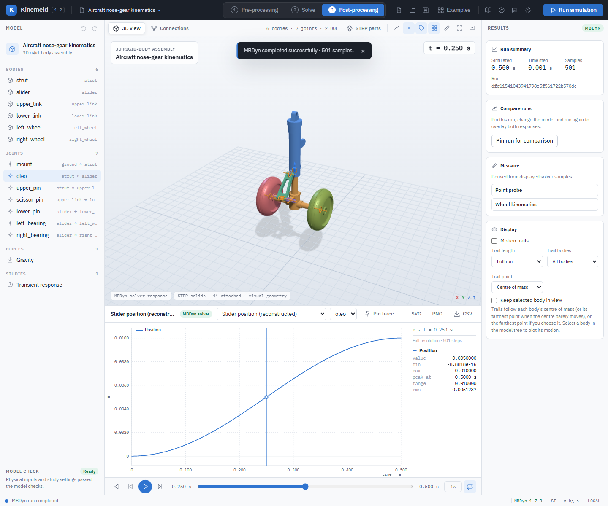

# Aircraft nose-gear STEP kinematic demonstration

[Watch the slowed simulation recording](demos/aircraft-nose-gear.mp4).

This is an **inferred kinematic demonstration only** using all 11 unchanged occurrences of the [source aircraft nose-gear STEP assembly](../examples/open-aircraft-nose-gear/README.md). The source has known initial solid overlaps. The substitutes used for two scissor joints admit different freedoms from physical pins, and all material densities, masses, mounting and driving assumptions are illustrative. **Do not interpret this fixture's joint reactions as aircraft load, actuator capacity, bearing design, stress or certification results.** It is not a drop test and has no tire–ground contact, brake, steering, pneumatic or hydraulic strut model.

The model is titled **Aircraft nose-gear kinematics**; its engineering limits are documented here. Use this example to see how original STEP occurrences can follow a constrained model and how the linkage moves when a slider is prescribed; it is not a complete engineering model of the source mechanism.

## What the model represents

The original assembly is translated into the simulation frame without altering the STEP bytes, placing its axle centre at approximately `(0,0,0.35) m`. Its occurrence placements are retained relative to one another. The outer strut is welded to ground. The piston, axle and hub are treated as one rigid slider; the two original wheels are two separately rotating bodies. The upper and lower scissor links are separate bodies. Three source fasteners are rigidly grouped with those links. The physical fastener connections and wheel bearing fits are assumptions, not extracted source mates.

The scissor uses a revolute upper pin, a spherical middle joint and a universal lower joint to avoid redundant constraints in the available 3D solver representation. **The middle and lower joint types are mathematical substitutions for the intended parallel pin mechanism**, not a bearing model; their reaction components and off-plane behavior need not match a physical scissor. A 10 mm cosine strut sweep is prescribed in zero gravity. No actual actuator, airframe or ground loads are modeled.

OpenCascade inspection found `7.5 mm`-radius X-axis cylindrical faces on both source occurrences at each selected upper, middle and lower pin line. Their axis centres agree with the modeled initial joint locations after the stated assembly translation. This observation supports the selected geometric references; it does not recover source mates, prove bearing clearances or justify the nonphysical joint substitutions.

For mass and inertia calculation, each metal occurrence uses a uniform density of `2700 kg/m³` and each wheel `1100 kg/m³`, combined about each body centre using the parallel-axis theorem. These are sample values, not material certificates or supplier inertia data. The wheel's uniform-density solid is not a pneumatic tire model. Inertias affect solver dynamics and ideal constraint reactions, even though this example only interprets positions.

Known **initial source overlaps** remain unchanged: approximately 9,199 mm³ piston/strut, 374 mm³ strut/upper-link and 2,875 mm³ upper/lower link. This non-contact simulation does not correct those intersections and does not test moving clearances. Refer to [source geometry checks](../examples/open-aircraft-nose-gear/README.md) before using the shape for packaging studies.

## Run it

1. Open `examples/open-aircraft-nose-kinematics/nose-gear-kinematics.mbdyn-studio`, titled **Aircraft nose-gear kinematics**. The six rigid bodies, seven joints and 11 STEP attachments belong to this illustrative fixture, not recovered CAD mates.
2. Select **oleo** and inspect **Prescribed slider motion**: amplitude `0.005 m`, frequency `1 Hz`. The modeled displacement is `q(t) = 0.005(1−cos(2πt)) m`, starting from rest and reaching `0.010 m` at `0.5 s`.
3. Select **Validate model**, then **Run simulation**. In Results choose **Slider position (reconstructed)** and joint **oleo**. Scrub from 0 to 0.5 s while observing the STEP piston, wheels and links. Save and reopen the project to retain the CAD bindings and recorded result.
4. Restrict interpretation to the displayed positions and geometric constraints. The generic reaction plots are available because MBDyn solves constraint forces, but they are **not valid aircraft-load predictions** for this fixture.

This example records the pinned source assembly's distinct occurrence IDs, including separate IDs for the two wheels. When reopening, the application verifies each ID against the same source bytes and can remap a changed traversal order. Older copies without these identifiers need explicit review before attachments are used; see [STEP attachment review](step-geometry.md#reviewing-older-assembly-attachments). The identity check does not establish that the inferred bodies, joints or material assumptions are physically correct.

## Numerical evidence and scope

An independent planar check intersects two circles centered on the fixed upper pin and the moving lower pin, using the two link lengths from the specified joint anchors. The selected intersection is the branch containing the initial scissor pin. For the 0.5 s sweep, the maximum MBDyn versus circle-intersection scissor-point difference was approximately `4.3 × 10⁻¹⁵ m`. Comparing 1 ms and 0.5 ms simulations gave a maximum matched-time body-position difference below `1.1 × 10⁻¹³ m`; the maximum reconstructed joint residual was below `5.3 × 10⁻¹⁴ m`. The maximum link out-of-plane translation for this specific case was below `8 × 10⁻²⁰ m`.

These checks establish numerical consistency with **this idealization** only. They do not prove that the original source is assembled without interference, that a real scissor follows the inferred joint model, or that a force, deformation or load case is correct. Larger strokes may reach a different branch or singularity. The very small differences are due to position being prescribed and should not be generalized to free dynamic or contact simulations.

From the source checkout, `python -B backend/test_aircraft_nose_kinematics.py` checks original STEP identity, mapping, initial joints and mass definitions; `python -B backend/verify_aircraft_nose_kinematics.py` runs the independent two-circle and MBDyn timestep comparison. With the local application and MBDyn running, `node tests/aircraft-nose-kinematics-ui.mjs` checks STEP import, simulation, animation and project save/reopen. Browser tests are included in the source archive, not the local Windows package.

To advance to an aircraft study, correct and verify CAD clearance and physical pin geometry, supply actual wheel and bearing properties, strut gas/hydraulic laws and friction, aircraft-supported mass and tire/ground behavior, then correlate independent test data. The [landing-gear engineering workflow](landing-gear-engineering-workflow.md) details those steps.
