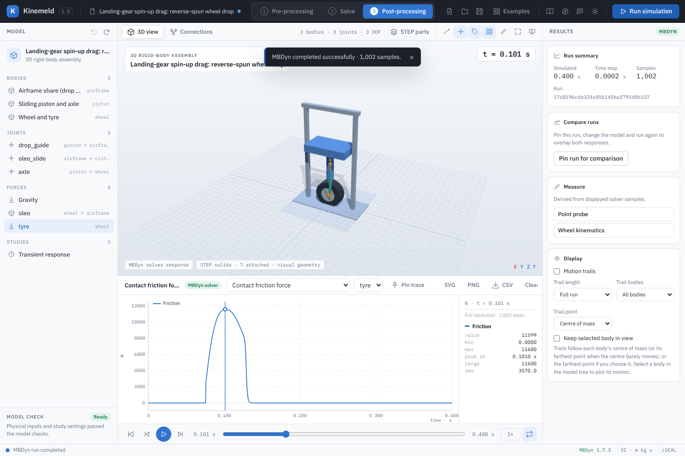

# Contact friction

A sphere-plane contact can carry regularised Coulomb friction. Set **Friction coefficient μ**
on the contact (0 is frictionless) and, optionally, **Friction slip velocity** `v_s` (default
0.05 m/s). MBDyn then applies, at every iteration,

```
slip  s = in-plane part of (v_centre + R n × ω)          velocity of the contact point
F_t   = −μ N tanh(|s| / v_s) s / |s|                       friction force on the body
```

where `N` is the contact's own normal force (elastic and damping), `R` the sphere radius and `n`
the plane normal. The force acts at the contact point: Kinemeld applies it at the sphere centre
together with the couple `(−R n) × F_t`, so a sliding ball spins up and a braked wheel drags its
axle.



## Choosing the slip velocity

Above about `2 v_s` the friction force is the full `μ N`. Below it the force falls smoothly to
zero, so the law has no true stiction: a part held by friction on a slope creeps at
`v_s · atanh(tan θ / μ)`. A smaller `v_s` creeps less but makes the friction stiffer for the
solver. Friction enters MBDyn's Newton iteration without its Jacobian, so near sticking each
iteration contracts by about `h μ N / v_s · (1/m + lever² / I)`. **Validate model** estimates this
with the system weight shared between the frictional contacts and asks for a smaller time step
or a larger slip velocity when it exceeds 0.5. Heavily loaded contacts — a landing gear at its
peak load, for example — may need a larger `v_s` than the estimate suggests; a run that does
not converge reports it.

## Results

With friction, each contact reports:

| Quantity | Source |
| --- | --- |
| Contact friction force | MBDyn's applied force (`result.frc`), magnitude |
| Contact slip speed | Contact-point slip rebuilt from the body motion |
| Friction power and dissipated energy | Applied force × slip, integrated over the run |

The CSV adds `contact:<id>:frictionForce_N`, `slip_m_s`, `frictionPower_W` and
`frictionEnergy_J`. Joint reactions show where the drag goes: in the spin-up study the axle's
fore-aft reaction equals the tyre drag.

## Worked example: landing-gear spin-up drag

At touchdown the wheel is not turning while the runway passes under it at the landing speed;
tyre friction spins the wheel up within milliseconds and loads the gear aft — the spin-up
drag load. Drop-test rigs reproduce this by spinning the wheel backwards to the landing speed
and dropping it on a stationary platform. **Examples → Landing-gear spin-up drag** does the
same: a 30 m/s tyre surface speed, a 290 kg carriage at 2 m/s sink speed, an oleo-pneumatic
strut and a tyre with μ = 0.55.

1. Open the example and select **tyre** under Forces. Its friction coefficient is 0.55 and its
   slip velocity 0.5 m/s, small against the 30 m/s initial slip.
2. Run it. **Contact friction force** opens: the drag rises with the vertical tyre load and is
   0.55 × that load until the wheel stops sliding about 50 ms after touchdown.
3. Plot **Joint reaction force on B** for **axle**: the X component is the drag carried by the
   axle.
4. In **Solve**, the preloaded study runs μ = 0.3, 0.55 and 0.8. Higher friction gives a higher
   peak drag (6.3, 11.6 and 16.9 kN) and a shorter spin-up (220, 53 and 36 ms).

## Verification

`python -B backend/verify_contact_friction.py` runs MBDyn against independent results:

- a ball launched sliding at 2 m/s rolls at 5/7 of that speed from `t = 2 v₀ / (7 μ g)`, and its
  speed and spin match an independent RK4 integration of the same law within 3·10⁻⁵ m/s;
- a block on four corner spheres slides to rest in `v₀² / (2 μ g)` on planes with general
  orientations, decelerates and accelerates on slopes as `g (sin θ − μ cos θ)`, and creeps at the
  predicted speed when friction cannot hold it;
- MBDyn's applied friction equals `μ N tanh(|s| / v_s)` rebuilt from the motion, and kinetic,
  potential, elastic and dissipated energy balance.

`python -B backend/verify_featured_studies.py gear-spin-up gear-spin-up-study` checks the
spin-up example: the wheel's angular momentum matches the friction impulse, the drag is Coulomb
while sliding, the axle carries it, and friction dissipates exactly the wheel's spin energy.

These checks establish the implemented law. They do not make it a calibrated tyre or brake
model; choose μ and `v_s` from test data for engineering use.
