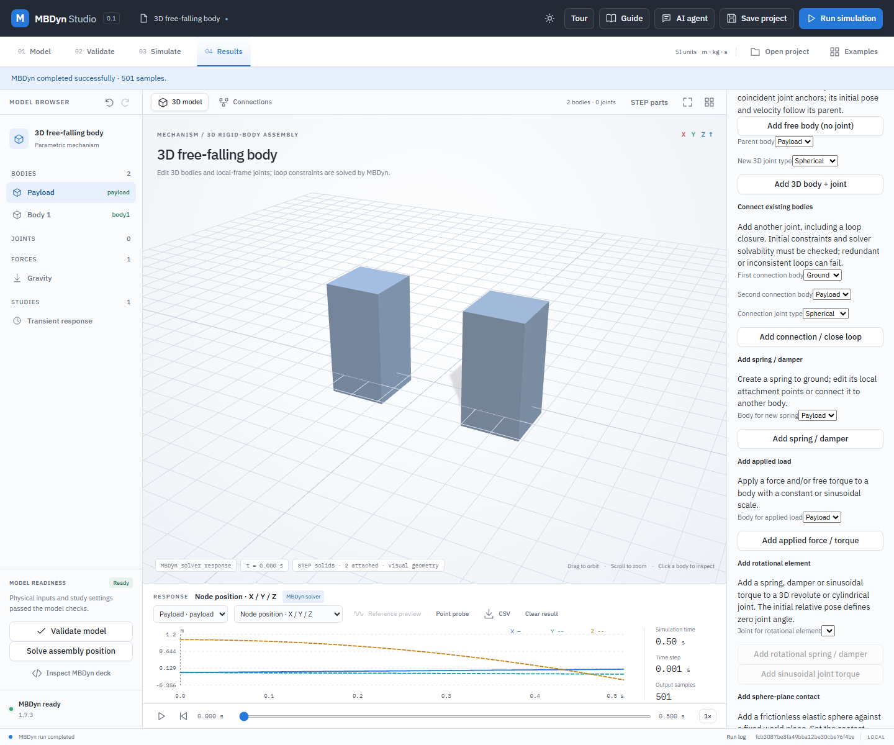

# Free 3D rigid bodies

A spatial model may contain free bodies, disconnected groups and zero joints. MBDyn integrates each body's world position and orientation from its mass, inertia, centre of mass, initial velocity, gravity and any explicitly applied forces or contacts. No ground constraint is added to a free body. The deck still contains a clamped static world node used by possible ground loads and contacts.

## Worked example: two free-falling bodies with STEP solids

1. Open **Examples → 3D free-falling body**. The Payload begins at `(0, 0, 1) m` under gravity `(0, 0, −9.81) m/s²`, with nonzero angular velocity and no joints.
2. With Payload selected, expand **Calculate mass and inertia from a uniform solid**. Choose a **Brick**, set density `1000 kg/m³`, widths `0.2 m` and `0.2 m`, and length `0.4 m`. Select **Create STEP solid and apply mass**. This creates a 16 kg rigid body and a matching display solid, replacing its previous inertia.
3. Select **Add free body (no joint)** in the body controls. The second body is independent and is not constrained to Payload. Create the same STEP brick for the new body. Use **Reset view** to fit both solids.
4. Validate and select **Run simulation**. The tree and model badge show two bodies and zero joints. At `t = 0.5 s`, each body origin has fallen to approximately `z = −0.22625 m`. Payload also rotates from its nonzero initial angular velocity; the second body begins at rest. Scrub the timeline, export CSV, then save and reopen the project.

The example uses ideal rigid bodies and uniform gravity, with no aerodynamic drag or physical collision between the bricks. STEP geometry is visual and does not automatically create contact. The screenshot is an actual application result, not a validation of a physical system.

## Diagnostics and limits

The empty joint array is intentional. Result samples retain numeric joint-residual fields as zero for compatibility; with no joints these fields mean **no constraints were evaluated**, not a measured residual. `metrics.jointCount` records how many authored joints were evaluated. Models can include free components together with grounded ones, and disconnected loops are identified in the validation summary. Real MBDyn still reports inconsistent or redundant constraints as errors.

`python -B backend/verify_free_bodies.py` runs real MBDyn checks for: free fall with a non-diagonal inertia tensor against an independent rotational RK4 integration and angular-momentum conservation; two disconnected bodies against their analytic trajectories; a free sphere rebounding from a fixed plane against independent integration; and an offset-centre-of-mass impact checked against mechanical-energy conservation. `node tests/free-body-ui.mjs` exercises the actual editor, STEP generation, solver, plots and save/reopen against an isolated local server. These are representative numerical tests, not production or hardware certification.
