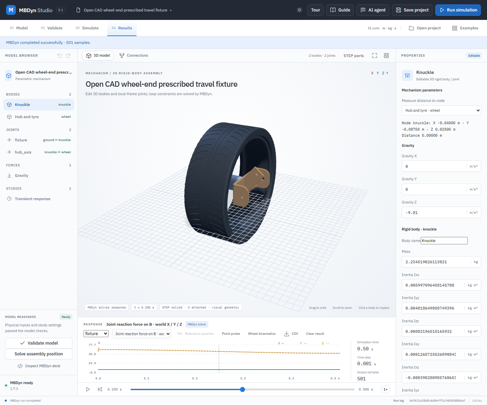

# Inspect joint reactions in a 3D simulation

The spatial results view can show MBDyn's joint constraint force and moment on **body B**, resolved along world X, Y and Z. The moment is taken about the B-side joint anchor. These are solver outputs from the ideal constraint, not measurements, material stresses or a bearing-life calculation. A separately modeled joint torque, axial force or spring is not included in the constraint reaction; consider every load path when calculating a total interface load.

## Worked example: driven STEP wheel-end

1. Open `examples/prescribed-wheel-bump/wheel-bump.mbdyn-studio`. It uses the detailed open-source STEP wheel, hub and knuckle documented in [the wheel-end guide](open-wheel-end.md). The ground-to-knuckle **fixture** is a prismatic joint with a prescribed 0.025 m amplitude at 1 Hz.
2. Select **Gravity** and set Z to `-9.81 m/s²`. Validate, run MBDyn and open **Results**.
3. Choose **Joint reaction force on B · world X / Y / Z** and joint **fixture**. Move the timeline to `0.25 s`. At this instant the ideal sinusoidal slider's acceleration is zero; for this example its Z reaction is approximately the combined model weight, 57.24 N. Select **Joint reaction moment at B anchor · world X / Y / Z** for the moment at the joint's body-B anchor.
4. Export **CSV** for the complete native-sample history, or save and reopen the project to retain the displayed samples. Existing saved results without joint reactions remain readable; run them again to obtain the new channels.

This is a guided fixture, not a real vehicle suspension test. The source geometry, component alignment, mass and material assumptions are not manufacturer specifications. The prismatic constraint imposes motion and is not a hydraulic actuator model. The plotted fixture reaction is on the knuckle; to understand the load on the wheel, inspect **hub_axis** and the applied loads separately. Do not interpret the ideal constraint moment as a local stress, actuator rating or production certification.

## Interpretation and verification

For each joint, `force` is the force on B and `moment` is the free moment at B's anchor, both in world axes. MBDyn's joint formulations use different internal output signs; the exporter converts the native outputs to this common convention. For a free prismatic joint its guide force and orientation-constraint couple are combined. Angular components are N·m and translational components are N. The reaction about a different point requires a moment transfer `M_P = M_B + (r_B − r_P) × F`. The force and moment on the other body must also account for the different anchor positions; simply negating the B-anchor moment is not sufficient when the anchors differ.

CSV columns are `jointReaction:<joint-id>:force_<axis>_N` and `jointReaction:<joint-id>:moment_<axis>_Nm`. They repeat on each body row at the same native time, as do the other element channels. The plot uses up to 2,001 displayed samples; the solver CSV retains all accepted native samples. Missing, incomplete or malformed joint output fails the run rather than being presented as zero.

Native `result.jnt` output is limited to 256 MiB. The full-resolution body-row CSV also has a 1,600,000-scalar limit for element and reaction values, including repeated values on each body's row. A model that passed the older estimate can now be rejected because these values are counted explicitly. A job exceeding either limit fails with a diagnostic rather than being silently truncated. Shorten the study, reduce its bodies or elements, or choose a larger time step only if a convergence check supports it.

MBDyn's `t = 0` reaction can reflect its initial derivative solve, and the first step can overshoot when prescribed acceleration is nonzero. Treat startup values as initialization results; check time-step and startup sensitivity before interpreting peaks.

From the source checkout, use `python -B backend/verify_joint_reactions.py` to repeat the real-MBDyn analytical checks, and `node tests/joint-reactions-ui.mjs` against a local application server to check the STEP workflow, CSV and save/reopen. Browser tests are in the source archive, not the Windows local package. Representative solver checks do not establish accuracy for every mechanism, time step, solver version or physical assembly.
