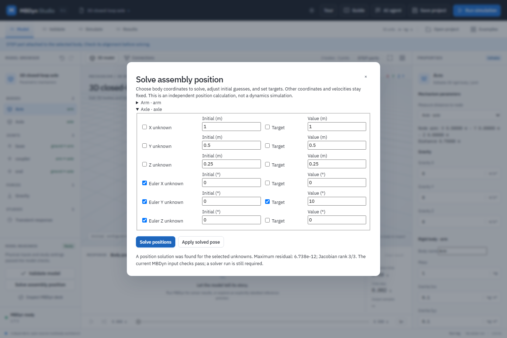

# Solve a 3D assembly position and velocity

The position solver finds a pose for explicitly selected body coordinates that satisfies the supported joint constraints and user targets. It is a local, independent numerical calculation; it does not run MBDyn or calculate forces, reactions, contact, acceleration or dynamics. The model and STEP attachments are unchanged until you choose **Apply solved pose**.

## Worked example: rotate the closed-loop axle

1. Open **Examples** and choose **3D closed-loop axle**. Its two bodies and three joints form a closed loop. If desired, use **STEP geometry** to attach a STEP part to `axle`; the attachment is retained when the pose changes.
2. Select **Solve assembly position** in the spatial-assembly workspace and choose **Position**.
3. Expand the **Axle** group, select **Euler X unknown**, **Euler Y unknown** and **Euler Z unknown**. The initial-guess fields default to the authored pose and can be edited to select a different starting branch.
4. Select **Euler Y target**, enter `10` degrees as its target value, and choose **Solve positions**. A successful result reports the residual and the selected-coordinate Jacobian rank: this example has rank `3/3`.
5. Inspect the result. Choose **Apply solved pose** to update only those selected body coordinates. Undo remains available. The screenshot above is an actual application view; it is not evidence of hardware or design qualification.
6. Check the regular model-validation panel, then choose **Run simulation**. A successful real MBDyn run provides the dynamics response and animates attached STEP geometry.

The independent solver was checked on a three-body closed slider-crank. For a 30-degree crank angle with 1 m crank length and 2 m connecting-rod length, its slider coordinate matches `cos(30°) + sqrt(4 - sin²(30°))` metres. A solved closed-loop axle was also run through the configured MBDyn 1.7.3 solver; it completed 251 samples with a maximum reconstructed position-constraint residual of approximately `8.8e-12 m`. Those tests cover representative mechanisms only.

## Inputs and diagnostics

Each unknown is one body coordinate: X, Y and Z in metres or Euler123 X, Y and Z in degrees. Targets specify the desired value of any body coordinate. Unselected coordinates remain at their current values. The solver accepts at most 96 unknowns and 96 targets, 60 iterations and an eight-second numerical deadline; it returns no candidate if it cannot establish a solution. Position residuals are measured in metres and angular and rotation-target residuals in radians; the displayed maximum is the largest absolute component across both. The Jacobian rank concerns the selected unknowns and does not establish global uniqueness or prove that another assembly branch does not exist.

A rank-deficient result reports **underdetermined**: add an appropriate target, fix unnecessary coordinates, or use a different initial guess away from a singular pose. An inconsistent target or loop may not converge; inspect joint anchors and target values or try a different initial guess. An expired time limit has unknown rank. The solver uses numerical derivatives, local iteration and the authored starting configuration; it does not enumerate branches.

The result includes a separate validation report for the current MBDyn input. **All velocities stay unchanged.** A geometrically solved pose can still need velocity changes, non-redundant constraints or other model repairs before MBDyn can run. Even when input validation passes, an actual solver run may still fail on a singular or redundant mechanism. STEP geometry provides visual placement; the constraints are defined by the body and joint data rather than automatically inferred from the CAD solid.

## API and tests

`POST /api/kinematics` accepts a spatial model and `variables` / `targets` arrays. A variable has `body`, `component` and optional `initial`; a target has `body`, `component` and `value`. Components are `x`, `y`, `z`, `rx`, `ry`, and `rz`. Numeric failures are returned as diagnostics with no candidate; malformed requests receive an actionable error. Successful candidates preserve all fields except the selected pose components.

Run `python -B -m unittest discover -s backend -p test_kinematics.py -v` for analytic, invalid-input, singular and deadline checks. Run `node tests/kinematics-ui.mjs` against an isolated local server for the actual STEP, UI, MBDyn and save/reopen workflow. The tests do not establish industrial certification.

## Worked example: consistent initial velocity for a pendulum

The velocity solver finds instantaneous body-origin linear velocities and world-frame angular velocities that satisfy the current joint constraints and explicit targets. It holds every pose and every unselected velocity fixed. It does not perform a dynamics run, calculate accelerations, or infer loads. Positions must already satisfy the joints.

1. Open **Examples** and choose **3D revolute pendulum**. Optionally attach `examples/step-pendulum/pendulum.step` to `arm` in **STEP geometry**.
2. Choose **Solve assembly position**, then select **Velocity** in the calculation selector. Expand **Arm**.
3. Select **Linear X unknown**, **Linear Z unknown** and **Angular Y unknown**. Select **Angular Y target** and enter `1` rad/s.
4. Choose **Solve velocities**. The result should report rank `3/3` and proposed values near `vx = -0.8660254 m/s`, `vz = -0.5 m/s`, and `wy = 1 rad/s`. These signs follow this example's anchor geometry and world axes. Review them before choosing **Apply solved velocities**.
5. Run **Validate model**, then **Run simulation**. The values are initial conditions, not a motion prescribed throughout the run. Save and reopen the project to retain them and any STEP attachment.

Linear velocity is measured at the authored body origin, in world axes; angular velocity is the physical world-frame rotation vector in radians per second, not Euler-angle rates. Constraints use anchor velocities and, for a sliding joint on a moving parent, account for rotation of the parent frame. The calculation is linear at the fixed pose. A rank-deficient choice of unknowns returns no candidate; add suitable targets or leave free components fixed. Inconsistent targets likewise return no candidate. The displayed residual is the maximum of linear constraints in m/s and angular constraints in rad/s, so the mixed units must be interpreted componentwise. The separate MBDyn input check and an actual run remain necessary.

For the API send `POST /api/kinematics` with `{"mode":"velocity", "model": ..., "variables": [...], "targets": [...]}`. The component names are `vx`, `vy`, `vz`, `wx`, `wy`, `wz`; `initial` guesses and `value` targets use m/s or rad/s. A successful candidate changes only selected velocity components. The existing position request without a `mode` remains supported. `node tests/kinematics-velocity-ui.mjs` verifies the UI, attached STEP geometry, real MBDyn run and saved-project reopening against an isolated configured server. The analytic tests also compare a moving closed slider-crank to its differentiated geometry and test sliding-frame transport; they do not establish industrial qualification.
