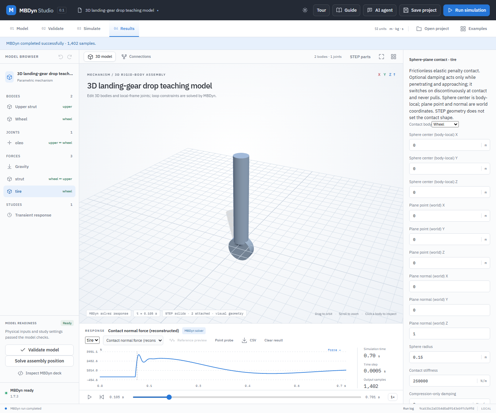

# 3D landing-gear drop teaching model

This is an original, simplified two-body landing-gear drop: a **100 kg** upper mass and **5 kg** wheel mass fall together, with a prismatic oleo guide, linear strut spring-damper and an ideal frictionless sphere-plane tire contact. The model uses real STEP solids for the strut and wheel. The tire contact sphere is explicitly specified, not inferred from the wheel's cylindrical STEP surface.



## Run the example

1. In Kinemeld select **Open project** and choose `examples/landing-gear-3d/landing-gear-drop.mbdyn-studio`. Confirm **STEP solids · 2 attached**.
2. In the model tree inspect **oleo**, a prismatic joint between upper strut and wheel, and **strut**, the axial spring-damper. Select **tire** to inspect its sphere radius, plane and stiffness. Both bodies start with `−1.5 m/s` vertical velocity.
3. Select **Validate model**, then **Run simulation**. Choose **Contact normal force (reconstructed)** and scrub to about `0.105 s`; the force rises from zero as the tire idealization penetrates the plane. The default run produces a peak contact force of about `3.50 kN` and maximum strut compression of about `0.190 m`.
4. Select the strut in the relevant force plot to inspect its response; export the normal result CSV for the complete solver record. Save and reopen the project to retain both STEP assets, bindings and the result. Change the timestep and repeat before interpreting a result.

## Model and assumptions

The positive world Z direction is upward. For upper and wheel centre heights `zu, zw` with velocities `vu, vw`, the strut length is `L = zu − zw` and its tension is `Fs = k(L − L0) + c(vu − vw)`. Tire contact is the unilateral elastic penalty `Ft = kt max(0, r − zw)`. The resulting translational equations are:

```text
100 au = −100 g − Fs
  5 aw = −  5 g + Fs + Ft
```

Here `g = 9.81 m/s²`, `L0 = 0.65 m`, `k = 12000 N/m`, `c = 900 N·s/m`, `kt = 250000 N/m`, and `r = 0.15 m`. The tyre idealization has no damping or friction, the plane is fixed, and the prismatic joint locks both bodies' relative orientations. It does not model wheel spin, rolling, steering, aircraft pitch, real tire geometry, gas precharge, nonlinear hydraulic valves, physical contact with the strut, flexible parts or aerodynamic loads. The linear spring does not impose a hard travel stop. The parameters and geometry are illustrative and are not measured from an actual aircraft.

The original strut STEP is a solid cylinder, radius `0.09 m` and length `1.1 m`; its uniform density is set to yield 100 kg. The original wheel STEP is a solid cylinder, radius `0.15 m` and width `0.1 m`, rotated so its axis is horizontal; its density yields 5 kg. The project mass, centre of mass and full body-axis inertia are derived from those STEP volumes. The solids are visual/physical mass approximations, not manufacturing CAD. The two bodies may visually overlap as the strut compresses; no automatic solid-to-solid collision is performed.

## Verification

`python -B -m unittest discover -s backend -p test_landing_gear_3d.py -v` checks the original STEP hashes, bindings, mass, centre of mass and rotated inertia. `python -B backend/verify_landing_gear_3d.py` compares every MBDyn sample with an independent RK4 integration of the equations above, then repeats at half the timestep. At `0.0005 s`, the maximum position error was `4.01e−5 m` and velocity error `0.00895 m/s`; at `0.00025 s` they fell to `1.00e−5 m` and `0.00231 m/s`. At the default step, reconstructed joint residual stayed below `1e−7 m`. The verifier generates `verification/landing-gear-3d.json` for both runs and force errors; this local report is not included in the public checkout. These are numerical comparisons for this idealized example, not validation against flight-test or hardware data.

With an isolated local MBDyn server, `node tests/landing-gear-3d-ui.mjs` verifies STEP attachment, actual solver execution, contact plot and project save/reopen. Regenerate the two STEP sources and project with `python -B examples/landing-gear-3d/generate.py` using the configured OpenCascade OCP runtime; STEP export timestamps and hashes may change.

The [engineering input record](../examples/landing-gear-3d/engineering.json)
also records the authored guide hardpoints, force laws and the mass-normalizing
densities explicitly. The [engineering verifier](engineering-example-verification.md)
checks all body mass properties, three timesteps and a 20% lower initial-speed
case. Position errors against its separate RK4 integration are approximately
40.08, 10.04 and 2.55 µm; tire-force errors are 10.02, 2.51 and 0.638 N at
0.5, 0.25 and 0.125 ms. It also compares first contact with the analytic free-fall
time. These remain numerical checks of the specified teaching equations.
