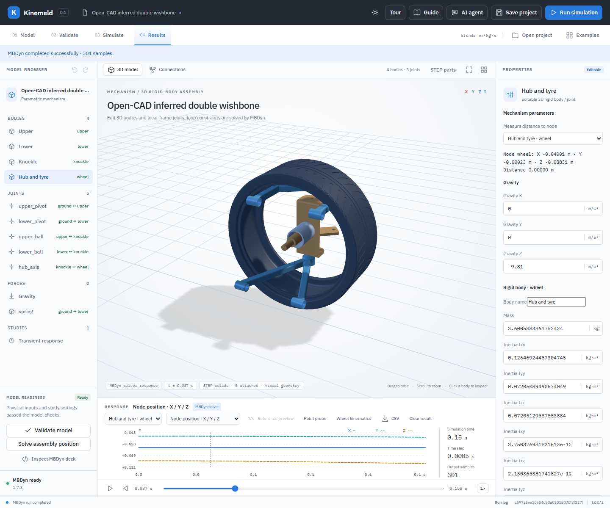
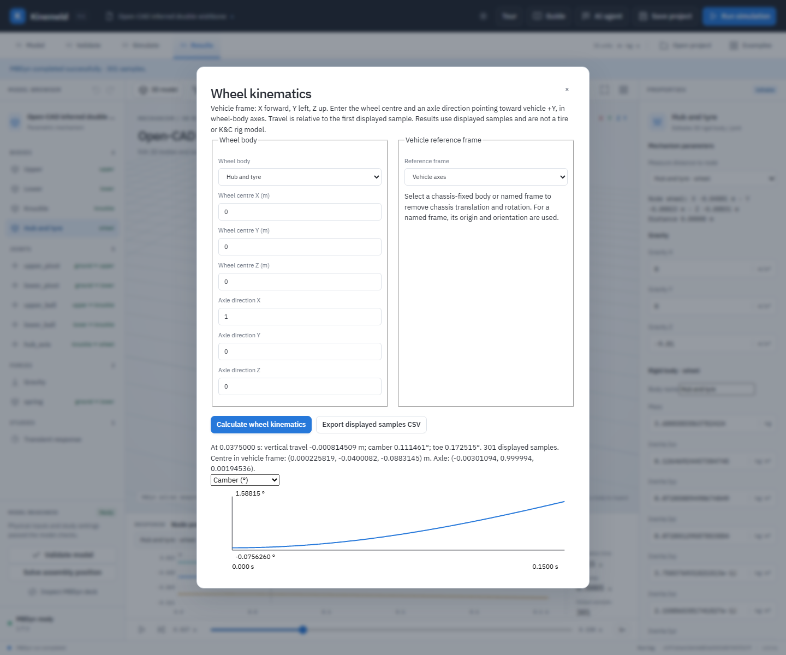

# Open-CAD double-wishbone linkage study

[Watch the slowed simulation recording](demos/double-wishbone.mp4).

Open `examples/open-suspension/suspension.mbdyn-studio` for a four-body, five-joint closed-loop multibody study. It combines five unchanged STEP exports—upper arm, lower arm, knuckle, hub and tire—from the [MIT-licensed source suspension CAD project](../examples/step-suspension/README.md). Unlike a wheel-only fixture, this example moves both arms and the upright in a three-dimensional loop. It is an **inferred teaching reconstruction**, not the original source assembly or an OEM-validated suspension. The source does not provide assembly constraints, hardpoint data, material specifications or calibrated tire and damper properties.

## What the mechanism computes

The chassis is idealized as ground. Each arm rotates on one fixed revolute axis. Upper and lower spherical joints attach the arms to the knuckle; the hub and tire are combined as a single body on the knuckle's revolute wheel axis. The arm–knuckle linkage forms one closed spatial loop; the wheel bearing is a branch. MBDyn solves the constrained dynamics and can report [joint constraint reactions](joint-reactions.md), but these do not certify physical interface loads. The wheel is free to spin. A linear spring-damper connects the lower arm to ground, and gravity is the only applied external load. There is **no tie rod**, so the upright's steering motion is not constrained by a steering rack. There is no road contact, preload adjustment, hydraulic damper, tire deformation or bushing compliance. This is a free-response illustration, not a wheel-travel or vehicle-handling test.

In physical terms, as gravity moves the wheel and upright, the ball joints transfer load into both arms. Their ideal chassis revolutes transfer load to ground; the lower-arm spring reacts along its line of action. The geometry couples wheel travel, upright orientation, and spring length. Spherical joints are mathematical constraints here: their presence does not establish that the STEP bearing seats and physical parts fit together.

## Geometry and assumptions

The five STEP files and their pinned hashes are retained in the [source catalog](../examples/step-suspension/README.md); the project embeds their exact bytes. OpenCascade calculations assume uniform density of 7,850 kg/m³ for each metal part and 1,100 kg/m³ for the tire; these yield 0.6213 kg upper arm, 0.6558 kg lower arm, 2.2345 kg knuckle, and 3.6006 kg combined hub/tire. The tire is a rigid homogeneous solid; the rim, bearing, fasteners and brakes are excluded. Replace all masses and inertias with measured or supplier values for serious analysis.

| Connection | Source CAD observation, mm | Modeling choice |
| --- | --- | --- |
| Upper arm outboard | 20 mm-radius cylindrical feature along local Y, line through (180, 0, -95) | Align its axis with the upper knuckle feature and offset the arm 40 mm along that axis. The ideal spherical center lies outside the arm solid. |
| Lower arm outboard | 20 mm-radius cylindrical feature along local Y, line through (0, 0, -225.225) | Align with the lower knuckle feature, rotate the arm 90° about its local Y, and offset it 40 mm along its outboard axis. The ideal spherical center lies outside the arm solid. |
| Knuckle interfaces | 25 mm-radius cylindrical features along Y at (35, 0, 12.5) and (35, -169, -12.5) | These are selected geometric references only. Their radii differ from the arm features; no physical mating fit or actual ball-center location is established. |
| Arm inboard axes | Upper has a cylindrical feature through (-11, 0, 17.5) parallel to local Z; lower has one through (-110, 0, 11) parallel to local X | One feature on each part is used to define an ideal ground revolute. The other pivot support and coaxiality are not established. |
| Knuckle/hub | Knuckle has an X-parallel 20 mm-radius cylindrical feature on Y = -87.5, Z = 0 | Hub and tire local origins are placed at X = -40 mm on the feature line. This has been checked for no hub/knuckle solid overlap, but bearing, rim and clearance fit are unverified. |

Initial world positions are in metres, with Z up. The reconstructed poses and the two 40 mm virtual joint extensions are not recovered source mates. They leave unmodeled connector gaps; a real bearing or ball joint has not been designed. OpenCascade detects no common solid volume between the four metal parts in this initial placement. That initial static intersection check excludes the tire and does not prove clearance through motion. The spring uses 2,500 N/m, 30 N·s/m and a 0.53 m rest length. Its chassis and arm attachment points are illustrative, not measured interfaces. Initial spring length is approximately 0.569 m. The 0.15 s simulation starts at rest.

## Run and inspect

1. In Kinemeld, choose **Open project** and select `examples/open-suspension/suspension.mbdyn-studio`. The model tree lists four bodies, five joints and a spring; **STEP parts** shows five attachments.
2. Select `upper_ball` or `lower_ball` to inspect local anchors. Select `upper_pivot` and `lower_pivot` to inspect the assumed body-local and world axes. Select `spring` to inspect its endpoints and parameters.
3. Select **Validate model**, then **Run simulation**. The solver result presents a time history. In **Results**, select **Hub and tyre** and **Node position**; drag the timeline to observe the linkage.
4. Choose **Wheel kinematics**, set the wheel body to **Hub and tyre**, centre to `(0,0,0)`, local axle to `(1,0,0)`, and reference to **Vehicle axes**. Calculate and select camber, toe or vertical travel. This ground-fixed example frame is rotated −90° about Z so its +Y points along the initial axle. See [wheel kinematics](wheel-kinematics.md) for its definitions and sign conventions.
5. Save the project, reopen it, and verify the STEP bindings and solver result remain available. If you edit geometry, masses, joint frames, spring properties or other inputs, rerun before interpreting the result.

With MBDyn 1.7.3, 0.5 ms and 0.25 ms runs give a maximum wheel-center position difference of approximately 0.096 µm across matching output times, with maximum reconstructed joint residual below 7 × 10⁻¹⁴ m. The coarser run produces 10.35 mm maximum vertical wheel-center displacement. The timestep comparison checks numerical sensitivity of this load case; it does not prove that either CAD placement or the physical suspension is correct. The trajectory is not a measured K&C curve.

From the source checkout, `python -B backend/test_open_suspension.py` checks embedded original CAD bytes, initial joint positions and pairwise initial metal-part solid intersections; `python -B backend/verify_open_suspension.py` runs both installed-MBDyn timesteps. `node tests/open-suspension-ui.mjs` exercises STEP import, an actual solver run and project save/reopen against a running application. The verifier generates `verification/open-suspension.json`; the local report is not included in the public checkout. Browser tests are included in the source archive, not the local Windows package.

To upgrade this into an engineering model, obtain the original assembly coordinate system, physically compatible joints and verified hardpoints, a steering tie rod and rack, full sprung and unsprung masses, spring/preload/damper curves, bushing stiffness and damping, tire/road data and measured K&C or instrumented test results. Check initial and dynamic component interference before using the geometry for packaging. See the [suspension engineering workflow](suspension-engineering-workflow.md) for correlation and the distinction between kinematics and compliance.
