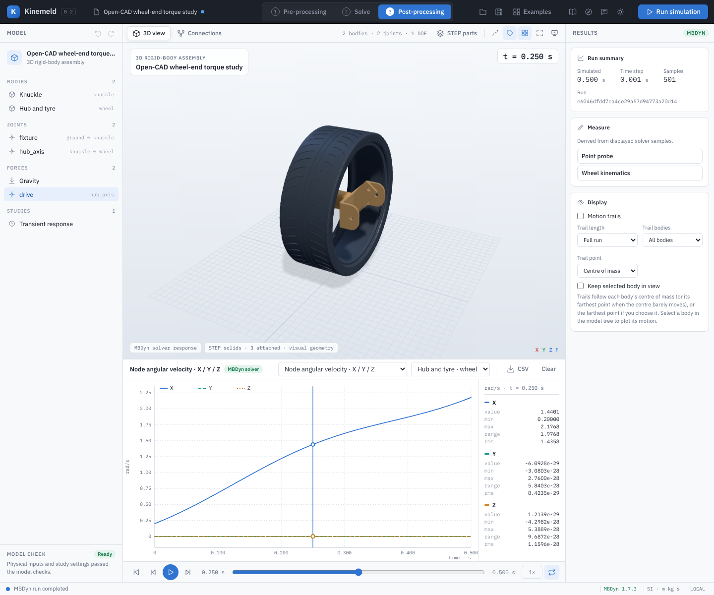
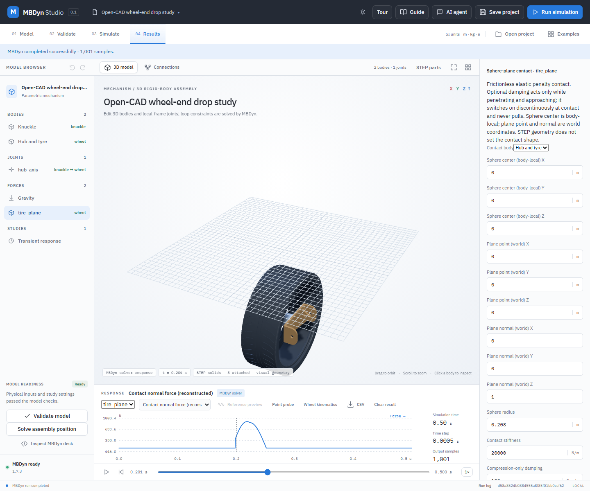

# Open CAD wheel-end: torque and drop studies

[Watch the slowed torque simulation recording](demos/wheel-end.mp4).

These worked examples use original STEP models of a knuckle, hub, and tyre from a community-authored double-wishbone CAD project. They are an **illustrative wheel-end subset**, not a complete suspension, OEM geometry, a verified manufactured part, or a validated vehicle. The two studies demonstrate how to connect real CAD geometry to rigid-body equations and check a result independently. They do not assess structural strength or tire performance. For hardpoint measurement, suspension kinematics and compliance, and correlation planning, see the [suspension engineering workflow](suspension-engineering-workflow.md).

## Source, rights, and geometry

The original files come from [Prammit-06/Double_Wishbone_Suspension_CAD, revision d822c401ad51aae76cfd4fbbe80d13b42800f339](https://github.com/Prammit-06/Double_Wishbone_Suspension_CAD/tree/d822c401ad51aae76cfd4fbbe80d13b42800f339). The repository declares the MIT license. The accompanying [source notes and license](../examples/step-suspension/README.md) retain provenance. Both saved projects embed the exact source STEP bytes and retain the original files; the viewer tessellates them for display. No mesh-to-STEP conversion is used.

| Source STEP | SHA-256 |
|---|---|
| Assembly 1 - Knuckle_Left Knuckle.step | `670681b02f1923520f49d46eb6fe0166040eb43869283566f04fba7f2a4313b9` |
| Assembly 1 - Hub.step | `5a035846fcd27121ac5337484b4f5e791b5deb3349030faff4768eed0c0ffbdb` |
| Assembly 1 - Front Tyre.step | `a0b7e75748354b03547decf398d0257d79442c051c330956d208136fac7255d0` |

The STEP files are individual exports without the source assembly hierarchy, mates, materials, or hardpoint metadata. OpenCascade inspection finds a 20 mm radius cylindrical face in the knuckle with its axis parallel to +X, on the line Y = -87.5 mm, Z = 0. The point X = -40 mm on that line is chosen as the axle origin. The hub and tyre exports have axes parallel to +X around their local origins; we align those origins to the selected point. This is an **inferred registration**, not evidence that the three exported parts mate correctly or have production clearances. An OpenCascade solid intersection check found about 3,221.5 mm³ of knuckle–hub overlap in the earlier X = -30 mm placement. The current -40 mm placement has zero measured solid-intersection volume and an approximately 3.5 mm minimum surface gap; the missing bearing and correct axial location remain unverified. The source rim was excluded because its alignment and fit were not established. There is no bearing model.

Coordinates are metres, kilograms, seconds and radians. +X is the idealized axle, +Z is upward in the drop case. The knuckle would normally transfer hub/bearing loads into control arms and steering links; this study replaces the bearing by an ideal revolute joint. The hub and tyre are rigidly combined, so their relative motion and deformation are absent.

### Mass assumptions

Each source B-rep was integrated using OpenCascade with assumed uniform density: 7,850 kg/m³ for knuckle and hub, 1,100 kg/m³ for tyre. The knuckle mass is 2.2345 kg, hub 0.3522 kg and tyre 3.2484 kg. The combined hub/tyre mass is 3.6006 kg and its calculated centroidal Ixx is 0.126469 kg·m². The individual tensors are combined with the parallel-axis theorem and retain off-diagonal terms. These are geometry-derived estimates, **not supplied component specifications**. The tyre is treated as homogeneous solid rubber and a rigid body; a real pneumatic tyre has layers, pressure and a deformable contact patch. There is no rim, bearing, brake or fastener mass. Replace estimates with measured or supplier mass, center of gravity and inertia before engineering decisions.

## Study A: wheel-end torque

1. Open `examples/open-wheel-end/wheel-end.mbdyn-studio` in Kinemeld. Three original STEP assets load and are bound to two bodies.
2. Select **hub_axis** to inspect the revolute joint, +X axes and coincident anchors. The knuckle is welded to ground; the hub and tyre turn as one rigid body.
3. Select **drive** in Forces. It applies `τ(t) = 0.5 + 0.2 sin(4πt)` N·m about the axle. Initial angular velocity is 0.2 rad/s. Gravity, tyre contact, friction, bearing losses and a brake are omitted.
4. Run MBDyn. In Results select **wheel** and **Node angular velocity · X / Y / Z**; move the timeline to inspect the rotation while the excitation is visible in the inspector. Save and reopen to keep CAD bindings and results.

The load path is the applied torque → rotating hub/tyre inertia → reaction at the ideal hinge → ground-fixed knuckle. There is no claim that this fixture represents a full vehicle. For this fixed-axis case an independent check is `J θ̈ = τ(t)`, where `J = Ixx + m(cy² + cz²)`. At 0.5 seconds, comparing the solver history against the analytical solution gave the following:

| Step | Maximum angular-position error | Maximum angular-velocity error | Maximum work-balance error |
|---|---:|---:|---:|
| 1 ms | 3.49 × 10⁻⁶ rad | 1.32 × 10⁻⁵ rad/s | 1.25 × 10⁻⁶ J |
| 0.5 ms | 8.68 × 10⁻⁷ rad | 3.29 × 10⁻⁶ rad/s | 3.14 × 10⁻⁷ J |

These numbers verify this idealized calculation and show improvement under refinement. They do not validate the assumed geometry, inertia, bearing, or material.

## Study B: free wheel-end drop with surrogate contact

1. Open `examples/open-wheel-end/wheel-end-drop.mbdyn-studio`. The same exact CAD and revolute binding are used; the ground weld and drive torque are removed.
2. Both bodies start at Z = 0.6 m with downward velocity 1 m/s. Gravity is -9.81 m/s². The wheel initially spins at 0.2 rad/s about +X.
3. Inspect **tire_plane** in Forces. The selected contact is an **ideal frictionless sphere against an infinite plane**, with a radius of 0.208 m estimated from the tire's optimized STEP bounding box and a mesh sample (approximately 208.002 mm maximum radial distance). The earlier 0.2538 m value came from a conservative bounding box and incorrectly placed contact well outside the visible tire. Stiffness is 20,000 N/m and approach damping 100 N·s/m. These coefficients are illustrative assumptions, not tire data. No tire mesh or STEP face participates in contact.
4. Run MBDyn and select **Contact normal force (reconstructed)** in Results. The output is reconstructed from simulated positions and velocities; it is not a measured load or a calibrated tire model. Move the timeline into the force pulse and export/save if desired.

For signed center-to-plane distance `d`, sphere radius `r`, and normal approach speed `v_n`, the illustrative law is `δ = max(0, r − d)` and, while `δ > 0`, `F_n = kδ + c max(0, −v_n)`; outside contact the force is zero. The dashpot acts during approach only. There is no tangential force or friction, and this calculation does not model rolling traction, tire footprint, pressure, tread, road roughness, suspension compliance or structural deformation. The penalty method permits finite penetration. The initial spin does not imply a rolling tyre/road model.

The verification reconstructs each rigid body's translational and rotational kinetic energy from solver states, adds gravitational potential and contact spring energy, and accounts for integrated damper dissipation. It compares the total to initial energy:

| Step | Peak reconstructed normal force | Dissipated energy | Maximum energy-balance drift | Maximum joint residual |
|---|---:|---:|---:|---:|
| 0.5 ms | 892.41 N | 9.123 J | 0.0812 J | 2.24 × 10⁻¹⁴ m |
| 0.25 ms | 890.69 N | 9.194 J | 0.0386 J | 5.00 × 10⁻¹⁴ m |

Refinement reduced the numerical energy drift; the approximately 0.19% peak-force change is a calculation comparison, not physical accuracy. Energy integration and force are reconstructed from sampled states. A contact discontinuity and the chosen numerical step influence this check.

## Reproduce and extend

From the source checkout, run `python -B backend/test_open_wheel_end.py` for source hash, embedded-byte, axis and mass-property checks. Run `python -B backend/verify_open_wheel_end.py` and `python -B backend/verify_open_wheel_end_drop.py` with MBDyn available to repeat the analytical and two-step energy checks. Run `node tests/open-wheel-end-ui.mjs` and `node tests/open-wheel-end-drop-ui.mjs` against a local running application to exercise actual STEP loading, solver runs and project save/reopen. Browser tests are included in the source archive, not the local Windows package. The verifiers generate `verification/open-wheel-end.json` and `verification/open-wheel-end-drop.json`; these local reports are not included in the public checkout.

To move toward a useful vehicle K&C model, obtain the source assembly's verified coordinate systems and control-arm/steering hardpoints, measure or source bearing and component mass properties, supply a matched rim and complete suspension, define realistic bushing, spring and damper behavior, and compare wheel travel, camber, toe and steering response against test or trusted reference data. The independent exports alone cannot establish these missing design inputs. Do not use these sample values for safety, durability or production sign-off.
