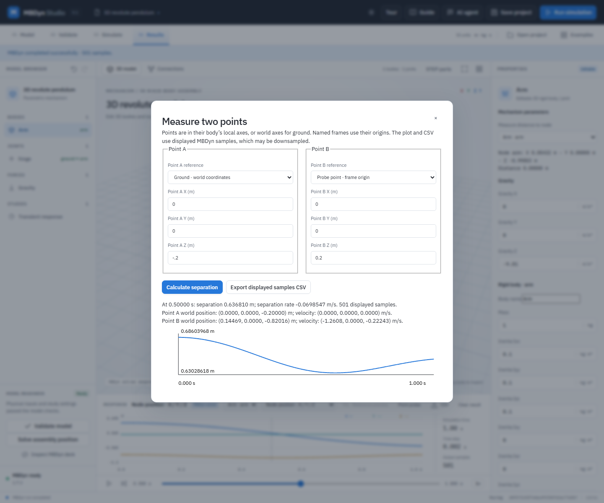

# Measure two points in a spatial result

The **Point probe** measures two body-local points, named-frame origins, or fixed world points from a current 3D MBDyn result. It plots their separation across the displayed samples and exports those samples with world positions, velocities, distance, separation rate, body IDs and local offsets. A body point's world velocity includes both origin velocity and `ω × r` from its rotation. Results use metres, seconds and world-frame m/s.

The probe is a post-processing calculation. It does not add a sensor, joint, force or body to the model. It uses solver-reported body positions, Euler123 orientations, origin velocities and world angular velocities; it does not extract velocities from STEP surfaces or infer contact. At exactly zero separation, the scalar separation rate is undefined and its CSV cell is blank.

## Worked example: inspect a point on a pendulum

1. Open **Examples → 3D revolute pendulum**. Optionally import `examples/step-pendulum/pendulum.step` and attach it to **Arm**.
2. Expand **Named reference frames**, add a frame on Arm named `Probe point`, and enter local translation `(0, 0, 0.2) m`. Frame orientation does not change its origin. Save the project if you want to retain this frame.
3. Validate and run MBDyn. Select a time in the timeline and choose **Point probe** beside the results CSV button.
4. For **Point A**, choose **Ground · world coordinates** and enter `(0,0,-0.2) m`. For **Point B**, choose **Probe point · frame origin**. Select **Calculate separation**. The dialog reports separation and separation rate at the selected time and plots separation over the displayed samples.
5. Select **Export displayed samples CSV** to save the numerical history. Close the dialog to return to the model. Reopen a saved project containing its recorded result and run the same calculation without rerunning the solver. Probe choices themselves are not saved.

The application returns at most 2001 displayed samples; long runs may be decimated. The probe CSV contains only those samples. For full-resolution node histories, use the regular results **CSV** export; do not treat probe extrema or sample spacing as proof of a peak or convergence. Changes to the model, result or STEP bindings invalidate an open calculation, and a stale result cannot be probed. Named frames are snapshots in the project model, and their origins are used; their orientation does not alter a point at the origin.

Run `node --test tests/point-probe.test.mjs` for independent transform and invalid-input cases. Against an isolated configured server, `node tests/point-probe-ui.mjs` exercises a real STEP attachment and MBDyn run, compares a moving point with an independent velocity calculation, checks CSV and save/reopen, and verifies stale-result blocking. The demonstration is not physical validation or industrial certification.
