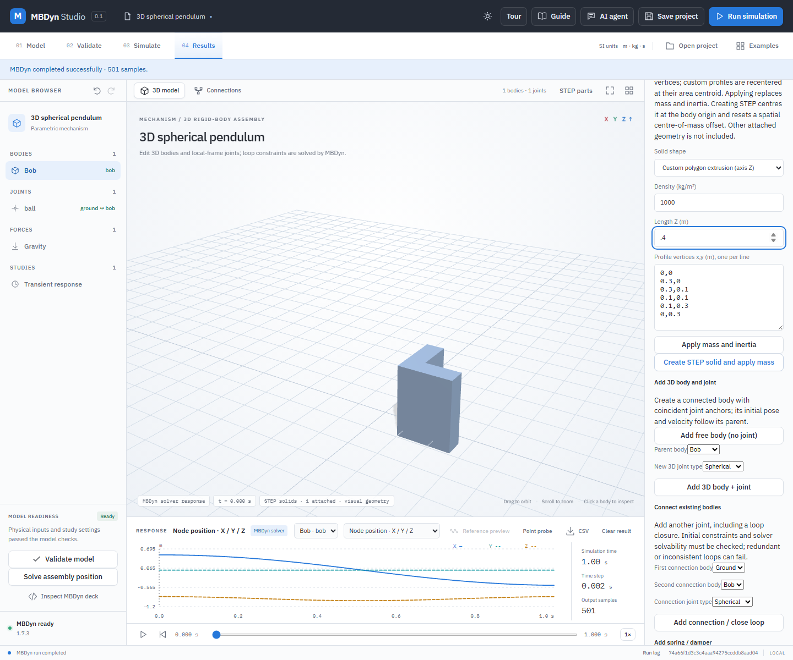

# Custom polygon STEP extrusion

Spatial bodies can be assigned a solid extruded from a simple closed polygon in local XY. Enter one `x,y` vertex per line in metres, in boundary order, without repeating the first point. Both clockwise and counter-clockwise winding are supported, including concave outlines. The profile is recentered at its area centroid, then extruded equally along local ±Z. It has uniform density and its full body-axis inertia includes the signed off-diagonal term.

## Worked example: L-section pendulum

1. Open **Examples → 3D spherical pendulum** and select **Bob**. Expand **Calculate mass and inertia from a uniform solid**.
2. Choose **Custom polygon extrusion (axis Z)**. Set density to `1000 kg/m³` and length to `0.4 m`. Enter these vertices:

   ```text
   0,0
   0.3,0
   0.3,0.1
   0.1,0.1
   0.1,0.3
   0,0.3
   ```

3. Select **Create STEP solid and apply mass**. The area is `0.05 m²`, the mass is `20 kg`, and the signed inertia matrix in body axes is approximately `[[0.411333, 0.072, 0], [0.072, 0.411333, 0], [0, 0, 0.289333]] kg·m²`. The generated STEP is centred at the body origin, resetting an existing spatial centre-of-mass offset. Other attached solids are excluded from these values.
4. Validate and run MBDyn. Save and reopen the project to retain the STEP bytes, binding, physical mass and inertia. Profile control points are not retained as an editable CAD feature; edit and regenerate to change the shape.



The boundary may contain 3–64 vertices, without self-intersections, overlapping edges, repeated points or holes. Dimensions and physical properties must fit the application's bounds. This feature is available on spatial bodies because an arbitrary profile may have nonzero cross inertia; planar bodies do not accept it. STEP geometry does not infer material, real-world strength, contact or certification. Tests compare the generated concave solid's volume, centre and inertia with an independent two-rectangle calculation and OpenCascade measurements.
