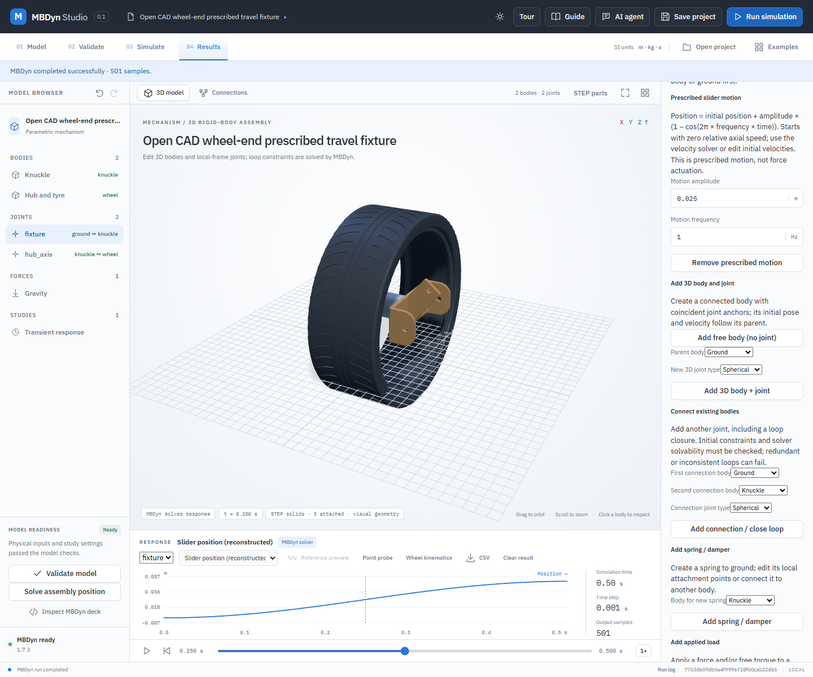

# Prescribed slider motion: wheel-end travel fixture

A spatial prismatic joint can prescribe its relative axial position as
`q(t) = q₀ + A (1 − cos(2π f t))`. Here `q₀` is the **initial signed distance** between the joint anchors along body A's local joint axis; `A` is an entered signed amplitude in metres and `f` is frequency in hertz. The motion starts at `q₀` with **zero relative axial speed**. It reaches `q₀ + 2A` after half a cycle. The solver imposes this movement: the model does not calculate it from an actuator force.

## Worked example

1. Open `examples/prescribed-wheel-bump/wheel-bump.mbdyn-studio`. Its original STEP tire, hub and knuckle come from the [open CAD wheel-end study](open-wheel-end.md), which documents source rights, measured geometry, inferred registration and assumed densities.
2. Select **fixture** in the model tree. This is a ground-to-knuckle **prismatic** joint along world +Z. Its anchors and axis define the guided travel; the **hub_axis** revolute joint connects the hub/tire to the knuckle.
3. In **Prescribed slider motion**, inspect amplitude `0.025 m` and frequency `1 Hz`. The 0.5-second study moves the joint from `0` to `0.05 m`. Change those values to explore another cycle. If authoring from another model, choose a prismatic joint and press **Add prescribed slider motion**; use **Remove prescribed motion** to restore its free sliding coordinate.
4. Validate the model and **Run simulation**. In Results choose **Slider position (reconstructed)** and joint **fixture**; scrub the timeline to see the STEP bodies move and the position history change. Save and reopen the project to retain the motion and CAD bindings.

The fixture constrains wheel travel directly; it is **not a complete suspension, a road surface, a calibrated test rig or a tire/contact model**. The knuckle's connection to control arms is replaced with a linear guide. No force is prescribed. The solver's [joint constraint reaction](joint-reactions.md) can be inspected, but it does not establish actuator capacity. The STEP source does not establish real vehicle hardpoints or certified properties. Do not use this fixture as evidence of vehicle performance or component strength.

## Initial conditions and solver representation

The entered body velocities must satisfy the joint constraints and have zero initial relative axial velocity. For a moving parent this is the derivative of relative anchor separation in the rotating parent frame, including the angular-velocity transport term. Use **Solve assembly position → Velocity** or edit the initial body velocities to repair an inconsistent state. The velocity solver includes the prescribed zero axial speed when solving its initial constraints.

The MBDyn deck replaces the free slider's separate guide and orientation constraint with a `total joint` constraining all translations and rotations. Its local third axis is aligned with the joint axis, and a cosine drive prescribes that coordinate. The opposite endpoint frame is aligned from the initial pose. This avoids imposing a second redundant axial constraint on the same slider. Other joint types do not accept this motion; displacement tables, ramps and revolute prescribed motion remain unimplemented. The constraint reaction is available, not a validated actuator capacity. Redundant closed loops or conflicting constraints may still cause MBDyn to fail; the input validator cannot prove general loop solvability.

Validation rejects non-finite and out-of-range values, inconsistent initial axial speed, and fewer than 20 time steps per cycle. The step rule is a minimum sampling guard, not proof of convergence. A position imposed by the solver does not establish that a motor, hydraulic cylinder, structure or tire can produce the trajectory.

## Verification

`python -B backend/test_prescribed_slider.py` checks validation and velocity repair. With the configured MBDyn 1.7.3 solver, `python -B backend/verify_prescribed_slider.py` compares positive and negative prescribed displacements against their analytical position and velocity, including a moving parent case. In the fixed oblique slider at `A=0.1 m`, position error was below `6.2e-14 m` and the maximum velocity error fell from `8.3e-6 m/s` at `1 ms` to `2.1e-6 m/s` at `0.5 ms`. The separate [reaction checks](joint-reactions.md) test representative loads; hardware accuracy has not been verified.

From the source checkout, `node tests/prescribed-slider-ui.mjs` against the local application checks actual STEP loading, motion authoring, MBDyn execution, result plotting, save/reopen and stale-result handling. Browser tests are included in the source archive, not the local Windows package. Results are documented for these representative models, not every mechanism or solver version.
