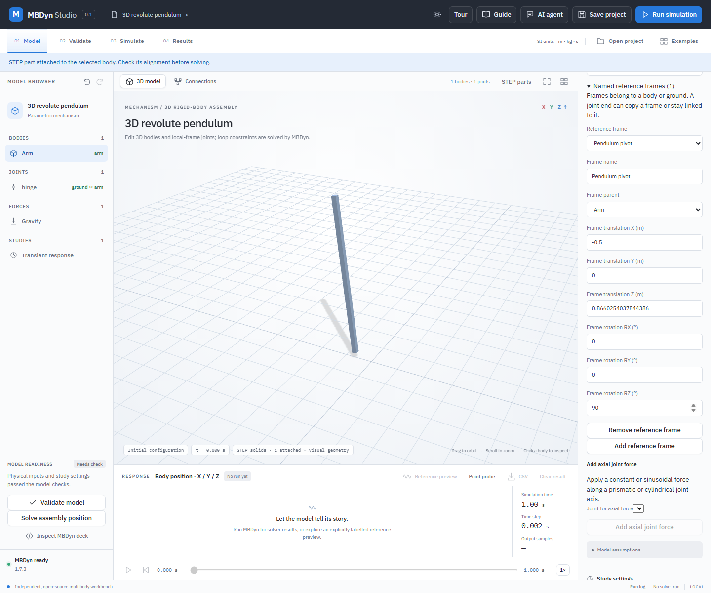
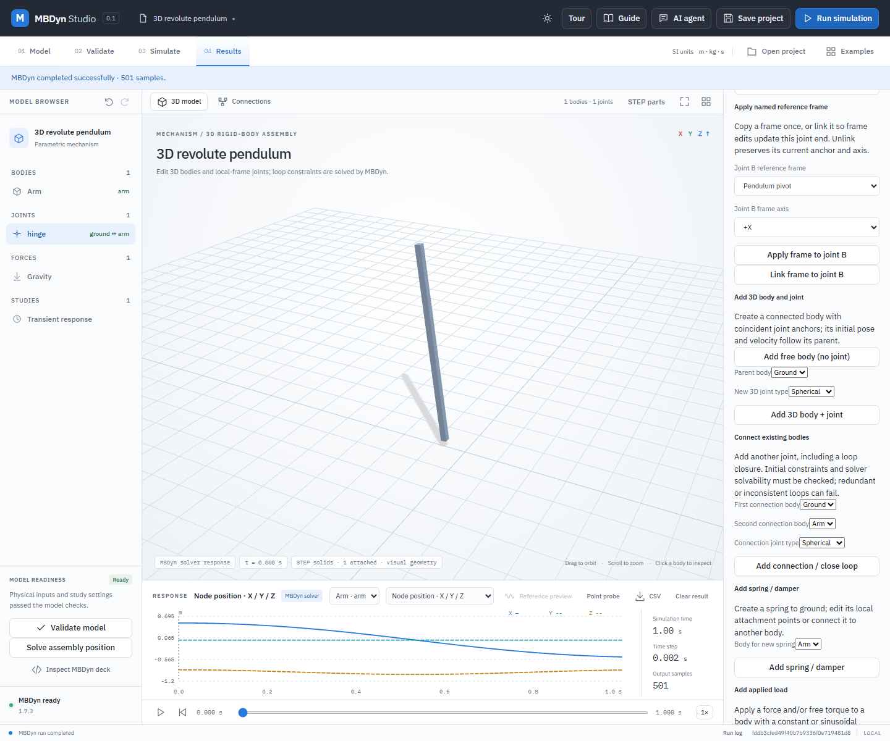
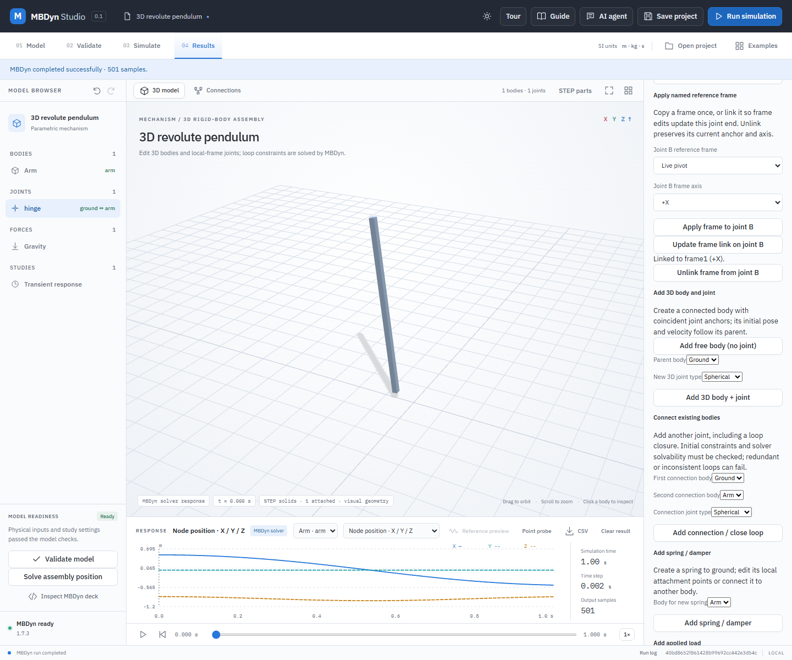

# Named reference frames for spatial joints

A named frame stores a position and orientation relative to one rigid body or ground. Position is in metres in the parent's axes; rotation uses Euler123 angles in degrees (`Rx × Ry × Rz`), also relative to the parent. Ground means world coordinates. The position and orientation are saved in the project, independently of STEP display geometry.

Use a frame to set one end of an existing joint. **Apply frame** makes a one-time copy of the frame origin and selected positive frame axis. **Link frame** keeps the joint end synchronized when the frame changes. Joint validity, coincident anchors, compatible axes and initial velocities must still be checked. Named frames do not infer CAD topology or physical connections from a STEP part.

## Worked example: mark a pendulum pivot

1. Open **Examples → 3D revolute pendulum**. Optionally import `examples/step-pendulum/pendulum.step` and attach it to **Arm** in **STEP geometry**.
2. In the properties panel, expand **Named reference frames** and choose **Add reference frame**. The default parent is **Arm**. Rename it `Pendulum pivot`.
3. Set translation X to `-0.5 m`, Y to `0 m`, Z to `0.8660254037844386 m`; set rotation RZ to `90°` and RX and RY to zero. The frame's positive X axis then points along positive Y in Arm's axes.

   

4. Select the **hinge** joint in the model tree. Under **Apply named reference frame**, choose `Pendulum pivot` for **Joint B** and choose **+X** as its frame axis. Select **Apply frame to joint B**. The B anchor now uses the frame's translation, and its B axis points along the body's positive Y. Ground's A anchor and axis stay unchanged.
5. Choose **Validate model**, then **Run simulation**. With the attached STEP part, the real solver animates it around the hinge. Save and reopen the project to retain the frame, copied joint values, STEP attachment and result.

These dimensions describe the included illustrative pendulum. The screenshot is the running application with an MBDyn result; it does not validate a physical mechanism or establish industrial qualification.

## Worked example: link the pivot frame to a joint

1. Set up `Pendulum pivot` on Arm as above, and optionally attach the STEP pendulum. Select **hinge**, then select the frame and **+X** for **Joint B**.
2. Choose **Link frame to joint B**. The joint's B anchor and axis become read-only and follow the named frame. Validate and run MBDyn; the screenshot shows this state.
3. Expand **Named reference frames** and change translation X from `-0.5` to `-0.4 m`. The linked B anchor changes immediately and an earlier result becomes stale. This particular edit makes the initial joint anchors inconsistent, so change it back to `-0.5 m` before validating and running again.
4. The project saves the link and its current joint values. A linked frame cannot be deleted or reparented, and the linked joint cannot be deleted, until the link is removed. Choose **Unlink frame from joint B** to preserve the current joint anchor and axis as an ordinary editable snapshot.

## Validation and lifecycle

The optional spatial-model `frames` array holds up to 64 entries: `id`, `name`, `body`, `translation` (`x`, `y`, `z`) and `rotation` (`rx`, `ry`, `rz`). IDs are unique letter-leading identifiers up to 32 characters. A parent must name an existing body or `ground`. Components are finite and bounded to ±1000 m and ±360°. Existing projects without `frames` remain valid. A body with a frame cannot be removed until that frame is removed or reassigned.

The optional `frameLinks` array stores up to 64 `{joint, side, frame, axis}` references. Side is `a` or `b`; axis is `x`, `y` or `z`. Each joint end has at most one link, whose frame must belong to that end's body. Joint anchor and axis fields are synchronized physical snapshots; validation rejects dangling, mismatched or stale links. Only those physical fields enter the MBDyn deck and kinematic constraints; link metadata does not add constraints or change inertia. A prismatic joint has an axis only on side A; spherical and weld joints use only the linked anchor. Universal-joint A and B axes must remain perpendicular. All joint types require the normal model checks, and redundant closed loops can still fail in the solver. The AI assistant can edit an already linked frame and update its linked joint, but cannot create or remove links; direct AI edits to linked joint-end fields are rejected.

Run `python -B -m unittest discover -s backend -p test_reference_frames.py -v`, `node --test tests/frame-editor.test.mjs`, and `node tests/reference-frames-ui.mjs` and `node tests/live-frame-ui.mjs` against an isolated configured local server for snapshot and live-link transformation, validation, STEP/MBDyn, stale-state and project round-trip coverage.
