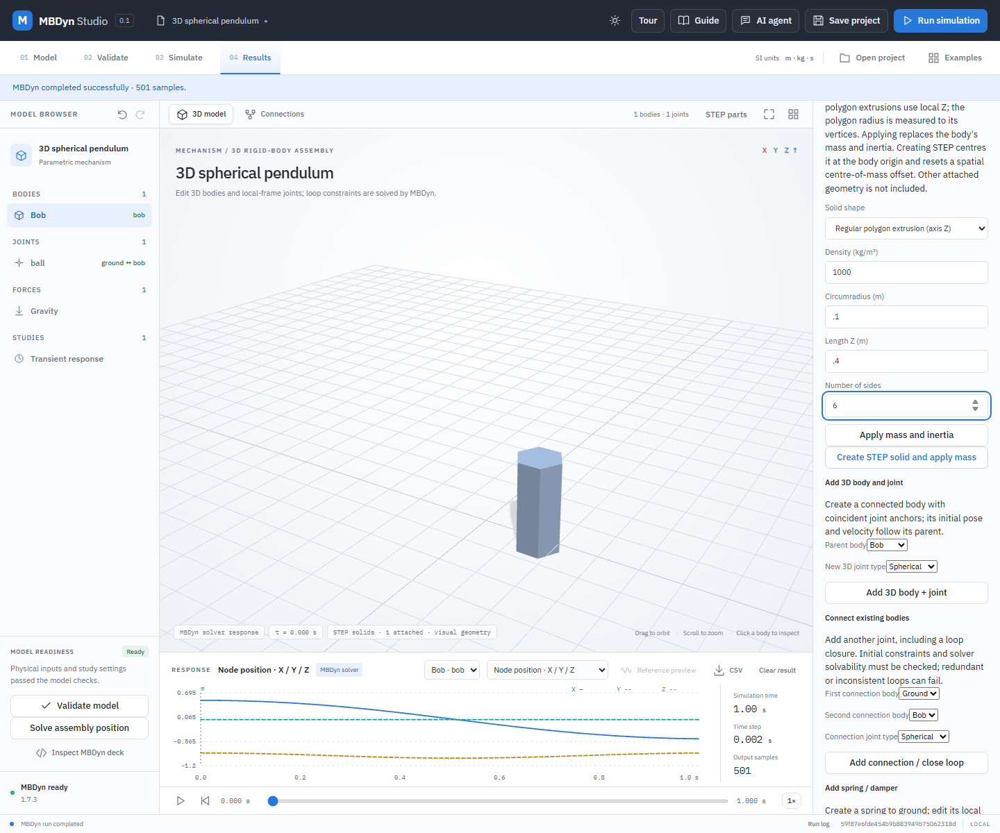

# Regular polygon STEP extrusion

Create a uniform regular polygon prism with a real STEP solid and matching rigid-body mass and inertia. The regular polygon lies in body-local XY; its first vertex is on +X, its radius is measured from the centre to a vertex, and the prism extends equally in +Z and -Z. Density is uniform. The number of sides must be an integer from 3 through 64.

## Worked example: hexagonal pendulum body

1. Open **Examples → 3D spherical pendulum**. Select **Bob**, then expand **Calculate mass and inertia from a uniform solid**.
2. Choose **Regular polygon extrusion (axis Z)**. Enter density `1000 kg/m³`, circumradius `0.1 m`, length `0.4 m`, and `6` sides.
3. Select **Create STEP solid and apply mass**. The application creates and attaches a STEP solid at the body origin. It replaces Bob's mass and inertia and resets a spatial centre-of-mass offset to zero. Existing attached parts are not included in these physical properties.
4. The mass is approximately `10.3923 kg`. Validate and run MBDyn, then save and reopen the project. The original generated STEP bytes and body binding are stored in the project.

For `n` sides, circumradius `r`, length `L` and density `ρ`, the cross-sectional area is `n r² sin(2π/n)/2`. The principal moments about the centre are `Izz = m r² (2 + cos(2π/n))/6` and `Ixx = Iyy = Izz/2 + m L²/12`. Independent STEP round-trip tests compare volume and inertia with OpenCascade, including a rotated hexagonal prism. The application uses these analytic formulas; it does not infer material, union overlaps or validate manufacturing constraints.

The prism is a single regular polygon extrusion, not an arbitrary sketched extrusion, hollow section, CAD feature tree or an industrial design certification.
