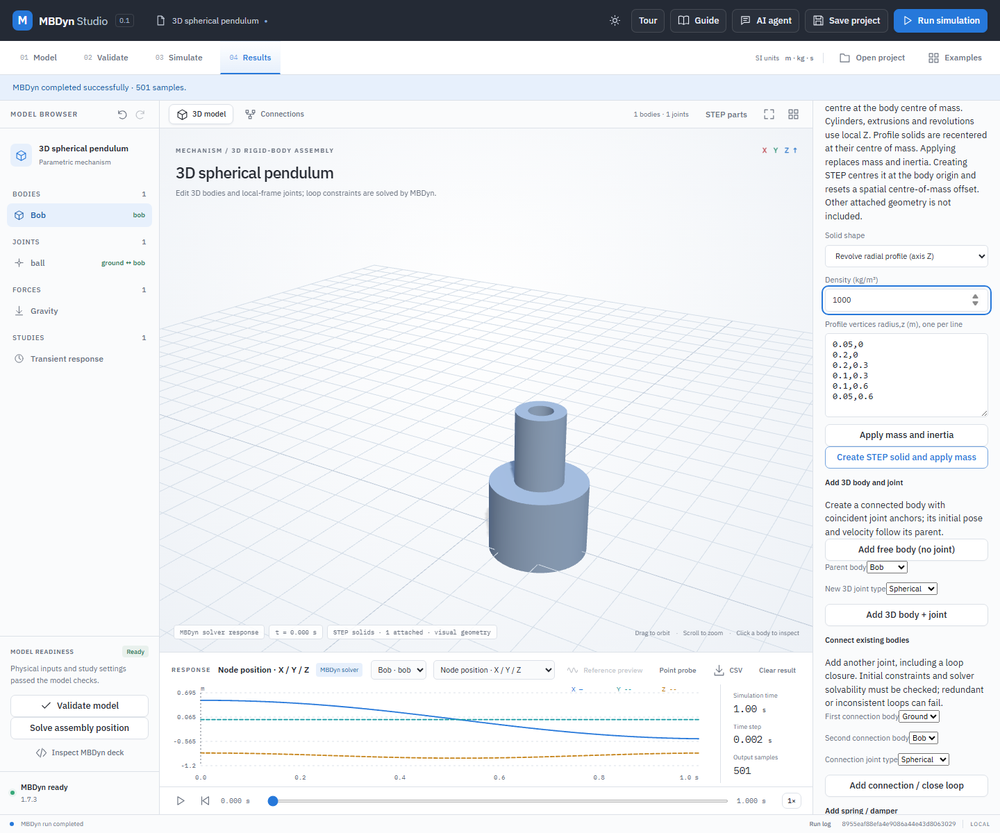

# Revolve a radial profile into a STEP solid

A body of revolution is made by turning one simple closed radial/axial polygon through 360° around body-local Z. Enter `radius,z` in metres, one boundary vertex per line without repeating the first. Radius must be nonnegative. Both winding directions are supported; the polygon may meet the axis in one continuous boundary section. The generated uniform-density solid is centred at its volume-weighted centre of mass on the body origin. Its moment of inertia is calculated about that centre in body axes.

## Worked example: stepped hollow sleeve

1. Open **Examples → 3D spherical pendulum** and select **Bob**. Expand **Calculate mass and inertia from a uniform solid**.
2. Choose **Revolve radial profile (axis Z)** and enter density `1000 kg/m³`. Enter the profile below. The first coordinate is radius, not X position in the world:

   ```text
   0.05,0
   0.2,0
   0.2,0.3
   0.1,0.3
   0.1,0.6
   0.05,0.6
   ```

3. Select **Create STEP solid and apply mass**. This creates a stepped hollow sleeve of approximately `42.4115 kg`, centred on Bob's origin. Existing attached solids are excluded from the calculated mass and inertia. Creating a STEP solid resets any spatial centre-of-mass offset to zero.
4. Validate and run MBDyn, then save and reopen the project. The STEP source and binding persist; the profile itself is not retained as an editable CAD feature.



The profile has 3–64 vertices and must not self-intersect or contain holes in the profile plane. Its revolution can have an axial hole as in this example. The app integrates the solid's volume, centroid and moments from the radial profile; tests compare actual STEP mass properties with independent hollow-cylinder and two-tube formulas, including a rotated body. It does not infer material, contact or strength, and the example is not a certified engineering component.
