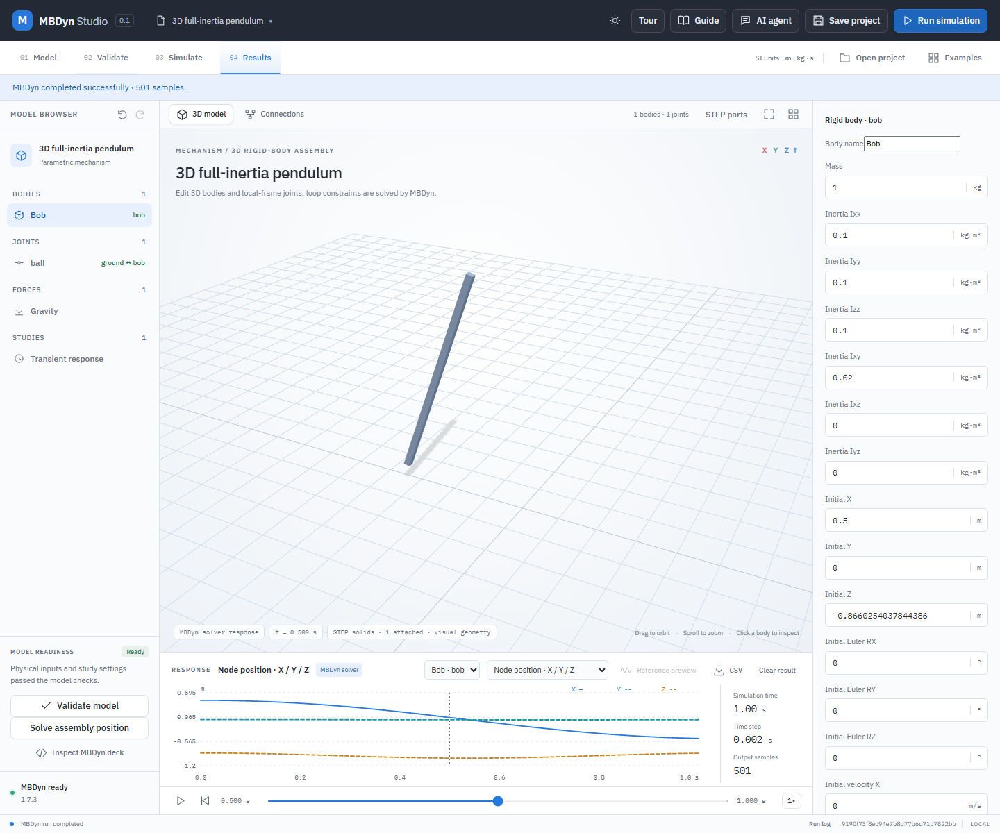

# Spatial rigid-body assembly

The spatial assembly exporter writes an MBDyn 1.7.3 input deck with dynamic six-degree-of-freedom structural nodes, rigid bodies, uniform gravity and spherical, revolute, prismatic, cylindrical, universal or weld constraints. It accepts free bodies, disconnected groups and grounded bodies; a graph may contain closed loops. A loop must have consistent independent constraints. Geometrically redundant, singular or otherwise unsolvable assemblies can still fail in MBDyn; read the solver log rather than treating the graph check as proof of solvability. This is a rigid-body dynamics capability with optional ideal sphere-plane contact; it is not flexible-body or industrial validation.

The syntax follows the [MBDyn 1.7.3 input manual](https://www.mbdyn.com/userfiles/documents/mbdyn-input-1.7.3.pdf); the MBDyn [FAQ](https://www.mbdyn.org/Documentation/FAQ.html) describes using a total joint to constrain six relative degrees of freedom.

## Model and units

A model has kind `spatial-assembly`, a name, `parameters.gravity` as a world vector in m/s², `simulation.duration` and `step` in seconds, `bodies`, and `joints`. Every body has an identifier, name, mass in kg, `inertia` with diagonal entries `xx`, `yy`, `zz` and optional cross entries `xy`, `xz`, `yz`, `pose` and `velocity`. An optional body-local `centerOfMass` offset identifies the centre of mass relative to the body origin; omitted means zero. Inertia is the symmetric 3×3 matrix about the centre of mass in the body-local axes, in kg·m²; omitted cross entries are zero. Cross entries are the signed matrix elements themselves, not engineering products of inertia with an implicit sign reversal. The app checks positive definiteness and that the corresponding second-moment matrix is positive semidefinite, which enforces physically realizable principal moments. Existing diagonal-only projects retain their original representation. Pose contains world `x`, `y`, `z` in metres and `rx`, `ry`, `rz` in degrees. The orientation matrix is `Rx(rx) * Ry(ry) * Rz(rz)` (Euler123). Velocity contains world `vx`, `vy`, `vz` of the body origin in m/s and world `wx`, `wy`, `wz` in rad/s. The centre-of-mass velocity equals node velocity plus angular velocity crossed with the rotated local offset. The initial orientation need not be zero.

Each joint names distinct endpoints `a` and `b`; `a` may be `ground`, `b` must be a body. `anchorA` and `anchorB` are the same physical point expressed in each endpoint's local frame (ground is the world frame). A revolute joint additionally has local unit vectors `axisA` and `axisB` that coincide in world coordinates at the initial pose and point in the same direction. A prismatic joint supplies only `axisA`, a unit direction in body A’s frame (world coordinates for ground). The B anchor may have any initial offset along that axis, and its relative velocity may have a component along the axis; transverse position and velocity must agree. Its initial body-relative orientation is the orientation reference, held constant while B slides. Position and velocity plots report the signed B-minus-A displacement and speed projected onto the moving axis. Perpendicular position and velocity residuals and the change from the initial relative orientation are reconstructed from native results.

A cylindrical joint supplies `axisA` and `axisB`, local unit axes that must initially align in the world frame and point the same way. Its anchors may be displaced along the common axis and move relative to each other along that axis. Their angular velocity may differ along the axis: spin and translation are independent. The initial relative orientation defines zero spin. The app reconstructs an unwrapped signed spin angle and rate from the actual body orientations and angular velocities; the sampled spin rate must not exceed 0.1 rad per integration step. Perpendicular anchor/axis residuals are reconstructed separately. MBDyn's total joint enforces the four transverse constraints. The editor and CSV report signed position, velocity, angle and angular velocity. Cylindrical joints also accept rotational springs and joint-torque actuators about their shared axis.

A universal joint uses `axisA` and `axisB` as unit vectors in the corresponding body-local frames (world for ground). They must initially be perpendicular in the world frame; the anchors must coincide and have matching velocity. The allowable relative angular velocity has no component normal to the plane of these two axes. MBDyn 1.7.3 implements this through its `cardano hinge`: the A axis is constrained to remain perpendicular to the B axis while each axis rotates with its own body. The reconstructed angular error is the departure from 90 degrees in radians, and the angular velocity error is the magnitude of its time derivative in rad/s. This is a universal joint, not a constant-velocity joint, and no pair of joint angle coordinates is reported.

A spherical joint has three rotational degrees of freedom. A weld fixes relative position and orientation; this implementation requires equal initial body orientations and matching angular velocity, as well as coincident anchors. Anchor positions and velocities must initially coincide. The exporter does not perform geometric constraint assembly to repair inconsistent input.

The solver writes raw Euler123 angles, which are kept in each result node without branch normalization, and a row-major 3-by-3 `rotationMatrix` derived from them. Reconstructed joint residuals include position in metres, velocity in m/s, angular direction in radians, and angular velocity in rad/s. The revolute angular residual is the angle between the two unit axes, computed with atan2. Weld angular residual uses the matrix relative rotation angle. Numerical tolerances depend on integration and are not evidence of design correctness. Each run retains its input deck, project, native output and solver diagnostics; the CSV provides motion and maximum reconstructed residuals per sample.

Creating a centered STEP primitive and applying its mass resets the spatial body-local centre-of-mass offset to zero because the generated solid is centered on the body origin; undo restores the previous offset. Calculating mass alone from manually supplied uniform-solid dimensions preserves the existing COM, assuming that solid is centered there.

STEP geometry is used as visual geometry bound to body poses by the STEP integration. The solver uses the supplied mass, inertia, frames and joints, not automatically inferred STEP geometry or collisions; source geometry alone does not establish physical accuracy.

## Worked example: a body with non-diagonal inertia

1. Open **Examples → 3D full-inertia pendulum** and select the body **bob**. Its diagonal inertia entries start at 0.1 kg·m², and its Ixy entry starts at 0.02 kg·m².
2. In **Properties**, enter `0.11` in **Inertia Ixy** and select **Validate model**. The matrix is not positive definite, so the issue panel explains why it cannot run.
3. Replace **Inertia Ixy** with `0.02` kg·m² and validate again. The resulting body-frame matrix is `[[0.1, 0.02, 0], [0.02, 0.1, 0], [0, 0, 0.1]]`; its principal moments are 0.08, 0.12 and 0.1 kg·m².
4. To visualize a STEP part, open **STEP geometry**, import `examples/step-pendulum/pendulum.step`, attach its part to **bob**, and close the dialog. This is only a visual attachment; the supplied STEP part is not a verified mass model of bob.
5. Select **Run simulation**. Scrub the timeline to see the attached part follow the MBDyn body, then save the project. The saved physical model retains the off-diagonal tensor independently of the STEP geometry.



The screenshot is from the actual Kinemeld browser interface and a real MBDyn run. It illustrates input and animation, not validation of a real vehicle or mechanism.

## Closed-loop axle example

Choose **3D closed-loop axle** in the example library to open a two-body, three-joint assembly. A revolute joint connects the arm to ground; spherical joints connect the arm to an oblique axle and the axle back to ground. The axle starts spinning about its own axis at 1 rad/s, with no gravity. Its center and the arm remain stationary while the axle rotates. This is a deliberately simple constraint demonstration with synthetic geometry and isotropic inertias, not an industry axle or suspension model. A real MBDyn 1.7.3 run was checked against Rodrigues’ rotation formula and joint closure; that verification does not establish arbitrary loop solvability.

## Translational spring-dampers

An optional `forces` array describes axial spring-dampers joining ground and a body, or two distinct bodies. Each element has an `id`, type `linear-spring-damper`, endpoints `a` and `b`, 3D `anchorA` and `anchorB`, stiffness in N/m, damping in N·s/m, and `restLength` in metres. Body anchors are local coordinates and ground anchors are world coordinates. The example **3D oblique spring-slider** shows a ground connection.

Positive tension is `stiffness * (length - restLength) + damping * lengthRate`; MBDyn applies equal and opposite forces at the attachment points, including their moments about each body’s center of mass. Length rate uses the world velocity of both attachment points including angular velocity. `forces` result channels and CSV columns reconstruct these quantities from native body poses and velocities. Elastic energy and damping dissipation include both translational and rotational elements; dissipation is numerically integrated.

The endpoints must start at least 1e-6 m apart; a computed length below 1e-9 m rejects the result because its force direction is undefined. A conservative time-step bound uses the endpoint masses, offsets and inertias, but users must still check convergence. Rod elements skip MBDyn’s initial joint assembly to retain the authored spring preload; joint initial states must therefore already be consistent. Springs do not add collision or contact geometry.

## Applied force and torque

The optional `loads` array applies a force and/or free torque to a dynamic body. Each load has `id`, `body`, `frame` (`global` or `body`), a body-local application `point` in metres, `force` in N, `torque` in N·m, and dimensionless `offset` and `amplitude` with `frequencyHz` in Hz. The vectors are multiplied by `offset + amplitude * sin(2*pi*frequencyHz*time)`. Set amplitude to zero for a constant load. A nonzero sinusoid requires at least 20 integration steps per cycle.

For `global`, the vector directions stay fixed in world coordinates. For `body`, they follow the body orientation. The force acts at the given body-local point, producing the moment `r × F` about the body’s center of mass; the free torque adds to it. Reconstructed result `loadStates` reports world force, free torque, total moment about the center of mass, and power. `loadPower` and `appliedWork` aggregate power and its trapezoidal time integral, and CSV exports the same channels. These are applied efforts, not prescribed motion, reactions or contact forces. Units are SI; the scale is dimensionless.

## Rotational springs, dampers and drives

`rotationalElements` and `jointTorques` are optional arrays, so existing assemblies remain valid. Each item references an existing revolute or cylindrical joint by its `joint` identifier. For a cylindrical joint, the rotational element acts about the joint axis while axial sliding remains free. For example:

```json
"rotationalElements": [{ "id": "spring", "joint": "hinge", "stiffness": 1.0, "damping": 0.1, "restAngleDeg": 20.0 }],
"jointTorques": [{ "id": "drive", "joint": "hinge", "amplitude": 1.0, "frequencyHz": 1.0, "offset": 0.0 }]
```

The initial authored joint orientation defines zero relative angle, regardless of the bodies' absolute initial orientations. `restAngleDeg` is the desired relative angle from that reference. Positive angles rotate body B around body A's positive joint axis by the right-hand rule. The resulting spring-damper torque on B is `-stiffness * (angle - restAngle) - damping * angularVelocity`; stiffness is N·m/rad, damping N·m·s/rad, and angular velocity rad/s. The elastic strain shown as `rotationalStates[].angle` is `angle - restAngle` in radians, so a 20-degree rest angle begins with strain −20 degrees. The reference is reconstructed from the initial body frames and remains meaningful when the joint axis moves in world space.

A drive applies `offset + amplitude * sin(2*pi*frequencyHz*time)` N·m in the positive axis direction to B. For a body-to-body joint, its equal and opposite counterpart follows A's local axis; for a ground joint the reaction goes to ground. The spring likewise exchanges internal moments. These are torque inputs, not prescribed angle or velocity motion. The exporter uses MBDyn's follower couples and deformable hinge. `rotationalStates` and `actuationStates` are reconstructed from the MBDyn poses, angular velocities, and input function; work and damping dissipation use trapezoidal time integration and are available in samples and CSV.

The implementation rejects undefined joint references, duplicate IDs, zero spring and damping, excessive time steps based on a conservative inertia estimate, and drives with fewer than 20 time steps per cycle. It rejects spring trajectories that cross or cannot resolve the ±π strain branch; multi-turn springs and preloads exceeding that branch are not supported. These guards do not replace a time-step convergence study.

## Verification

Run `python -m unittest discover -s backend -p test_spatial_assembly.py -v` for input and transformation checks. Run `python backend/verify_spatial_assembly.py` with the configured MBDyn 1.7.3 solver for native checks and a machine-readable `verification/spatial-assembly.json` report, generated locally and not included in the public checkout. The verifier solves a spherical and revolute pendulum, a welded body, a spherical pendulum with out-of-plane motion, a two-body three-joint closed-loop axle, an oblique prismatic slider and a moving-axis prismatic carrier, simultaneous cylindrical sliding and spin on oblique fixed and moving axes, and cylindrical motion beyond π against analytic or independent RK4 solutions, a slider combined with revolute spring and torque, a cylindrical slider with rotational spring and sinusoidal torque checked against RK4, a 3D translational spring-slider, equal-and-opposite body forces, an offset spring moment, global off-center force and a sinusoidal body-following force and torque against independent trajectories and work, a freely rotating, non-diagonal inertia tensor on a nonidentity body frame compared against independent rigid-body integration and angular-momentum conservation, a revolute body with nonzero initial orientation, a tilted spring-damper and sinusoidal torque against independent analytic solutions, and a moving-axis internal torque case checked against conservation of angular momentum, a two-axis universal joint against an analytic orientation and a universal joint on a moving, differently oriented carrier against Rodrigues’ formula. It compares the revolute motion to an independent RK4 solution and the loop axle orientation to Rodrigues' formula. It checks residuals and exits nonzero on those check failures. These tests cover representative assemblies only; they do not establish all possible closed loops or real hardware behavior.
