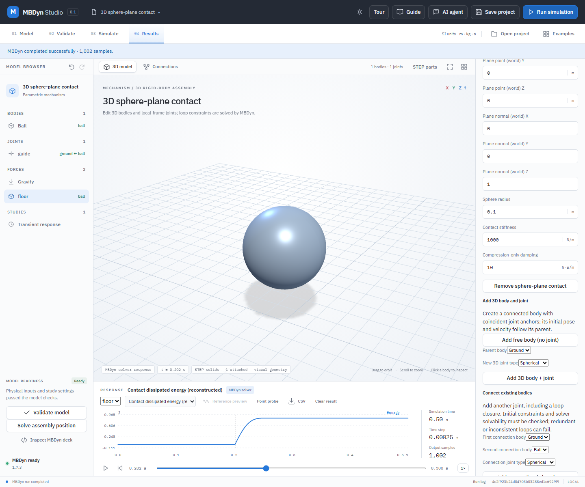

# Compression-only sphere-plane damping

Spatial sphere-plane contact supports an optional nonnegative damping coefficient in N·s/m. The default is zero and existing saved models retain their previous elastic law. With signed gap `g` and normal velocity `v`, the modeled force magnitude is zero for `g ≥ 0`; when `g < 0` it is `k × (−g) + c × max(0, −v)`. The normal points into the permitted half-space. The damper acts only while the sphere penetrates and approaches the plane. During release the force is elastic; it never pulls the body toward the plane.

This is a compression-only penalty model, not symmetric Kelvin–Voigt damping or a measured coefficient of restitution. Its damping term turns on discontinuously at impact when approach speed is nonzero. Contact and dissipation values depend on integration step and impact timing; perform a step-convergence study and calibrate parameters for the intended physical system. The sphere and plane are specified ideal geometry, not automatic STEP-surface collision. No friction or moving plane is modeled.

## Worked example: damp a guided STEP sphere

1. Open **Examples → 3D sphere-plane contact**. Select **Ball** and create a **Sphere** STEP solid of radius `0.1 m` and density `238.732414637843 kg/m³` using **Calculate mass and inertia from a uniform solid**. This gives approximately `1 kg`; the STEP solid is only the display geometry.
2. Select **floor** in the model tree. Set **Compression-only damping** to `10 N·s/m`; retain the contact radius `0.1 m`, stiffness `1000 N/m` and upward plane normal. In **Study settings**, set the time step to `0.00025 s`.
3. Validate and run. The force plot is nonnegative; choose **Contact dissipated energy (reconstructed)** to inspect the accumulated energy dissipated during compression. A tested reference run dissipates approximately `0.854 J` by `0.5 s`. These are reconstructed values from the simulated samples, not measured material properties.
4. Export CSV to see `contact:floor:dampingPower_W` and `contact:floor:dissipatedEnergy_J`, as well as gap, penetration, force, power and elastic energy. Save and reopen the project; editing damping marks the prior result stale.

`python -B backend/verify_spatial_contact_damping.py` compares real MBDyn trajectories and energy with independent RK4 references for vertical, oblique, multiple-contact and initially penetrating configurations, plus zero damping. Two additional free-body cases start in penetration with ±10 m/s normal speed: at the initial frame the approaching case has 120 N force and 1000 W damping power, while the separating case has 20 N force and zero damping power. At `0.00025 s` the sampled native contact forces agreed with reconstructed values within `1.0e-10 N`, and the largest position discrepancy in these examples was approximately `0.00034 m`. At the coarser `0.001 s` step, the two-contact example differed by approximately `0.0026 m`; the conservative timestep guard is not an accuracy guarantee. Trapezoidal integration of damping power is sampled and especially sensitive to the discontinuity at first contact.

The MBDyn 1.7.3 deck uses the existing elastic contact plus a compression-only nonlinear viscous law gated by a separate zero-force gap sensor. A zero elastic function keeps the installed 1.7.3 viscoelastic path active; the purely viscous nonlinear scalar-function path in that version does not apply its nonlinear component. This verified compatibility workaround does not change the contact stiffness or add a constraint. The workaround and idealized law require additional qualification for other solver versions and mechanisms.
