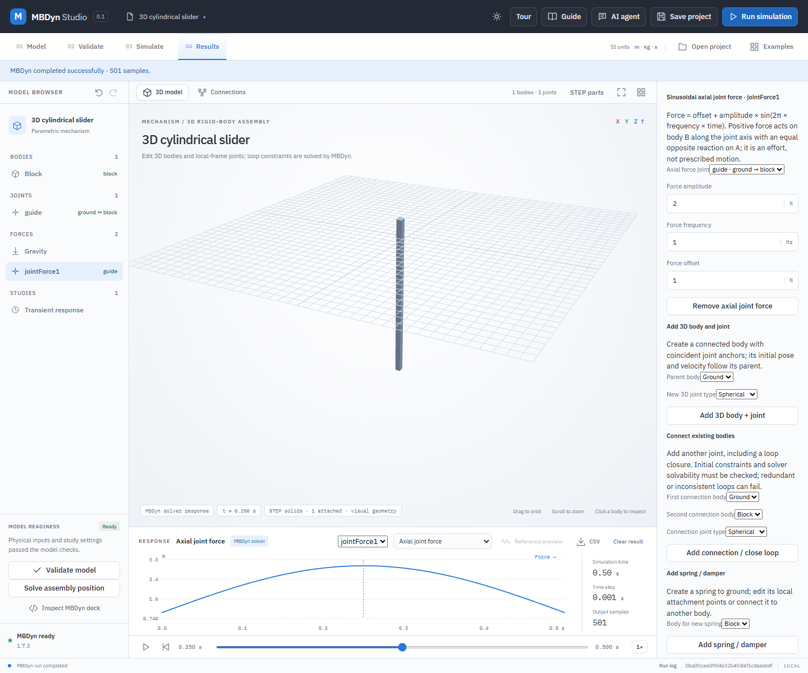

# Axial joint forces

A spatial prismatic or cylindrical joint can carry an optional time-varying **effort** along its axis. Positive force acts on body B in the direction of joint axis A; an equal and opposite reaction acts on body A, or ground. The magnitude is `offset + amplitude × sin(2π × frequency × time)` in newtons. A constant force uses zero amplitude. This is a force input: the simulation calculates motion, it does not prescribe a position, speed or acceleration.

## Worked example: push a cylindrical slider

1. Open **Examples → 3D cylindrical slider**. In **Properties**, set **Gravity X** and **Gravity Y** to zero.
2. Scroll to **Add axial joint force**, choose joint **guide**, and select **Add axial joint force**. Set **Force offset** to `1 N`, **Force amplitude** to `2 N`, and **Force frequency** to `1 Hz`.
3. Open **STEP geometry**, import `examples/step-pendulum/pendulum.step`, attach it to **block**, and close the dialog. This STEP part is an illustrative visual attachment; it does not define the actuator, inertia or contact.
4. Select **Validate model**, then **Run simulation**. Choose **Axial joint force** in the results list and move the time slider to `0.25 s`. The plotted force is `3 N`. **Axial joint force power** and **Axial joint force work (reconstructed)** provide the corresponding power and cumulative work.
5. Export **CSV** to inspect `jointForce:jointForce1:force_N`, `jointForce:jointForce1:power_W`, `jointForcePower_W` and `jointForceWork_J`. Save and reopen the project to retain the model, STEP attachment and result.

The screenshot shows the real application and a real MBDyn 1.7.3 run of this illustrative model. It is not validation of an industrial actuator or hardware.

## Model, frames and checks

`jointForces` is an optional array of objects with `id`, `joint`, `offset`, `amplitude`, and `frequencyHz`. IDs must be unique within the array and `joint` must refer to a spatial prismatic or cylindrical joint. Existing projects without this field remain valid. Offset and amplitude are bounded to ±1e9 N; frequency must be between 0.001 and 1000 Hz. Nonzero sinusoidal amplitude requires at least 20 integration steps per cycle; this rule is not a substitute for a convergence study.

The MBDyn deck uses one **follower internal** force per actuator, applied at the two body-local joint anchors. Its child-frame direction stays along the constrained axis as the mechanism moves. The clamp supplies the reaction when body A is ground. For a prismatic joint the child-frame direction is derived from the initial body orientations; for a cylindrical joint it is the entered child axis. Work is reconstructed from the force function and the relative velocities of the application points, then integrated with the trapezoidal rule; results are not measured actuator forces.

The position and velocity of each joint and all initial constraints still require validation. Incompatible, redundant, or singular loops may fail in MBDyn. The included tests compare an oblique fixed slider and cylindrical slider against analytic sinusoidal-force motion, and a rotating parent slider against independent integration, energy and angular-momentum conservation. A separate slider test combines an offset centre of mass, non-diagonal inertia and initial velocities from the kinematics solver with axial force; its motion and work are checked against analytic translation. They cover representative systems, not all industrial mechanisms.

Run `python -B -m unittest discover -s backend -p test_spatial_joint_forces.py -v` for validation checks. With configured MBDyn 1.7.3, run `python -B backend/verify_spatial_joint_forces.py` for the solver-backed checks and `MBDYN_STUDIO_URL=http://127.0.0.1:8766 node tests/spatial-joint-force-ui.mjs` against the local app (in PowerShell, set `$env:MBDYN_STUDIO_URL` first) for the guided UI, STEP, export and save/reopen workflow.
