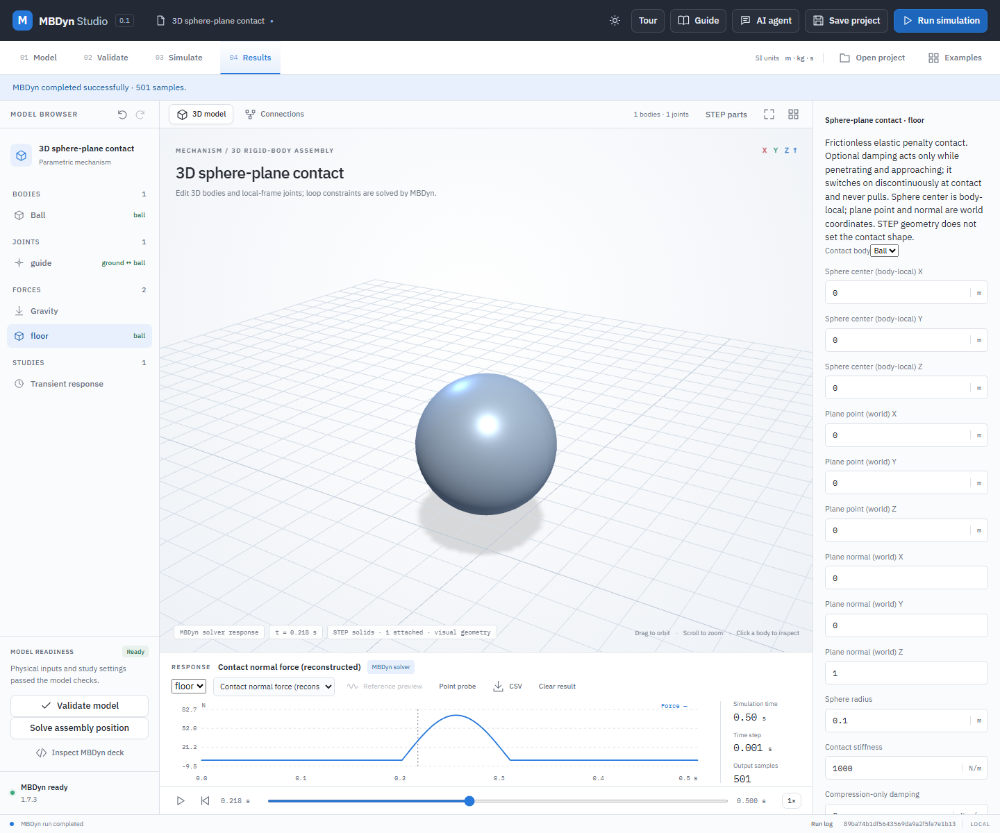

# Frictionless sphere-plane contact

Spatial assemblies can apply a linear elastic, unilateral normal force between a specified sphere and a fixed infinite plane. The sphere center is an explicit body-local point; its radius is an explicit scalar. The plane point and unit normal are world coordinates, and the normal points into the allowed half-space. The clearance is `gap = dot(normal, sphereCenterWorld - planePoint) - radius`. The force magnitude is `stiffness * max(0, -gap)`, directed along the normal. There is no tensile force, friction, moving plane, or general collision detection. Optional compression-only damping is described in the [damping guide](spatial-contact-damping.md). A linear penalty permits finite penetration and is not a rigid impact model.

The contact sphere is a physical idealization: it is not derived automatically from the STEP surface. The normal force is applied at the sphere center; for a frictionless sphere-plane contact this produces the same moment as applying the normal force at the surface because the radius vector is parallel to the force. Different geometry requires a different verified contact law.

## Worked example: a guided sphere rebounds

1. Open **Examples → 3D sphere-plane contact**. The example has a 1 kg body on a vertical prismatic guide, a sphere radius of 0.1 m, plane at world Z = 0, normal +Z, stiffness 1000 N/m, and gravity −9.81 m/s². It begins with 0.2 m clearance. The guide constrains the sphere to vertical motion; it is not a free six-degree-of-freedom drop.
2. Select **Ball**, expand **Calculate mass and inertia from a uniform solid**, choose **Sphere**, enter radius `0.1` m and density `238.732414637843` kg/m³, then select **Create STEP solid and apply mass**. This creates and attaches an actual STEP sphere with approximately 1 kg mass and inertia 0.004 kg·m². The STEP solid is for viewing; the separate contact radius remains the physical input.
3. Select **floor** in the model tree. Inspect the sphere center, plane point, normal, radius and stiffness. To add a contact to another spatial model, choose a body in **Add sphere-plane contact**, select **Add sphere-plane contact**, and enter these values explicitly.
4. Validate and run. Choose **Contact normal force (reconstructed)** in the response list, scrub the timeline and observe a zero force before impact, a positive pulse during penetration, and zero force after release. The example peaks near 73 N at this step size. Select **Contact gap / penetration** to inspect the penalty deformation.
5. Export CSV for `contact:floor:gap_m`, `penetration_m`, `force_N`, `power_W` and `energy_J`; these values are reconstructed from solver body motion and the specified contact law. Save and reopen the project to retain the STEP solid, contact and recorded result. Editing a contact makes that result stale.

## Validation and solver boundary

The MBDyn 1.7.3 deck uses one deformable-displacement joint and one scalar piecewise-linear elastic law per contact. At contact the normal component is compressive; on separation it vanishes. Contact joints are not rigid constraints. A conservative timestep check sums contact stiffness and damping contributions for each body using its mass, inertia and contact-center lever arms; it does not replace a timestep convergence study. Overly stiff contact, redundant joints or poor initial conditions can prevent convergence. Spatial bodies may also be free-floating; the contact is still an ideal sphere against a fixed plane.

`python -B -m unittest discover -s backend -p test_spatial_sphere_contact.py -v` exercises invalid geometry, missing references, duplicate IDs and timestep checks. `python -B backend/verify_spatial_sphere_contact.py` runs installed MBDyn against independent RK4 trajectories, checks energy, native joint force and CSV output for vertical, rotated-offset, two-contact and stiff four-contact guided cases. A separate rotating pendulum check compares reconstructed forces with the native joint output. For the four-contact case the allowed 0.0005 s step had roughly 0.030 m/s maximum velocity error against the independent reference, while 0.00025 s reduced it to about 0.008 m/s; the guard alone is not an accuracy guarantee. `node tests/spatial-sphere-contact-ui.mjs` uses an isolated local server for the real application, generated STEP, MBDyn, plot, CSV, save/reopen and stale-result workflow.

These representative tests establish the implemented force law and workflow only. They do not establish engineering, production or safety certification; choose contact parameters from a validated physical model and check mesh, geometry and convergence independently.
