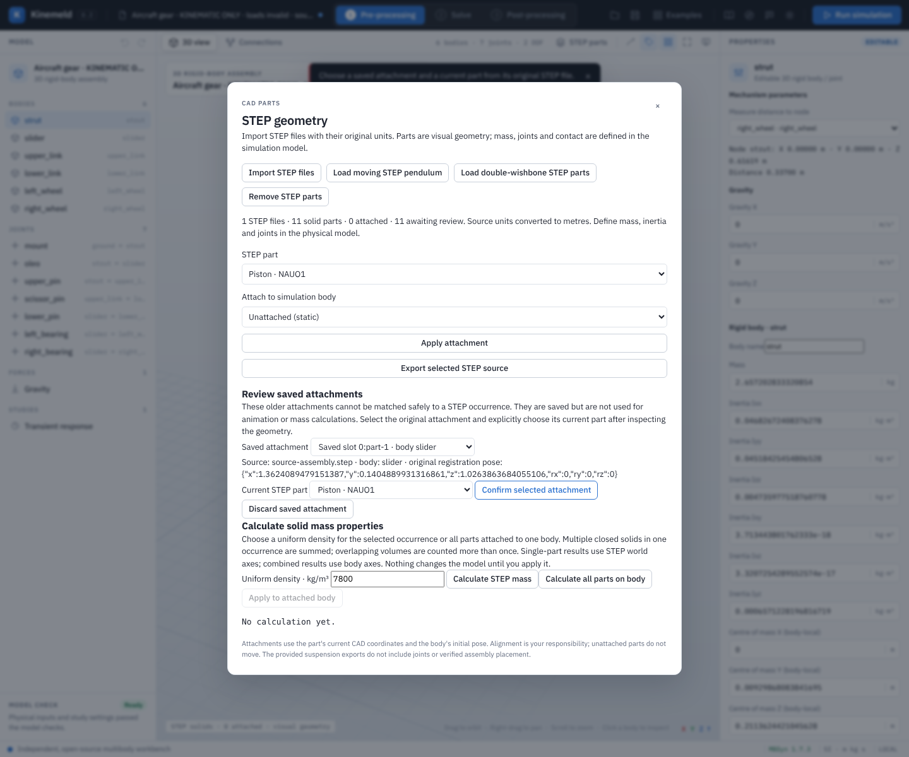

# STEP solids and body attachment

The **STEP parts** control imports `.step` / `.stp` solids and assemblies through
OpenCascade XDE. The original source bytes, SHA-256 and explicit part bindings
are retained in the project. STEP file units and occurrence placements are read
by OpenCascade; display vertices are in metres. Tessellation is a derived display
representation, not a replacement STEP file. Reopening regenerates it from the
preserved original files.

**Import STEP files** replaces the loaded CAD with the files you choose; once CAD is
loaded, **Add STEP files** adds more files to it, one part or several at a time. Earlier
parts keep their attachments, and every part is listed with its file name. Undo removes
the last addition. A set holds up to 24 files, 12 MiB and 200,000 display triangles.
[`examples/open-aircraft-nose-gear/parts`](../examples/open-aircraft-nose-gear/parts) has
the eleven parts of an aircraft nose gear as separate files to try this with.

You can keep editing while CAD converts. If the model, geometry or attachments
change before an import or generated solid is ready, Kinemeld keeps the newer
work and asks you to retry the operation. Starting another import or project open
also supersedes the older request. Undoing an intervening edit does not make an
older conversion safe to apply. Failed conversion and cancelled file selection
leave the current document intact.

For a complete moving-solid example, choose **Load moving STEP pendulum**. This
loads an original rectangular STEP solid and a matching rigid-body model with
the binding already set. Its dimensions, density, inertia and initial frame are
documented and checked in [the example guide](../examples/step-pendulum/README.md).
Select **Run simulation** and scrub the results to see the solid follow MBDyn.

Open **STEP parts** → **Load double-wishbone STEP parts** for 12 unmodified
MIT-licensed parts from the [pinned source](../examples/step-suspension/README.md).
Their source files are separate exports with no joint definitions; visual alignment
has not been independently checked against the original assembly. The
existing quarter-car study solves vertical motion only, and is not a double-
wishbone simulation. Source licensing and hashes are retained beside the files.

To create a matching STEP primitive, select a planar or spatial body, expand **Calculate
mass and inertia from a uniform solid**, enter dimensions and density, then
choose **Create STEP solid and apply mass**. The operation generates and attaches
a brick, cylinder, sphere or ellipsoid as a STEP file and assigns the calculated
mass and principal inertia to that body. It replaces the body's physical
properties; other attached geometry is not included in the calculation. The
solid is centered on the body COM and aligned to its principal axes, including
the spatial body’s authored Euler123 orientation. Use
**STEP parts → Export selected STEP source** to save the original generated or
imported STEP file outside the project.

To animate a solid, first open or author a **planar or spatial assembly**, then choose a STEP
part and an existing body and select **Apply attachment**. The CAD coordinates
are interpreted in the model's global initial coordinate frame. The original
binding pose is retained; subsequent solver output moves and rotates the solid
with its assigned body. Check geometry-to-body alignment manually before relying
on the display. Unattached parts stay fixed. Binding or importing a solid does
not create masses, inertia, joints, contact or forces; supply those separately.

The converter also records each face's analytic surface with the range of display
triangles it produced: cylinders with axis, centre, radius and length, and planes with
a point and outward normal, in metres and assembly coordinates. Full circular edges (hole
rims, shaft ends; up to 512 per part) are listed with centre, axis and radius. A rim
written as several arcs, as many CAD systems do, counts when its arcs complete
the circle; partial arcs such as fillet boundaries are left out. Joint anchors, joint
axes and named frames can then be placed by picking or dragging onto those faces and rims,
and features can be measured in the view, also at a solved frame; see
[placing joints and frames from CAD](workspaces.md#placing-joints-and-frames-from-cad).
Other surface types are tessellated for display but cannot be picked.
Undo and redo include attachments. Other model families show the solids as static
CAD only: their results do not animate the STEP geometry.

## Reviewing older assembly attachments

Multi-part STEP assemblies can be enumerated in a different order by another CAD
runtime. For supported assemblies, the application records each occurrence's
source-provided assembly-usage identity and the source file hash. On reopen it
matches that identity again rather than assuming that the old displayed part
number still identifies the same component. If an existing identity cannot be
matched uniquely, the project does not replace the current project. Some STEP
files do not provide distinct, usable occurrence identities; their attachments
require review after reopening. Older projects saved before identity tracking,
including single-part sources, also require review because their old importer
may have enumerated the file differently.

For example, open an older copy of the aircraft nose-gear kinematic project and
choose **STEP parts**. Under **Review saved attachments**, select one saved
attachment. Inspect its source file, body and original registration pose, and
inspect the visible STEP assembly. Choose the corresponding current part from
the same file, then select **Confirm selected attachment**. The original pose is
preserved; verify alignment before running the study. Repeat for each attachment
and save. The current part must have a verifiable occurrence identity; if it does
not, retain the unverified attachment and use a STEP source with identifiable
occurrences. **Discard saved attachment** is explicit and can be undone.

Pending attachments are preserved in project saves but do not animate or count
as attached geometry. Review all of a body's pending parts before applying STEP
mass properties. The CAD identity check does not prove correct joints, alignment,
material properties, or the physical validity of a simulation.

On this machine the separate Python process uses the installed `cadquery-ocp`
(OpenCascade) package, version 7.9 or 8; `backend/ocp_compat.py` maps the classes the two
versions name differently. STEP import on a different machine requires that package
in the same Python environment as the backend; no kernel is bundled in the
Windows executable. Conversion accepts up to 24 files / 12 MiB total, and a
maximum of 150,000 triangles per file and 200,000 per combined import. Each
conversion is isolated with a 90-second timeout. The original plus results must
fit the existing 32 MiB project limit. A malformed or exceptionally complex
file can consume substantial memory during kernel meshing before output limits
are reached: the converter is not a hardened sandbox for hostile CAD files.

This is a STEP viewing and planar or spatial body-attachment workflow, not an editable CAD
kernel, automatic joint extraction, or a validated suspension design. Spatial rigid-body
assembly is separately supported as documented in [spatial assemblies](spatial-assembly.md). The imported CAD does not provide real material properties or
prove physical accuracy.
