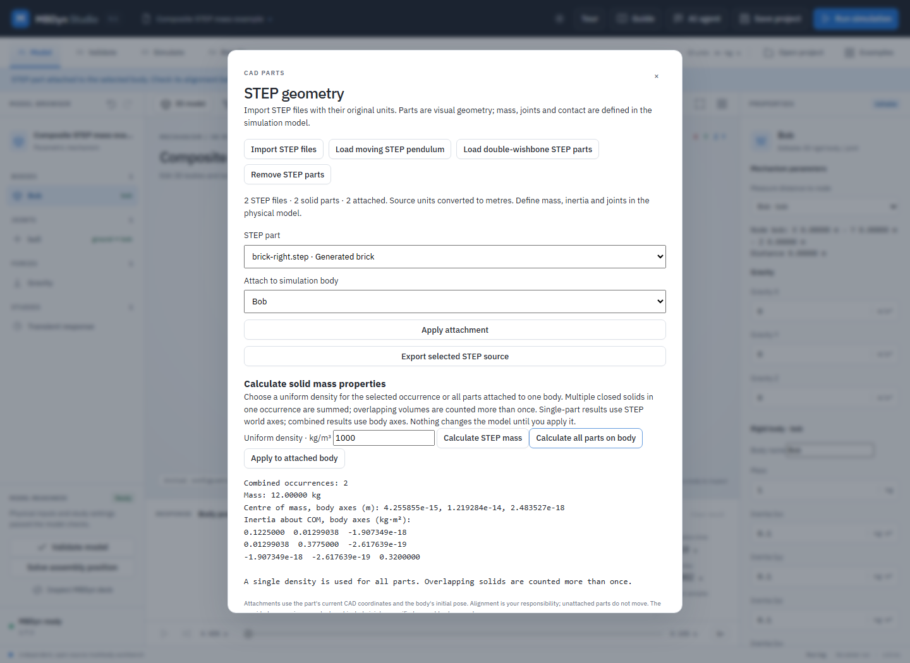
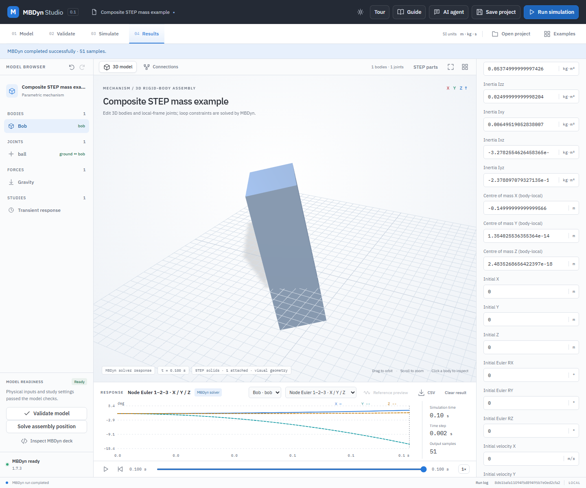

# STEP solid mass properties

The local STEP service can measure one imported occurrence with a user-supplied, uniform density. Send the original STEP bytes to `POST /api/step/mass` as `application/step`, with `X-Step-Density` in kg/m³ and `X-Step-Part` set to the occurrence ID within that file, for example `part-1`. When the viewer identifies a part as `2:part-1`, the prefix selects source file 2; the header must contain only `part-1`. The response contains the source SHA-256, source units, selected occurrence ID, volume in m³, mass in kg, centre of mass in m, and a 3×3 symmetric inertia tensor in kg·m² about that centre. The tensor and centre are expressed in the STEP file's world axes and coordinate system. The part's full assembly occurrence transform is included. Compare the returned hash with the original selected STEP file before using the result.

In the **STEP geometry** dialog, select an occurrence and enter a uniform density, then select **Calculate STEP mass**. To combine all parts attached to the selected body, select **Calculate all parts on body**. This uses the same density for every part, transforms each occurrence into its registered body frame, and combines their mass and inertia about the composite centre of mass. **Apply to attached body** stores the resulting body-local centre-of-mass offset and complete symmetric inertia tensor on a spatial body. Planar bodies still require a centre of mass coincident with the body origin and a diagonal tensor in their body axes. The candidate passes the model validator before application and can be undone. Density is supplied by the user; STEP visual geometry does not define it.

The calculation does not change a body, placement, or model. Applying it to a body requires an explicit user action and a correct conversion from the STEP global frame to the body's frame. A rotated non-diagonal tensor cannot be copied into a body that accepts only diagonal principal moments. Converting it requires a verified principal-axis rotation or a full-tensor body representation.

The user must choose the density, which is treated as uniform over all closed solids within that occurrence. STEP material, CAD design assumptions and application-point offsets are not inferred. OpenCascade checks topology and shell closure and computes B-rep volume properties; surface meshes and open or invalid solids are rejected. Multiple solids within or across selected occurrences are summed, not Boolean-unioned; overlapping solids therefore count overlapping material more than once. This calculation is not a validation of material assignment, assembly fit, wall thickness, contact or manufacturing quality.

Processing uses the same source unit conversion, hierarchy and tessellation traversal as STEP import, an isolated worker, the 12 MiB source, 256-part and 90-second bounds, and the shared STEP operation lock. HTTP requests must be same-origin loopback. Problems are returned as explicit errors; invalid selections do not update an existing project. Tests generate actual OpenCascade STEP fixtures for boxes, non-axis-aligned rotations, repeated occurrences, inch units, open surfaces, and the HTTP boundary.

## Worked example: two STEP parts on one body

1. Open `examples/step-composite/composite-body.mbdyn-studio`. This is a 3D spherical-joint model with its body origin at the two-part centre of mass and zero gravity.
2. Choose **STEP parts → Import STEP files** and select `examples/step-composite/brick-left.step` and `brick-right.step` together.
3. In **STEP part**, select each brick in turn. Choose **Bob** under **Attach to simulation body** and select **Apply attachment** for each; confirm **2 attached**.
4. Enter `1000` kg/m³ for **Uniform density**, then select **Calculate all parts on body**. With both solids, the result should be approximately 12 kg; body-frame inertia should have Ixx = 0.1225, Iyy = 0.3775, Izz = 0.3200, and Ixy = 0.0129904 kg·m². Small floating-point residuals are expected for the centre and nominally zero cross terms.
5. Select **Apply to attached body**, close the dialog, validate the model, and run MBDyn. Save the project to retain both original STEP sources and their bindings. This example illustrates a uniform-density calculation, not a material or manufacturing certification.

## Worked example: STEP mass away from a body origin

1. Open `examples/step-composite/composite-body.mbdyn-studio`. Select **Gravity** and set **Gravity Z** to `-9.81` m/s².
2. Choose **STEP parts → Import STEP files**, select `examples/step-composite/brick-left.step`, and attach its part to **Bob**. The spherical joint remains at the body origin.
3. Set **Uniform density** to `1000` kg/m³, choose **Calculate STEP mass**, and then **Apply to attached body**. The 6 kg solid produces a body-local centre-of-mass offset of approximately `(-0.15, 0, 0)` m and its full inertia tensor about that centre. Tiny floating-point residuals are normal.
4. Close the dialog and inspect **Centre of mass X/Y/Z (body-local)** in Bob's properties. The body pose and joint anchor have not moved. Run MBDyn and select **Node Euler 1–2–3** in the result plot; gravity causes the part to rotate about the spherical joint. Save and reopen the project to retain the offset, inertia and STEP attachment.

This example uses an artificial uniform-density brick. Its result demonstrates the workflow and is not a certification of a physical component.
