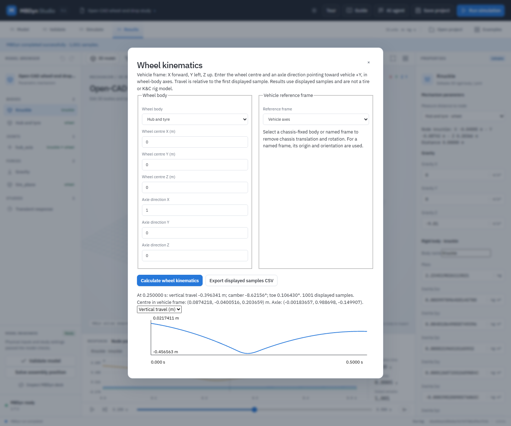

# Wheel travel, camber and toe from a 3D result

**Wheel kinematics** calculates a wheel-centre position, relative vertical travel, camber and toe from displayed samples in a current spatial MBDyn result. The measurement does not add a force, constraint or sensor to the solver model. A chassis body or named reference frame may move and rotate; the tool expresses the wheel centre and axle in that frame before computing angles.

## Worked example using source STEP parts

1. Open `examples/open-wheel-end/wheel-end-drop.mbdyn-studio`. The [wheel-end guide](open-wheel-end.md) explains the source CAD, inferred alignment and approximate contact. This is a free wheel-end drop, not a complete suspension K&C test.
2. In **Named reference frames**, add a frame named `Vehicle axes`, parented to ground, at `(0,0,0) m` with Euler123 rotation `(0,0,-90)°`. This makes the model's +X axle point in the vehicle frame's +Y direction. The frame's +X is the chosen forward direction; +Z is up. Save the project if the frame should persist.
3. Validate and run MBDyn. Move the results timeline to the desired sample and select **Wheel kinematics** beside the result CSV button.
4. Choose **Hub and tyre** as wheel body. Enter wheel-centre local coordinates `(0,0,0) m`, axle direction `(1,0,0)` and select **Vehicle axes** as the reference. Select **Calculate wheel kinematics**. Switch the plot between vertical travel, camber and toe; use **Export displayed samples CSV** to retain the measurements and frame definition.

For a full suspension, choose a frame fixed to the chassis rather than ground, and enter the wheel centre and the axle direction from the actual wheel or upright body. The chosen axle must remain fixed in that body and point toward vehicle +Y. Confirm its direction and all hardpoints from the assembly or measured data; spinning a wheel about that same axle does not change its direction. Reversing the input axle reverses the orientation convention and can change angles by 180°.

## Definitions and interpretation

Let `p` be the wheel centre and `u` the normalized oriented axle in the chosen vehicle frame. The conventional frame used here has +X forward, +Y left and +Z up. Travel is `p_z(t) − p_z(t₀)`; this is wheel-centre motion relative to the reference, not suspension spring stroke or contact-patch motion. Camber is `atan2(u_z, hypot(u_x,u_y))`; toe is `atan2(−u_x,u_y)`. These signs are tied to the stated oriented axle and **do not automatically apply left/right wheel sign conventions**. Both angles are reported in degrees. A vertical axle makes toe undefined; the corresponding CSV cell is empty. Toe uses the principal `atan2` range of −180° to +180° and the plot breaks at the wrap; it is not unwrapped steering rotation.

The CSV includes wheel-local centre and axle, reference identity and parent, reference-local origin and Euler123 rotation, calculated centre/axle, travel and angles. It uses only the displayed result samples (at most 2,001); long runs may be decimated. It is not a full-resolution peak detector. Reopen the saved project to repeat a calculation; the measurement choices are not persisted. Changing the model, STEP bindings or result invalidates an open calculation; a stale result cannot be measured.

This is a geometric measurement of solver results, not a measured tire force, automated K&C rig, compliance analysis or vehicle validation. Interpret the plots only after checking the joint geometry, coordinate conventions, numerical convergence and physical inputs. The worked drop uses a surrogate contact and assumed material properties.

From the source checkout, run `node --test tests/wheel-kinematics.test.mjs` for independent frame, travel, angle, wrap and invalid-value checks. With an isolated app server and the local MBDyn solver, `node tests/wheel-kinematics-ui.mjs` exercises the STEP model, a moving result, CSV values, save/reopen and stale-result gating. Browser tests are included in the source archive, not the local Windows package.
