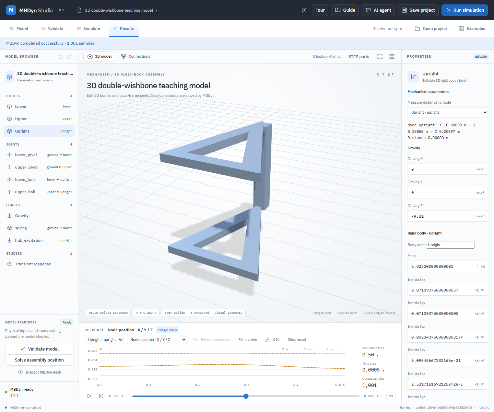

# 3D double-wishbone teaching model

This is an original, simplified multibody suspension linkage: two A-shaped control arms pivot on a chassis, and a rigid upright connects to their outer ends through two spherical joints. A spring-damper acts on the lower arm. An illustrative sinusoidal vertical force acts on the upright. The parts are real, independently generated STEP solids; the model uses explicit joints, gravity, forces and geometry-derived mass properties.

## Run the example

1. In Kinemeld choose **Open project** and select `examples/wishbone-3d/wishbone.mbdyn-studio`. The saved project contains the three original STEP sources and their body bindings. Confirm **STEP solids · 3 attached**.
2. Expand **Joints** in the model tree. The upper and lower inboard mounts are revolute joints around body/world X; the two outboard joints are spherical. Select each joint to inspect its local anchors and axes.
3. Select **spring** to inspect the ground-to-lower-arm spring and damper. Select **hub_excitation** to inspect the prescribed global force, `20 sin(4πt) N` in Z. This is a demonstration external force, not a simulated road/tire contact force.
4. Select **Validate model** and **Run simulation**. Choose **Upright** in the results selector and scrub the timeline. Export CSV for node coordinates and spring/force results; save the project to retain any edits and the result.

The reference case runs for `0.5 s` at `0.0005 s` per step. In the checked solver run, the maximum vertical displacement of the upright origin was approximately `0.03867 m`. Solver output and timestep changes may produce different values; the plot uses the actual result rather than a precomputed animation.

## Geometry, masses and joints

Each original control-arm STEP file is a 30 mm thick triangular plate with a triangular opening; the outer points span 360 mm laterally and reach 400 mm from the pivot line. The upright is a 50 × 50 × 350 mm rectangular solid. These are deliberately simple, editable reference geometries rather than a manufacturer component. The STEP sources are original project assets covered by the repository's MIT license.

The control arms use uniform density `2700 kg/m³`; the upright uses `7800 kg/m³`. OpenCascade STEP volume integration gives approximately `3.888 kg` for each arm and `6.825 kg` for the upright. Each arm's centre of mass is at approximately `(0, -0.06, 0) m` relative to its body origin; the full inertia tensors in the project are about each actual centre of mass. `python -B -m unittest discover -s backend -p test_wishbone_3d.py -v` compares the embedded STEP hashes, body bindings, mass, COM and all inertia entries against the actual saved solids. Regenerate the three STEP solids and matching project with `python -B examples/wishbone-3d/generate.py` when OpenCascade OCP is installed; STEP export timestamps and hashes may change.

## Independent reference and limits

For this symmetric geometry and initial condition, the upright remains parallel to its original orientation and both arms share the same rotation `θ` about X. The actual 3D model also has an upright steering freedom around the axis through the two spherical joints; the reference trajectory does not exercise that freedom. Let `r = 0.4 m` be the arm length and `c ≈ 0.14 m` the pivot-to-arm-COM distance. The effective rotational inertia is

`J = 2 (Iarm,xx + marm c²) + mupright r²`.

The spring length is `L(θ) = sqrt(0.45 - 0.36 sin θ)` and its derivative is `L′(θ) = -0.18 cos θ / L`. With `T = k(L − L0) + d L′ θ̇`, the reference equation is

`J θ̈ = -g (2 marm c + mupright r) cos θ - T L′ + 20 sin(4πt) r cos θ`.

`python -B backend/verify_wishbone_3d.py` integrates this independently with RK4 and compares every sampled upright position, arm angle and spring force with an actual MBDyn run. The recorded run had maximum upright-position error `1.82 × 10⁻⁶ m`, spring-force error `0.0035 N`, and reconstructed joint residual `1.1 × 10⁻¹³ m`. The verifier generates `verification/wishbone-3d.json`; the local report is not included in the public checkout. These are agreement checks for this specified model and step, not measurements from a physical vehicle.

This example omits wheel, tire, steering rack, compliant bushings, flexible arms, road contact, chassis motion, packaging clearances, material nonlinearities and calibrated parameters. It is not a production suspension design, a validated vehicle model, or a substitute for convergence and experimental correlation.
