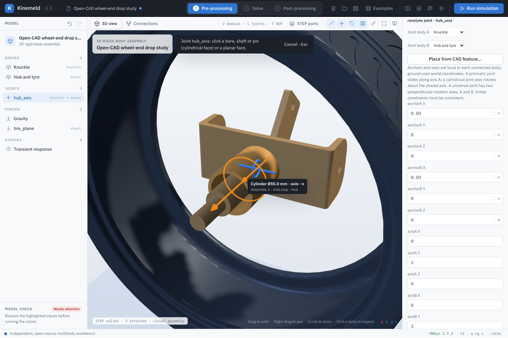

# Workspaces and post-processing

Kinemeld follows the usual simulation workflow in three workspaces, chosen from the
switcher in the top bar or with the keys **1**, **2** and **3**. Each shows only the
panels needed for that stage.

## 1 · Pre-processing

The model tree (bodies, joints, force elements, studies) sits on the left and the
properties of the selected entity on the right. Edit poses, joint frames, mass
properties and loads here; **CAD parts** imports STEP solids and attaches them to
bodies. The view header shows body and joint counts and, for 3D assemblies, the
Grübler–Kutzbach mobility estimate. Redundant loop constraints make the true mobility
higher than this estimate; MBDyn reports a singular assembly when constraints conflict.

### Placing joints and frames from CAD

STEP imports keep each face's analytic geometry: cylinders (bores, shafts, pins) with
their axis, centre, radius and length, and planes with a point and outward normal. In a 3D
assembly with imported parts:

- **Place from CAD feature…** (joint inspector) enters pick mode. Hovering a face shows its
  axis, and for a cylinder its bore circle, with a label such as *Cylinder Ø55.0 mm · axis
  −x*. Clicking places **both ends** of the joint on the feature, so the anchors coincide
  and, for revolute, cylindrical and prismatic joints, the axes agree by construction. On a
  plane, the anchor is the clicked point and the axis is the face normal. Universal joints
  keep their perpendicular cross axes.
- **Drag a joint symbol** onto a face to do the same in one gesture: the face under the
  pointer is previewed while dragging, dropping off a face leaves the joint unchanged, and
  **Esc** cancels.
- **Named reference frames → Place from CAD feature…** puts the frame's origin on the
  feature and its local **+Z** along the cylinder axis or plane normal. Joint ends linked to
  the frame follow it.
- **Measure** (ruler in the view header, or **M**) reports the distance between two picked
  features, its x/y/z components, and the angle between their axes (0° for parallel axes).

Features are evaluated at the initial configuration: a part attached to a body follows the
body's initial pose, an unattached part stays where the STEP file placed it, and the view
shows the initial pose while you pick. Every placement is one undo step. Faces that are not
cylinders or planes (fillets, splines, tori) cannot be picked; enter those anchors by value.

## 2 · Solve

The right panel holds the transient study settings (duration and time step, with the
resulting step count), the pre-run checklist (model inputs, solver availability, step
budget, mobility, result state), the model-check issue list and the solver controls.
For 3D assemblies the mobility comes from the rank of the constraint Jacobian; redundant
constraints are listed by joint with a link to each one (see
[constraint diagnostics](constraint-diagnostics.md)).
Selecting an issue jumps to its field. **Inspect deck** shows the exact MBDyn input.
The bottom console shows the latest solver output, including errors and the tail of
the log when a run fails; **Full log** opens the complete text.

**Run simulation** (top bar, or **F5**) validates, solves and switches to
post-processing when MBDyn finishes. Only one solver job runs at a time; **Cancel**
stops it and retains partial output.

## 3 · Post-processing

- **Animation:** play, pause (**Space**), step frame by frame (**←** / **→**), jump to
  start or end (**Home** / **End**), change speed (0.1× to 2×) and loop playback.
  The clock in the viewport shows simulation time.
- **Plot:** choose a response quantity and entity above the plot. Hover for a readout
  of every channel; click or drag on the plot to scrub the animation. The panel to the
  right lists each channel's value at the cursor and its minimum, maximum, range and
  RMS over the run.
- **Angular velocity in body axes** rotates MBDyn's world-frame angular velocity into
  each body's axes, which is how spin, flips and gyroscopic effects are usually read.
- **Motion trails** trace each body's centre of mass, or its farthest geometry point when
  the centre barely moves (a body spinning in place). Choose the full run or a trailing
  window, and all bodies or only the selected one.
- **Keep selected body in view** moves the camera with the selected body.
- **Measure:** the point probe and wheel kinematics tools derive distances, camber,
  toe and travel from the displayed solver samples.
- **Export:** CSV contains the full-resolution solver output with units in the header.

### Full resolution

The animation uses at most about 2,000 displayed samples per run, but MBDyn writes every
integration step. After a run Kinemeld loads the run's full CSV in the background; the
statistics panel then reads **Full resolution · N steps**, and the plot, hover readout,
minimum, maximum, time of the peak and RMS use every step. Long series are drawn with a
minimum/maximum per pixel column, so a one-step spike stays visible instead of falling
between decimated samples. RMS is time-weighted (trapezoidal). Body-axes angular velocity
is reconstructed per step from the solver's orientation and angular velocity. Quantities
the CSV does not contain (for example a commanded drive angle) fall back to displayed
samples, and the panel says which source it used.

### Pinned traces

**Pin trace** keeps the current quantity for the current body or element on the plot.
Choose another body, joint or element — or another quantity with the same unit — and
both appear together, each with its own statistics. Pins are listed in the statistics
panel; select one to remove it. Traces with a different unit are not drawn.

### Compare runs

**Results → Compare runs → Pin run for comparison** keeps the current solution. Edit the
model, run again, and the pinned run's matching channels appear as grey dashed curves
with their own statistics. Pin the newest run to move the reference forward; **Clear**
removes it. Pinned runs live in memory for the session and are not saved in projects.

### Export

**SVG** and **PNG** download the plot as shown, including pinned traces and comparison
curves, with colours resolved for the current theme. **CSV** exports the full-resolution
solver output.

## Presentation mode

**P** (or the screen button in the view header) hides the model tree, properties and
toolbars and keeps the 3D view, the clock and the plot. It is meant for reviews and
screen recordings; **Esc** returns to the full workspace. The demo recordings on the
project homepage were captured in this mode.

## Saved views

Projects store the selected entity, plot quantity, playback frame, camera, and trail
settings along with the model and results, so a reopened study looks the way it was
saved.
