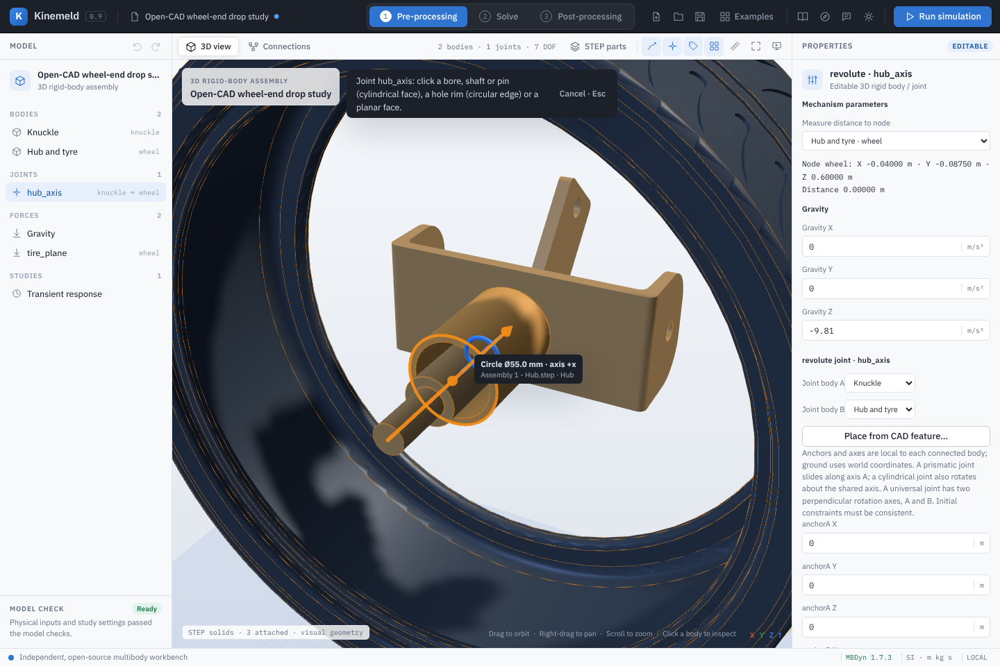
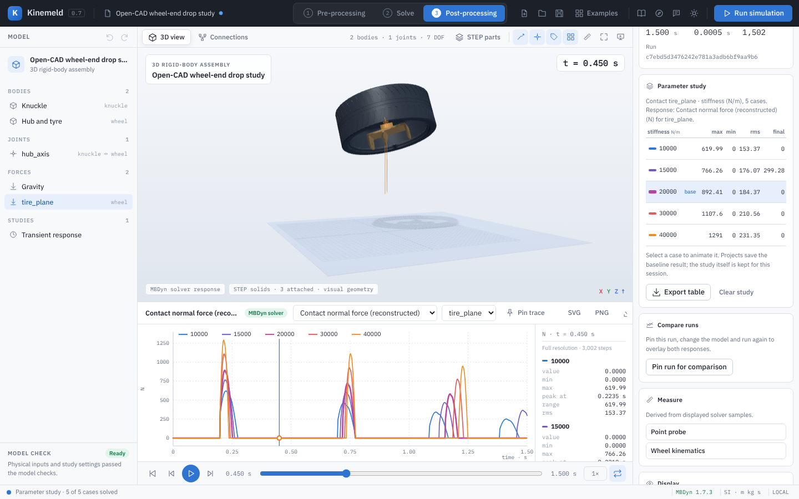

# Workspaces and post-processing

Kinemeld follows the usual simulation workflow in three workspaces, chosen from the
switcher in the top bar or with the keys **1**, **2** and **3**. Each shows only the
panels needed for that stage.

## 1 · Pre-processing

The model tree (bodies, joints, force elements, studies) sits on the left and the
properties of the selected entity on the right. Edit poses, joint frames, mass
properties and loads here; **CAD parts** imports STEP solids and attaches them to
bodies. The view header shows body and joint counts and, for 3D assemblies, the
Grübler–Kutzbach mobility estimate. Redundant loop constraints make the true mobility
higher than this estimate; MBDyn reports a singular assembly when constraints conflict.

### Placing joints and frames from CAD

STEP imports keep each face's analytic geometry: cylinders (bores, shafts, pins) with
their axis, centre, radius and length, and planes with a point and outward normal. They also
keep each full circular edge — a hole rim or shaft end — with its centre, axis and radius.
In a 3D assembly with imported parts:

- **Place from CAD feature…** (joint inspector) enters pick mode. Hovering a face shows its
  axis, and for a cylinder its bore circle, with a label such as *Cylinder Ø55.0 mm · axis
  −x*. Clicking places **both ends** of the joint on the feature, so the anchors coincide
  and, for revolute, cylindrical and prismatic joints, the axes agree by construction. On a
  plane, the anchor is the clicked point and the axis is the face normal. While picking,
  hole rims are drawn as thin orange circles; a rim near the pointer wins over the face it
  bounds, and its centre and axis place the joint (*Circle Ø55.0 mm · axis −x*). Rims hidden
  behind a surface cannot be picked. Universal joints keep their perpendicular cross axes.

  

- **Drag a joint symbol** to move it:
  - over a CAD face or rim, it snaps to that feature as above;
  - elsewhere, it slides along its own axis (revolute, cylindrical and prismatic joints) in
    1 mm steps, keeping its axis;
  - **Shift** slides along the axis even over CAD; **Alt** moves it across the axis, in the
    plane through the anchor; joints without a single axis (spherical, universal, weld) move
    in the plane facing you.

  The tooltip names the feature or the distance moved; **Esc** cancels, and each drag is one
  undo step. Dragging works in any 3D assembly, with or without CAD.
- **Named reference frames → Place from CAD feature…** puts the frame's origin on the
  feature and its local **+Z** along the cylinder axis or plane normal. Joint ends linked to
  the frame follow it.
- **Measure** (ruler in the view header, or **M**) reports the distance between two picked
  features — faces or rims — its x/y/z components, and the angle between their axes (0° for
  parallel axes).

In Pre-processing, features are evaluated at the initial configuration: a part attached to a
body follows the body's initial pose, an unattached part stays where the STEP file placed it,
and the view shows the initial pose while you pick. In **Post-processing**, Measure uses the
frame on screen instead: each attached part follows its body's solved pose at that time, and
the result states the time (*… at t = 0.2250 s*), so clearances and travel can be read
during the motion. Every placement is one undo step. Faces that are not cylinders or planes
(fillets, splines, tori) and partial arcs cannot be picked; enter those anchors by value.

## 2 · Solve

The right panel holds the transient study settings (duration and time step, with the
resulting step count), the pre-run checklist (model inputs, solver availability, step
budget, mobility, result state), the model-check issue list and the solver controls.
For 3D assemblies the mobility comes from the rank of the constraint Jacobian; redundant
constraints are listed by joint with a link to each one (see
[constraint diagnostics](constraint-diagnostics.md)).
Selecting an issue jumps to its field. **Inspect deck** shows the exact MBDyn input.
The bottom console shows the latest solver output, including errors and the tail of
the log when a run fails; **Full log** opens the complete text.

**Run simulation** (top bar, or **F5**) validates, solves and switches to
post-processing when MBDyn finishes. Only one solver job runs at a time; **Cancel**
stops it and retains partial output.

### Parameter studies

**Parameter study** solves the model several times, changing one input, so you can see how
a design choice moves the response: a tyre or contact stiffness, a damping coefficient, a
strut's gas pre-charge, a body's mass or drop velocity, a drive's speed.

1. **Input to vary** lists the template parameters or, for assemblies, the physical
   properties of each body and element: mass, stiffness, damping, free length, strut gas
   and orifice settings, load and torque amplitudes, drive settings, and initial positions
   and velocities. Geometry, joint frames, vectors and inertia tensors are not offered,
   because changing one component alone rarely means anything physically. The entity
   selected in the model tree is preselected.
2. **Values** starts at half, three quarters, one, one and a half and twice the current
   value; type any list of up to 12 numbers. The current value is always solved as the
   **baseline**, and the cases run in ascending order.
3. **Run study** validates the model, then solves every case with MBDyn in turn. The
   progress line and the console show each case; **Cancel** stops the running case and
   skips the rest, keeping the cases already solved. A case the solver rejects ends the
   study the same way, and the notice names it.

The study opens in Post-processing (see [study results](#study-results)).

## 3 · Post-processing

- **Animation:** play, pause (**Space**), step frame by frame (**←** / **→**), jump to
  start or end (**Home** / **End**), change speed (0.1× to 2×) and loop playback.
  The clock in the viewport shows simulation time.
- **Plot:** choose a response quantity and entity above the plot. Hover for a readout
  of every channel; click or drag on the plot to scrub the animation. The panel to the
  right lists each channel's value at the cursor and its minimum, maximum, range and
  RMS over the run.
- **Angular velocity in body axes** rotates MBDyn's world-frame angular velocity into
  each body's axes, which is how spin, flips and gyroscopic effects are usually read.
- **Motion trails** trace each body's centre of mass, or its farthest geometry point when
  the centre barely moves (a body spinning in place). Choose the full run or a trailing
  window, and all bodies or only the selected one.
- **Keep selected body in view** moves the camera with the selected body.
- **Measure:** the point probe and wheel kinematics tools derive distances, camber,
  toe and travel from the displayed solver samples.
- **Export:** CSV contains the full-resolution solver output with units in the header.

### Full resolution

The animation uses at most about 2,000 displayed samples per run, but MBDyn writes every
integration step. After a run Kinemeld loads the run's full CSV in the background; the
statistics panel then reads **Full resolution · N steps**, and the plot, hover readout,
minimum, maximum, time of the peak and RMS use every step. Long series are drawn with a
minimum/maximum per pixel column, so a one-step spike stays visible instead of falling
between decimated samples. RMS is time-weighted (trapezoidal). Body-axes angular velocity
is reconstructed per step from the solver's orientation and angular velocity. Quantities
the CSV does not contain (for example a commanded drive angle) fall back to displayed
samples, and the panel says which source it used.

### Pinned traces

**Pin trace** keeps the current quantity for the current body or element on the plot.
Choose another body, joint or element — or another quantity with the same unit — and
both appear together, each with its own statistics. Pins are listed in the statistics
panel; select one to remove it. Traces with a different unit are not drawn.

### Compare runs

**Results → Compare runs → Pin run for comparison** keeps the current solution. Edit the
model, run again, and the pinned run's matching channels appear as grey dashed curves
with their own statistics. Pin the newest run to move the reference forward; **Clear**
removes it. Pinned runs live in memory for the session and are not saved in projects.

### Study results

After a parameter study the plot shows every case of the chosen quantity, coloured from
blue (lowest value) to orange (highest), with the case being animated drawn heavier.
Quantities with several channels (X / Y / Z) show one channel at a time; choose it in the
**Parameter study** card. The card's table lists each case's maximum and minimum (hover
for their times), RMS and final value, computed from the full-resolution series.
**Export table** writes it as CSV. Select a row to animate that case.

Projects save the baseline result, so a saved project's result always matches its model;
the study itself stays in memory for the session. Loading another model or running a
single simulation ends it; **Clear study** returns to the baseline. Pinned traces and run
comparison are hidden while a study case is shown.

### Export

**SVG** and **PNG** download the plot as shown, including pinned traces and comparison
curves, with colours resolved for the current theme. **CSV** exports the full-resolution
solver output.

## Presentation mode

**P** (or the screen button in the view header) hides the model tree, properties and
toolbars and keeps the 3D view, the clock and the plot. It is meant for reviews and
screen recordings; **Esc** returns to the full workspace. The demo recordings on the
project homepage were captured in this mode.

## Saved views

Projects store the selected entity, plot quantity, playback frame, camera, and trail
settings along with the model and results, so a reopened study looks the way it was
saved.
