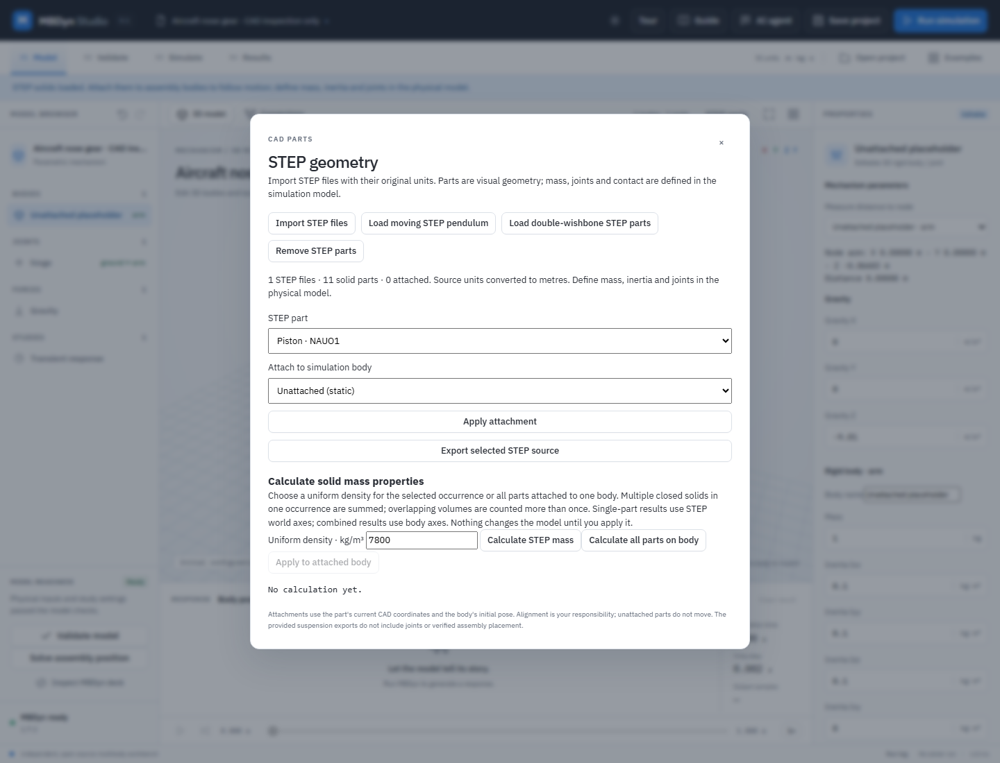
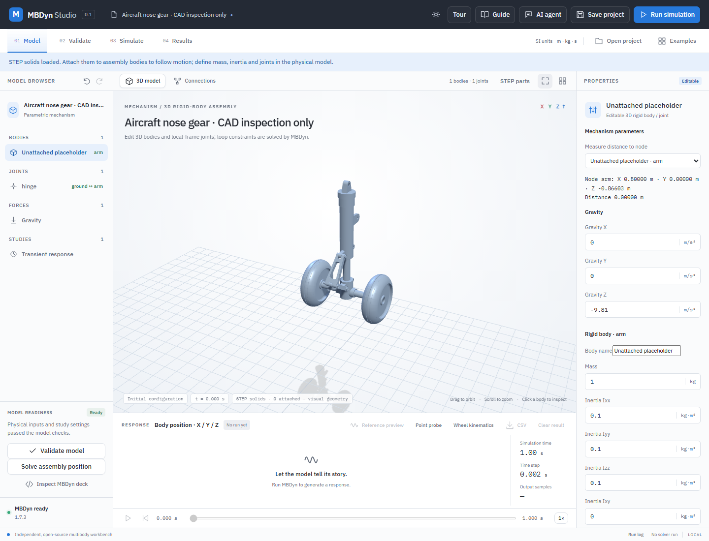

# Open aircraft nose-gear STEP assembly

`source-assembly.step` is the **unchanged** STEP assembly from [Aircraft Nose Landing Gear Design and Structural Analysis](https://github.com/aryan-pandharipande/aircraft-nose-landing-gear-design) by Aryan Pandharipande, pinned to revision [`12f44cb9e721a665b34b62239590404a3a504636`](https://github.com/aryan-pandharipande/aircraft-nose-landing-gear-design/tree/12f44cb9e721a665b34b62239590404a3a504636). The repository distributes its files under the MIT license, reproduced in `UPSTREAM-LICENSE.txt`. The original asset path is `CAD/Assembly/Assembly.STEP`.

- SHA-256: `b53205b3356f9b98b0edf6d2ba4f8b04f46cc61607cad263857192c1aeb7a575`
- Declared source length unit: millimetre. Kinemeld's STEP importer converts the tessellation to metres.
- OpenCascade import observed **11 meshable occurrences** and 54,864 triangles with the current importer. The generic occurrence labels `NAUO1`–`NAUO11` do not contain human part names; the importer also displays the underlying STEP product names below, alongside each occurrence label.

| Occurrence | STEP product | Count/role in the source assembly |
|---|---|---|
| `part-1` | Piston | Inner telescoping member |
| `part-2` | Shaft | Wheel axle |
| `part-3` | Strut | Outer strut |
| `part-4` | Upper Link | Upper torque link |
| `part-5` | Wheel Hub | Central hub |
| `part-6` | Lower Link | Lower torque link |
| `part-7`–`part-9` | Flange bolts | Fasteners |
| `part-10`, `part-11` | Wheel | Two occurrences of the same product |

The source describes a light-aircraft nose-gear design study; this file is not evidence of a manufactured, certified or tested gear. The STEP assembly retains occurrence placements but does **not** convey the original assembly constraints, material assignments, measured inertias, hydraulics, tire properties or calibrated load history to Kinemeld. A CAD import alone is visualization, not a dynamics model. Do not equate the publisher's structural-analysis claims with verification of this app's model.

## Separate part files

[`parts/`](parts) holds the eleven occurrences as separate STEP files, for importing the gear
part by part (**STEP parts → Import STEP files**, then **Add STEP files**). `split_parts.py`
writes them from `source-assembly.step` with OpenCascade: each keeps its source product name
and millimetre units, and the whole gear is translated by the same offset as the
[kinematic example](../open-aircraft-nose-kinematics/generate.py), so the axle centre lies
0.35 m above the origin. The geometry is otherwise unchanged and the files are MIT licensed
like the source.

| File | STEP product |
|---|---|
| `01-piston.step` | Piston |
| `02-shaft.step` | Shaft |
| `03-strut.step` | Strut |
| `04-upper-link.step` | Upper Link |
| `05-wheel-hub.step` | Wheel Hub |
| `06-lower-link.step` | Lower Link |
| `07-upper-pin-bolt.step`, `08-scissor-pin-bolt.step`, `09-lower-pin-bolt.step` | M12 flange bolts at the upper, scissor and lower torque-link pins |
| `10-wheel-left.step`, `11-wheel-right.step` | Wheel |

The [end-to-end recording](../../docs/demo-videos.md#end-to-end-aircraft-nose-gear) builds the
kinematic model from these files in the interface.

## Inspect in the application

1. Open a spatial example and choose **STEP parts → Import STEP**, then select `source-assembly.step`. The detail panel should list 11 parts. Use the viewport's fit/reset control to frame the assembly.
2. Select individual occurrences to map them against the table. The imported source positions are retained. Attach parts to independently defined bodies only after establishing body frames, joint pivots, mass and inertia; a saved project retains the original STEP bytes and bindings.
3. The [kinematic demonstration](../../docs/aircraft-nose-kinematics.md) attaches all 11 occurrences to an inferred linkage. Its joint substitutions and source overlaps make it unsuitable for aircraft loads or physical validation; follow the [landing-gear engineering workflow](../../docs/landing-gear-engineering-workflow.md) before attempting a dynamic study.

Product labels are descriptive metadata from the source STEP. They are not proof of a part's function, material, physical mates or motion. The importer also records the unique source assembly-usage identity of each occurrence, so the two wheels remain distinct even if traversal order changes. A saved identity that cannot be matched uniquely prevents the project from opening; older bindings without source identities require explicit review. See [STEP attachment review](../../docs/step-geometry.md#reviewing-older-assembly-attachments). If a source does not supply a product name, its occurrence label is used.

The screenshot shows the STEP assembly **unattached** in a placeholder project. Its body and joint belong to the placeholder, not to the landing gear; do not use the placeholder's simulation result as a gear analysis. `node tests/open-aircraft-nose-gear-ui.mjs` in the source checkout verifies the 11 occurrences, original bytes, and save/reopen. `python -B backend/test_open_aircraft_nose_gear.py` verifies the pinned hash and imported bounds. These checks do not test gear dynamics.

## Initial assembly checks and exploratory solver attempt

The following OpenCascade common-volume calculations were made on the **original, unmodified initial STEP placements**. They are initial static geometry checks, not proof of physical interference across travel; contacting faces and idealized or intersecting solid models can complicate interpretation.

| Source occurrences | Common solid volume |
|---|---:|
| Piston / strut | approximately 9,199 mm³ |
| Strut / upper link | approximately 374 mm³ |
| Upper link / lower link | approximately 2,875 mm³ |
| Piston / hub; shaft / hub; lower link / hub; shaft / each wheel; hub / each wheel; wheel / wheel | zero detected in the initial pose |

These source overlaps need engineering review and may require corrected geometry or contact/clearance treatment; a zero volume does not verify fits, clearances, source mates or the whole stroke. No source geometry was changed to conceal them.

An exploratory six-body formulation used a prescribed prismatic strut and three parallel torque-link revolute joints. It failed in MBDyn 1.7.3 with `ENOPIV` (singular pivot). Repeated constraints in a planar linkage can be redundant; the failure alone does not establish a defect in the CAD. Replacing the middle link's revolute with a spherical joint and the lower pin's revolute with a universal joint allowed one short kinematic test to run: 0.2 s at 1 ms and 0.5 ms, a 5 mm cosine amplitude, zero gravity and fixed strut. In this specific case the maximum link out-of-plane translation was about `1.35 × 10⁻¹⁹ m`, maximum out-of-plane Euler components about `3.4 × 10⁻¹⁶°`, and reconstructed joint residual below `5.2 × 10⁻¹⁴ m`. The separately shipped [kinematic demonstration](../../docs/aircraft-nose-kinematics.md) extends that sweep. These substitutions change the permitted joint freedoms; the result is a numerical experiment, **not** evidence of physical pin behavior, dynamic clearance, loading or a fitted mechanism.

Corrected source geometry or justified contact assumptions, a nonredundant formulation, verified initial conditions, loading and independent correlation are required before releasing a simulation example. No fitted bearing, dynamic clearance, drop test or actuator model has been validated for this source.
